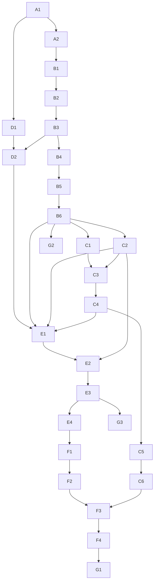

# Part 2 — Build plan overview

> Status: reference document. The **execution order and live status** are in `state.md`; the **detailed specification** of each step is in `work_packages/WP-*.md`.

> **Re-plan 2026-10-11 (D-018…D-024).** After the approach review (`reviews/2026-10-11_approach_review.md`), the plan continues with phase **R**: R1 real syllables + whistle voice + modes A/B in the plugin → R4 Perform UI → R3 variations; R2 (anatomical voice) optional. C6, D2, E1–E4, F1–F4 are optional/superseded. The live order is in `state.md`.

---

## 1. Phases

| Phase | Name | Goal | Outcome you can hear/use |
|---|---|---|---|
| **A** | Foundations | repository, build, CLI render, listening kit, parameter registry, oversampling, Python bindings | test tones through the full pipeline; first listening page |
| **B** | The bird body (DSP modules) | Tier-1 anatomical voice, one module per WP | raw syrinx → + trachea → + OEC/beak → + breath & noise → two sides → complete, scalable voice |
| **C** | Playability | plugin, atlas & inverse map, pitch-led playing, archetypes, generative engine, Perform UI | a playable VST/AU in your DAW: bird-voiced theremin → singing bird with 8 macros |
| **D** | Zebra finch data | dataset ingestion, feature extraction | clean syllable catalogue, spectrograms, feature plots |
| **E** | Fitting (regression) | find frame-by-frame controls that reproduce real syllables | A/B: real zebra finch vs resynthesis |
| **F** | Voice bank & variation | learned gestures, variation model, grammar, runtime integration, gesture page | the plugin sings like *your* zebra finches, with controllable variation |
| **G** | Release & extensions | polish, presets, validation, manual; optional Tier-2 source; optional differentiable/amortised fitting | release candidate |

Parts of the original request map as follows: **DSP modules** = Phase B (+A2); **algorithms to imitate birds** = Phase C (archetypes C4, generative engine C5) and Phase F; **regression on real recordings** = Phases D + E (+F for gestures).

---

## 2. Execution order (one agent session per WP)

The agent always takes the **first WP in this order whose status is `todo` and whose dependencies are all `done`** (see `protocol.md`).

| # | WP | Title | Depends on | Size | Main listening / result |
|---|---|---|---|---|---|
| 1 | A1 | Repository, build system, render CLI, listening kit | – | L | test sine sweep + first listening page |
| 2 | A2 | Parameter registry, control signals, oversampling, Python bindings | A1 | M | aliasing A/B (with/without oversampling) |
| 3 | D1 | Zebra finch dataset ingestion & catalogue | A1 | M | syllable catalogue page (real recordings) |
| 4 | B1 | Labial oscillator (normal form) | A2 | M | raw source: Hopf vs SNIC onsets, sweeps, regimes |
| 5 | B2 | Trachea waveguide | B1 | M | source + tube, reflection sign A/B |
| 6 | B3 | Upper vocal tract: glottis–OEC–beak + radiation | B2 | M | first complete "bird" sound; OEC/gape sweeps |
| 7 | D2 | Feature extraction (shared real/synthetic) | D1, B3 | M | feature plots over real syllables; validation on renders |
| 8 | B4 | Respiratory dynamics & noise sources | B3 | M | natural onsets, buzzy/noisy notes |
| 9 | B5 | Two sources: left/right, gating, side switching | B4 | M | two-voice notes, jump without smear |
| 10 | B6 | Voice assembly, body size, state save/load, benchmarks | B5 | M | size sweep: tiny to giant bird; CPU numbers |
| 11 | C1 | Plugin shell (VST3/AU/CLAP/Standalone) + offline plugin renderer | B6 | L | play the physiology in a DAW |
| 12 | C2 | Source atlas & inverse pitch map | B6 | M | chromatic scale in tune at several tones/sizes |
| 13 | C3 | Pitch-led direct playing (MIDI, couplings, ornaments, Snap) | C1, C2 | L | bird-voiced theremin from MIDI |
| 14 | C4 | Archetype library + gesture score format & player | C3 | M | archetype gallery |
| 15 | C5 | Generative performance engine (Leash, Variation, Density, polyphony) | C4 | L | the bird sings on its own around held notes |
| 16 | C6 | Perform UI, Physiology page, presets v1 | C5 | L | usable instrument with presets |
| 17 | E1 | Fitting framework, losses, identifiability benchmark | D2, B6, C2, C4 | M | synthetic fits A/B |
| 18 | E2 | Voice atlas + Viterbi initial path | E1, C2 | M | first rough resynthesis of real syllables |
| 19 | E3 | Windowed CMA-ES refinement → gesture scores | E2 | L | real vs resynthesis per syllable |
| 20 | E4 | Per-bird constants + model adequacy report | E3 | M | improved resynthesis; what the model cannot do |
| 21 | F1 | Gesture extraction, alignment, clustering | E4 | M | gesture-type galleries |
| 22 | F2 | Gesture variation model (FPCA), grammar, voice bank export | F1 | M | generated songs vs real songs |
| 23 | F3 | Voice bank runtime integration | F2, C6 | L | plugin performing with the zebra finch bank |
| 24 | F4 | Advanced Gesture page | F3 | M | view/draw/edit gestures in the plugin |
| 25 | G1 | Release polish: presets, validation, manual, packaging | F4 | L | release candidate |
| 26 | G2 | *(optional)* Tier-2 physical labial source | B6 | M | organic source A/B |
| 27 | G3 | *(optional)* Differentiable twin & amortised inference | E3 | L | faster/better fits |

Sizes: S ≈ a few hours of agent work, M ≈ one long session, L ≈ one long session, possibly continued in a second session (see `protocol.md` §7 "Partial completion").

---

## 3. Dependency graph

---

## 4. Milestones

| Milestone | After WP | What the human checks |
|---|---|---|
| **M1 — First bird sound** | B3 | a complete anatomical voice rendered from the CLI |
| **M2 — Complete voice** | B6 | two sides, breath, noise, size; CPU budget met |
| **M3 — Playable instrument** | C3 | MIDI playing in tune in a DAW |
| **M4 — Singing instrument** | C6 | generative bird with macros and presets |
| **M5 — Real zebra finch resynthesis** | E4 | A/B pages of real vs synthetic syllables |
| **M6 — Learned voice bank** | F3 | the plugin sings with variations learned from the data |
| **M7 — Release candidate** | G1 | installers, manual, validated formats |

At each milestone the human may re-order or edit remaining WPs (by editing `state.md` and the WP files, and logging it in `decisions.md`).

---

## 5. Work package file template

Every `work_packages/WP-*.md` follows this structure:

1. **Header** — ID, title, phase, depends on, size, milestone.
2. **Goal** — one paragraph.
3. **Read first** — exact sections of `01_research.md` / `02_architecture.md`.
4. **Deliverables** — files/modules to create or modify.
5. **Specification** — equations, algorithms, interfaces, parameter IDs.
6. **Suggested steps** — an order of work.
7. **Tests & acceptance criteria** — numeric, automated where possible.
8. **Listening & results** — renders to produce (with "listen for"), plots, metrics.
9. **Out of scope** — what not to do (put ideas in `backlog.md`).
10. **Pitfalls** — known traps.
