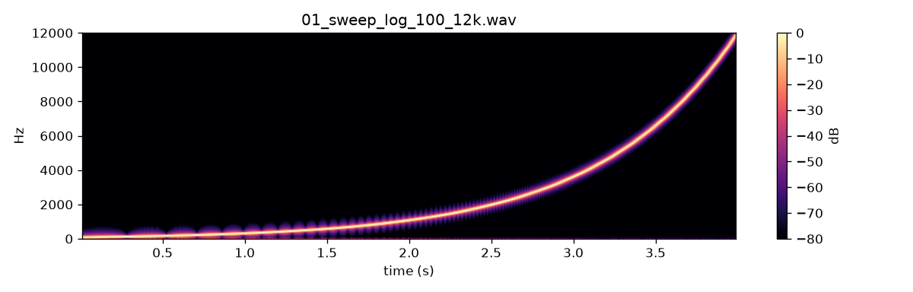

# WP-A1 report — Repository, build system, render CLI, listening kit

| Field | Value |
|---|---|
| WP | WP-A1 |
| Status | done |
| Started | 2026-09-16 |
| Finished | 2026-09-16 |
| Agent | Cursor Grok 4.6 |
| Sessions | 1 |

## 1. Summary (plain language, 3–6 lines)

The repository now builds with one command, runs C++ and Python tests with one command, and can turn a small JSON “recipe” into a WAV file. A listening page (audio players + spectrograms) is generated the same way later tasks will use. The only sounds in this task are test tones and a noise burst used to prove the pipeline — not yet a bird.

## 2. What was built

| File / module | Purpose |
|---|---|
| `.gitignore`, `.clang-format`, `README.md` | repo hygiene, LLVM-based format (4 spaces, 110 cols), how to build |
| `CMakeLists.txt`, `CMakePresets.json`, `cmake/Dependencies.cmake` | C++20, Ninja presets `debug`/`release`, Catch2 v3.8.1 + nlohmann/json v3.11.3 |
| `core/include/cuicui/version.hpp.in` | version + git hash (fallback `nogit`) |
| `core/include/cuicui/dsp/rng.hpp` | xoshiro128+ PRNG (`uniform`, `gaussian`) |
| `core/include/cuicui/io/wav_writer.hpp` | RIFF/WAVE float32 and PCM24 |
| `core/include/cuicui/io/render_spec.hpp` | parse `cuicui.render_spec` v1, linear automation |
| `core/include/cuicui/model/test_tone.hpp` | phase-continuous sine |
| `apps/bird_render/main.cpp` | `bird_render <spec> -o <wav> [--seed N] [--format float32\|pcm24]` |
| `core/tests/test_*.cpp`, `core/tests/golden/test_tone_sweep.render.json` | Catch2 unit tests |
| `schemas/*.schema.json` | render spec + listening manifest |
| `python/cuicui/listen/` | spectrograms, manifest validation, HTML page |
| `scripts/doctor.sh`, `build.sh`, `test.sh`, `check.sh`, `listen.sh` | standard commands |
| `scripts/render_listening_a1.py` | regenerates `listening/A1/` |

## 3. How to run it

```bash
./scripts/doctor.sh
./scripts/build.sh release
./scripts/test.sh
./scripts/check.sh

./build/release/bin/bird_render core/tests/golden/test_tone_sweep.render.json -o /tmp/sweep.wav

# regenerate this WP's listening page
uv-aware: scripts prepend tools/uv to PATH
python/… via: cd python && uv run python ../scripts/render_listening_a1.py
./scripts/listen.sh A1
open listening/A1/index.html
```

`uv` is not on the default macOS PATH. Scripts add `tools/uv` (a workspace copy installed with pip). `clang-format` is not installed; `check.sh` warns and continues.

## 4. Acceptance criteria

| # | Criterion (from the WP) | Result | Evidence (numbers, test name, file) |
|---|---|---|---|
| 1 | `scripts/doctor.sh` runs and reports the environment | PASS | `DOCTOR OK` — cmake 3.27.8, ninja 1.13.2, git 2.48.1, Apple clang 17, uv 0.12.15, Xcode CLT present. clang-format WARN (optional). |
| 2 | From a clean state (`rm -rf build`), `scripts/build.sh release` succeeds | PASS | First configure/build from empty `build/` wrote `BUILD OK (release)` in `build/logs/A1_build.log` |
| 3 | `scripts/test.sh` passes (automation, PRNG, WAV, render spec errors) | PASS | 24/24 CTest + 9/9 pytest. Names: `automation holds first and last…`, `PRNG same seed…`, `WAV float32 header chunk sizes`, `render spec unknown parameter ID is exit code 2`, `render spec test.waveform noise` |
| 4 | Test tone 1000 Hz @ 48 kHz, 1 s within ±0.1 Hz | PASS | `test tone 1000 Hz at 48 kHz is within 0.1 Hz` (zero-crossing interpolation) |
| 5 | Determinism: same spec twice → byte-identical WAV | PASS | CTest `same render written twice is byte-identical`; Python `test_determinism_sha256`; listening file SHA-256 `9faf97e131b3f4458d873b86f8d4bda208c011944206f200507916020d2d2685` (`listening/A1/determinism.json`, match true) |
| 6 | Python `soundfile` reads float32 and PCM24 WAVs | PASS | `test_soundfile_reads_float32_and_pcm24`: max abs diff vs expected sine < 1e-6 (float); PCM24 vs float < 1e-6 |
| 7 | Listening page generated and opens with audio + spectrograms | PASS | `listening/A1/index.html` (3 `<audio>` tags, spectrograms next to each WAV); opened in Safari |
| 8 | `scripts/check.sh` prints `CHECK PASSED` | PASS | last line of `build/logs/A1_check.log` |
| 9 | `git status` after staging shows no `build/`, `listening/`, `.venv/` | PASS | see §5.7 / `git diff --cached --stat` in this session |

## 5. Quality gate

```
100% tests passed, 0 tests failed out of 24
9 passed in 3.93s
TEST OK
All checks passed!
warning: clang-format not installed; skipping format check (brew install clang-format)
CHECK PASSED
```

## 6. Listening & results

- Page: `listening/A1/index.html`
- Items and what to listen for:

| File | What to listen for | Key metrics |
|---|---|---|
| `01_sweep_log_100_12k.wav` | Clean 4 s sweep, no clicks or extra tones. Spectrogram: one thin rising line. | duration 4.0 s, peak −12.0 dBFS |
| `02_tone_1k_gain_ramp.wav` | Smooth level change, no clicks at the start, peak, or end. | duration 2.0 s, peak −0.01 dBFS; SHA-256 `9faf97e1…2685` |
| `03_two_seeds_noise.wav` | Two different 1 s noise bursts (seed 1, then seed 2). They must not sound identical. | duration 2.0 s, peak −12.0 dBFS |

Key figures (copied to `agent documents/reports/assets/A1/`):



Determinism: rendering `02_tone_1k_gain_ramp.wav` twice produced the same SHA-256 `9faf97e131b3f4458d873b86f8d4bda208c011944206f200507916020d2d2685`.

The low-frequency end of the sweep spectrogram shows FFT-resolution “blobs” (1024-point FFT at 48 kHz). That is a display artefact, not extra tones in the audio.

## 7. Deviations from the spec

| Spec said | What I did | Why |
|---|---|---|
| Only parameters `test.freq_hz` / `test.gain_db` | Also `test.waveform` (`sine` \| `noise`), parsed like the other test params. CLI `--format` for PCM24. | Human feedback: waveform is a test parameter, not a top-level file field. PCM24 needed for criterion 6. |
| FetchContent pinned tags | Catch2 **v3.8.1**, nlohmann/json **v3.11.3** | Current stable tags at time of writing |
| `brew install uv` if missing | Workspace `tools/uv` via `pip` (uv 0.12.15) | Homebrew install was blocked in this environment; `tools/` is gitignored |
| clang-format required for `check.sh` | Warn and continue if missing (as the WP allows) | `clang-format` is not on the machine |

## 8. Contract changes (see decisions.md)

- D-013: **rejected — replaced by `test.waveform`**. No top-level `generator` field. `params.test.waveform` is `sine` \| `noise` in A1; A2 registers it and adds `saw`.

## 9. Measurements & baselines

| Metric | Value | Conditions |
|---|---|---|
| 1 kHz tone frequency error | < 0.1 Hz | 48 kHz, 1 s, zero-crossing interpolation |
| Identical-render SHA-256 | `9faf97e131b3f4458d873b86f8d4bda208c011944206f200507916020d2d2685` | 1 kHz gain ramp, float32 WAV |
| Sweep peak | −12.0 dBFS | as specified, not peak-normalised |

No CPU-per-voice baseline yet (that is B6).

## 10. Known issues & limitations

- `clang-format` is not installed; `check.sh` skips the C++ format check. Install with `brew install clang-format` when convenient.
- `uv` lives in `tools/uv` (gitignored). Opening a raw terminal without `scripts/_common.sh` will not find `uv` unless it is on PATH.
- Git hash in `version.hpp` is `nogit` until the first commit exists.
- Noise generator is uniform-white in [−amp, amp], not Gaussian, so peaks stay at the requested gain.
- No JUCE / plugin / bird model (out of scope).

## 11. Tools / dependencies added

- Catch2 v3.8.1 (CMake FetchContent)
- nlohmann/json v3.11.3 (CMake FetchContent)
- Python (uv): numpy, scipy, soundfile, matplotlib, jsonschema, pytest, ruff — see `python/pyproject.toml`
- uv 0.12.15 installed into `tools/uv` with pip (not committed)

## 12. Handoff notes for the next agent

- Work from the project root. Quote `"agent documents/…"` because of the space.
- Build outputs: `build/release/bin/bird_render`, `build/release/bin/cuicui_core_tests`.
- Python env: `python/.venv` created by `uv sync --python 3.12` (this machine used Anaconda CPython 3.12.4).
- Known A1 parameter IDs: `test.freq_hz`, `test.gain_db`, `test.waveform` (`sine` \| `noise`). Anything else → exit code 2.
- Listening kit CLI: `cd python && uv run python -m cuicui.listen page <manifest.json>` or `./scripts/listen.sh <WP-ID>`.
- Header-only core is an INTERFACE target; nlohmann/json is linked through it (IO headers only).
- Next WP in line after approval: **A2** (parameter registry, oversampling, Python bindings). `test.waveform` already exists (`sine`/`noise`); A2 adds `saw` and the registry. D1 also becomes eligible (needs recordings from the human).

## 13. Partial — remaining work (only if status is partial)

## 14. Revision history (feedback rounds)

| Date | Human feedback | Changes |
|---|---|---|
| 2026-09-16 | Not D-013 as a top-level field; use `test.waveform` (`sine` \| `noise`) now. Reject D-013. Note it on WP-A2. | Removed `generator` JSON/CLI. Parse `test.waveform` in `render_spec.hpp`. Re-rendered listening item 03. |

## 15. Proposed commit message

```
WP-A1: repository, build system, render CLI, listening kit

Add a CMake/Ninja core, bird_render, Catch2 tests and a Python listening
page so later work packages can build, test and present audio from one
command. Test tones only (`test.freq_hz`, `test.gain_db`, `test.waveform`).

Report: agent documents/reports/WP-A1_report.md
```
