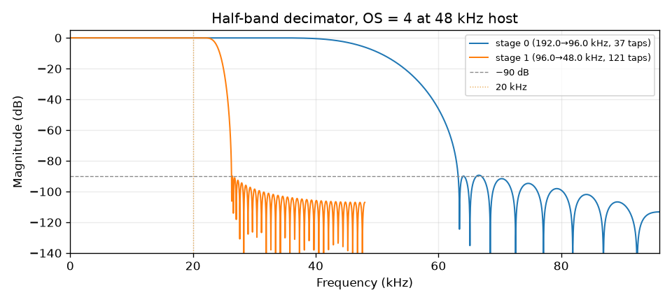
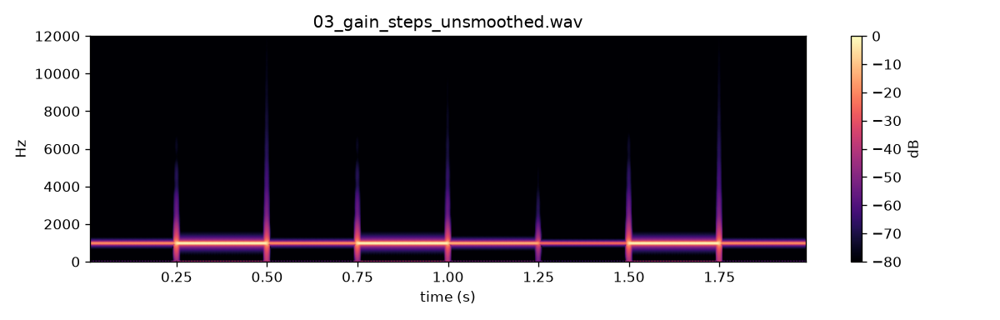
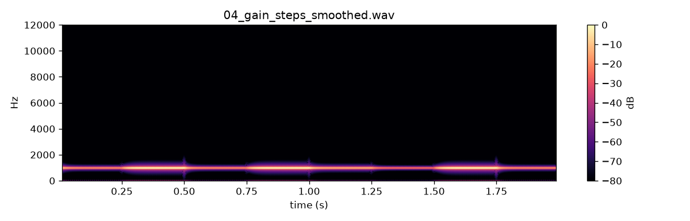

# WP-A2 report — Parameter registry, control signals, oversampling, Python bindings

| Field | Value |
|---|---|
| WP | WP-A2 |
| Status | done |
| Started | 2026-09-16 |
| Finished | 2026-09-16 |
| Agent | Cursor Grok 4.6 |
| Sessions | 1 |

## 1. Summary (plain language, 3–6 lines)

Every control the synth will ever have is now listed in one table. A test oscillator can run at a high internal sample rate (at least 176.4 kHz) and is filtered down to 44.1/48 kHz with half-band filters so aliases stay out of the audible band. Parameter jumps can be smoothed (no zipper clicks) or left raw. Python calls the same C++ engine as `bird_render` and gets bit-identical audio. There is still no bird model — only test sine, naive saw, and noise.

## 2. What was built

| File / module | Purpose |
|---|---|
| `core/include/cuicui/params.def`, `params.hpp` | X-macro registry (30 params), `findParam`, clamp, skew map |
| `core/include/cuicui/dsp/smoother.hpp` | one-pole smoother (τ in ms) |
| `core/include/cuicui/dsp/control_ramp.hpp` | linear ramp, no allocation |
| `core/include/cuicui/dsp/halfband.hpp` | Kaiser FIR half-band, polyphase zero-skip |
| `core/include/cuicui/dsp/oversampling.hpp` | `resolveOversampling`, cascade OS 2/4/8 |
| `core/include/cuicui/model/test_saw.hpp` | naive saw at internal rate |
| `core/include/cuicui/model/bird_voice.hpp` | skeleton `BirdVoice` (test source + decimate) |
| `core/include/cuicui/io/offline_render.hpp`, `param_dump.hpp` | shared render + `--dump-params` JSON |
| `apps/bird_render/main.cpp` | `--dump-params`, `--oversampling`, `--smoothing on\|off` |
| `core/tests/alloc_counter.hpp`, `test_alloc.cpp` | zero allocs in `process()` |
| `python/bindings/module.cpp`, `python/CMakeLists.txt` | nanobind module `cuicui_core` |
| `python/tests/test_bindings.py` | dump-params, OS policy, parity, GIL |
| `scripts/render_listening_a2.py` | listening WAVs + decimator plot |

## 3. How to run it

```bash
./scripts/doctor.sh
./scripts/build.sh release   # uv sync, then CMake; needs nanobind in python/.venv
./scripts/test.sh
./scripts/check.sh

./build/release/bin/bird_render --dump-params
./build/release/bin/bird_render core/tests/golden/test_tone_sweep.render.json -o /tmp/sweep.wav --oversampling 4

cd python && uv run python -c "import cuicui_core as cc; print(len(cc.param_specs()))"

cd python && uv run python ../scripts/render_listening_a2.py
./scripts/listen.sh A2
open listening/A2/index.html
```

`uv` is in `tools/uv` (not on the default PATH). `nanobind` 3.0.1 is a Python dependency so CMake can `find_package(nanobind)`.

## 4. Acceptance criteria

| # | Criterion (from the WP) | Result | Evidence (numbers, test name, file) |
|---|---|---|---|
| 1 | `bird_render --dump-params` JSON equals `cuicui_core.param_specs()`. Round trip < 1e-6 | PASS | `test_dump_params_matches_bindings`; `normalise/denormalise round trip` (all 30 params) |
| 2 | Smoother: 63.2 % after τ within ±2 % | PASS | `smoother step response reaches 63.2% after tau` (τ = 20 ms @ 48 kHz) |
| 3 | Auto OS: 44.1→4, 48→4, 88.2→2, 96→2, 176.4→1, 192→1 | PASS | `resolveOversampling auto policy` + `test_resolve_oversampling_auto` |
| 4 | Decimator passband ≤ 0.1 dB; alias ≤ −90 dB | PASS | `decimator passband ripple…` (20 Hz–20 kHz, OS 2/4/8, 44.1 and 48 kHz); `decimator aliases…` |
| 5 | Reported latency = IR peak (±1 host sample) | PASS | `reported latency matches impulse-response peak` |
| 6 | Naive saw 3 kHz OS1 vs OS4: alias energy −≥40 dB | PASS | `naive saw 3 kHz: OS 4 reduces…` — measured at 3171 Hz so the first wrap (2736 Hz) is off-harmonic; Goertzel+Hann ≥ 40 dB |
| 7 | Zero heap allocations in `process()` after `prepare()` | PASS | `BirdVoice::process allocates nothing after prepare` |
| 8 | Python `render_spec` bit-identical to `bird_render` (3 specs) | PASS | `test_render_spec_bit_identical_to_cli` (sine OS4, saw OS1, saw OS4) |
| 9 | GIL released: two 5 s threads ≥ 1.5× sequential | PASS | `test_gil_released_two_threads` (`nb::gil_scoped_release` in `python/bindings/module.cpp`) |
| 10 | `scripts/check.sh` passes | PASS | see §5 |

## 5. Quality gate

```
100% tests passed, 0 tests failed out of 39
14 passed in 4.58s
TEST OK
warning: clang-format not installed; skipping format check (brew install clang-format)
CHECK PASSED
```

## 6. Listening & results

- Page: `listening/A2/index.html`
- Items and what to listen for:

| File | What to listen for | Key metrics |
|---|---|---|
| `01_saw_sweep_os1.wav` | Inharmonic whistling that falls while pitch rises (above ~2 kHz) | 4.0 s, peak −3 dBFS, OS=1 |
| `02_saw_sweep_os4.wav` | Same sweep, aliases strongly reduced | 4.0 s, peak −3 dBFS, OS=4 |
| `03_gain_steps_unsmoothed.wav` | Zipper clicks every 250 ms | 2.0 s, not normalised, smoothing 0 |
| `04_gain_steps_smoothed.wav` | Same jumps, no clicks (20 ms smoother) | 2.0 s, not normalised, 20 ms |

Key figures (copied to `agent documents/reports/assets/A2/`):







Half-band tap counts (Kaiser, extra length for the last stage):

| Host | OS | Stage (F_in → F_out) | Taps |
|---|---|---|---|
| 48 kHz | 4 | 192→96 kHz | 37 |
| 48 kHz | 4 | 96→48 kHz | 121 |
| 44.1 kHz | 4 | 176.4→88.2 kHz | 41 |
| 44.1 kHz | 4 | 88.2→44.1 kHz | 173 |

## 7. Deviations from the spec

| Spec said | What I did | Why |
|---|---|---|
| Only A2 params in `params.def` | Registered the full §7.1 physiology table plus A2 engine/test params (30 total). Performance-layer params wait for C3. | Deliverable `findParam("src.L.beta")`; registry is the single source of truth |
| Naive saw **3 kHz** for alias energy | Oscillator at **3171 Hz**; first wrap at 2736 Hz | At exactly 3 kHz / 48 kHz aliases land on harmonics, so inharmonic energy is not measurable |
| `test.waveform` enum sine/saw | `sine` \| `saw` \| `noise` | A1 already had noise; D-013 |
| Python API as listed in §6.1 | Also `decimator_stage_taps(...)` | Needed for the 0–96 kHz magnitude plot |
| Listening manifest audio items only | Optional `figures` array (D-014) | Plot is not a WAV |
| — | CLI `--smoothing on\|off` | Item 03 needs 0 ms on `out.gain_db` without a file-format change |
| FetchContent nanobind v2.4 | pip `nanobind==3.0.1` + `find_package` | Git clone of nanobind into `build/` was blocked in this environment |

## 8. Contract changes (see decisions.md)

- D-014 (accepted): optional `figures` on the listening manifest.
- Additive: `test.waveform` now includes `saw`; registry IDs from architecture §7.1 are live (setting them does not yet change the sound except the A2 test/engine/`out.gain_db` params).

## 9. Measurements & baselines

| Metric | Value | Conditions |
|---|---|---|
| Auto OS @ 48 kHz | 4 (192 kHz internal) | `resolveOversampling` |
| Last-stage taps @ 48 kHz | 121 | 96→48 kHz, fp=20 kHz |
| Last-stage taps @ 44.1 kHz | 173 | 88.2→44.1 kHz (narrower transition) |
| Alias reduction, 3171 Hz saw | ≥ 40 dB at 2736 Hz | OS1 vs OS4, 48 kHz |
| Registry size | 30 parameters | `--dump-params` |

No CPU-per-voice baseline yet (B6).

## 10. Known issues & limitations

- `clang-format` still missing; `check.sh` skips the C++ format check.
- `Oversampling::decimate` must be called with `nHost ≤ maxBlockSize` (BirdVoice chunks; tests must too). See backlog.
- Test source only. Physiology params parse and dump but do not drive DSP yet.
- `VoiceState` is a stub (phase + smoother); FIR delay lines are not snapshotted.
- nanobind is compiled from the venv sources; first build needs write access to paths that contain `.venv` in the object-file name.

## 11. Tools / dependencies added

- nanobind 3.0.1 (Python package; CMake `find_package(nanobind CONFIG)`)
- scikit-build-core declared as Python build backend for `uv pip install -e python` (day-to-day builds use the top-level CMake)

## 12. Handoff notes for the next agent

- Quote `"agent documents/…"` (space in the folder name).
- `BirdVoice::process` interpolates `setTestRamp` / `setOutGainRamp` and runs sine/saw/noise at the internal rate, then decimates. Replace the oscillator in B1; keep `prepare` / `process` / oversampling.
- Render path used by CLI and Python: `cuicui::io::render_offline` in `offline_render.hpp`. Do not duplicate it in the binding.
- Parameter IDs: `core/include/cuicui/params.def`. Adding a parameter = one line there.
- Skew: `fromNormalised(u) = min + (max-min) * u^(1/skew)` (documented in `params.hpp`). Linear = 1; log-ish (`oec.freq_hz`, `body.size`, `test.freq_hz`) use 0.5.
- `test.waveform`: 0=sine, 1=saw, 2=noise. Render spec still uses strings.
- Python module lands at `python/cuicui_core*.so` (gitignored). `pythonpath = ["."]` finds it. Rebuild with `scripts/build.sh release` after `uv sync` (installs nanobind).
- Next WP in line: **B1** (labial oscillator) depends on A2. **D1** is also eligible if recordings are in `data/raw/zebra_finch/`.

## 13. Partial — remaining work (only if status is partial)

## 14. Revision history (feedback rounds)

| Date | Human feedback | Changes |
|---|---|---|

## 15. Proposed commit message

```
WP-A2: parameter registry, oversampling, Python bindings

Add the shared parameter table, control smoothing, half-band
oversampling and a skeleton BirdVoice so later DSP modules share one
engine. bird_render and cuicui_core.render_spec produce the same
samples. Test oscillator only (sine / saw / noise).

Report: agent documents/reports/WP-A2_report.md
```
