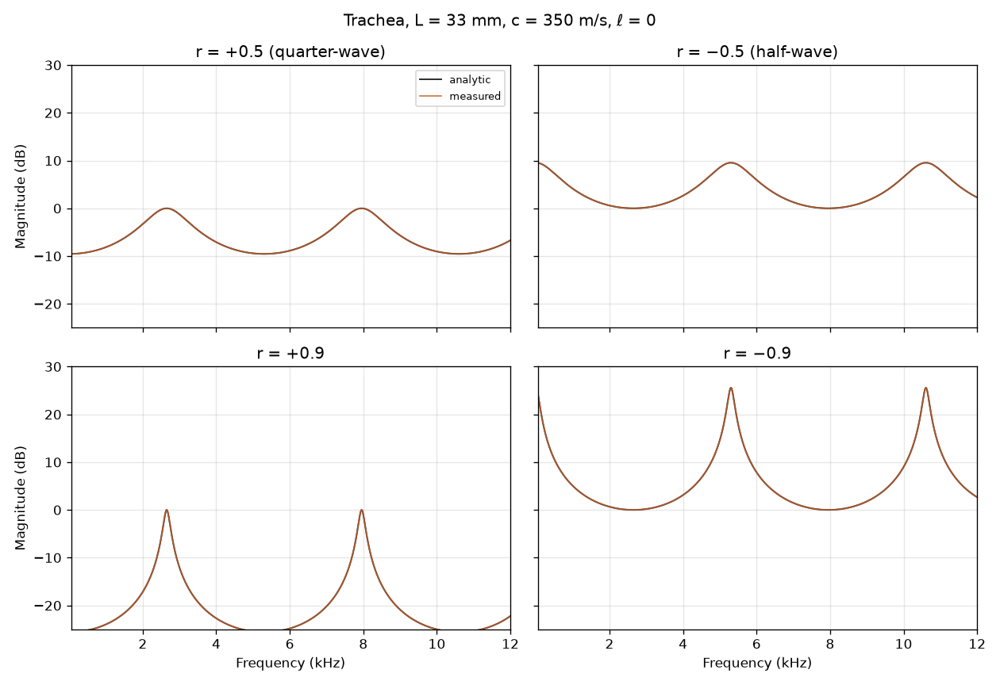
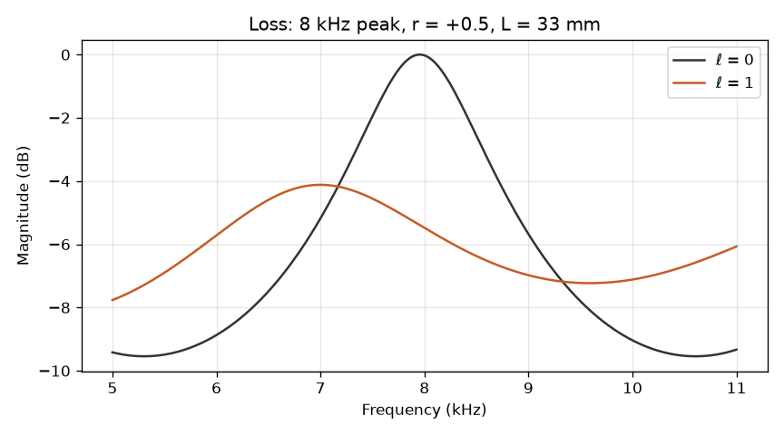
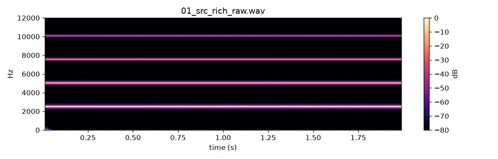
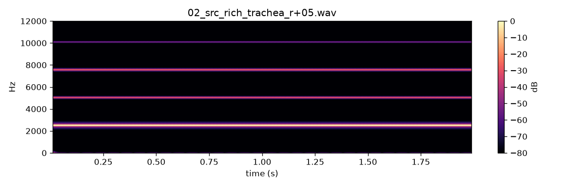
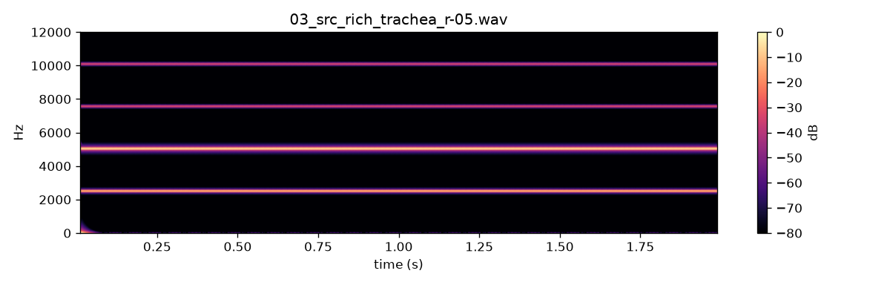

# WP-B2 report — Trachea waveguide

| Field | Value |
|---|---|
| WP | WP-B2 |
| Status | done |
| Started | 2026-09-16 |
| Finished | 2026-09-17 |
| Agent | Cursor Grok 4.6 |
| Sessions | 1 |

## 1. Summary (plain language, 3–6 lines)

The labial source now goes through a **trachea**: a short tube that adds resonances, like singing into a length of pipe. A positive reflection coefficient gives quarter-wave peaks (about 2.65 and 8 kHz for a 33 mm zebra-finch tube). A negative one gives half-wave peaks (about 5.3 and 10.6 kHz) plus a bass boost that the DC blocker removes. Length can be swept without clicks. There is still no beak or mouth cavity — it should sound more “tubey” than B1, not yet like a real bird.

## 2. What was built

| File / module | Purpose |
|---|---|
| `core/include/cuicui/dsp/lagrange.hpp` | 3rd-order Lagrange fractional delay read |
| `core/include/cuicui/dsp/one_pole.hpp` | one-pole low-pass (loss filter) |
| `core/include/cuicui/model/trachea.hpp` | delayed-feedback waveguide |
| `core/include/cuicui/model/bird_voice.hpp` | chain: source → trachea → DC → 0.5 → decimate |
| `core/include/cuicui/io/offline_render.hpp` | wires `trachea.*` params/automation |
| `core/tests/test_trachea.cpp` | criteria 1–6 |
| `core/tests/test_alloc.cpp` | labial+trachea still allocates nothing in `process()` |
| `python/cuicui/reference/trachea.py` | numpy twin |
| `python/cuicui/analysis/trachea_response.py` | measured vs analytic plots |
| `python/tests/test_trachea_parity.py` | C++ vs numpy |
| `python/bindings/module.cpp` | `trachea_process`, `render_labial(..., use_trachea=…)` |
| `scripts/render_listening_b2.py` | seven listening WAVs |

`params.def` already had the four trachea parameters (A2). Defaults unchanged: L = 33 mm, r = +0.5, ℓ = 0.3, A = 1.

## 3. How to run it

```bash
./scripts/doctor.sh
./scripts/build.sh release
./scripts/test.sh
./scripts/check.sh

cd python && uv run python -m cuicui.analysis.trachea_response --out ../listening/B2/figs
python/.venv/bin/python scripts/render_listening_b2.py
./scripts/listen.sh B2
open listening/B2/index.html
```

Response-plot log: `build/logs/B2_trachea_response.log`.

## 4. Acceptance criteria

| # | Criterion (from the WP) | Result | Evidence (numbers, test name, file) |
|---|---|---|---|
| 1 | Lagrange delay: 3.0–40.0, 1 kHz phase < 0.1°, amp < 0.01 dB; 10 kHz amp < 0.5 dB | PASS | `Lagrange delay: 1 kHz phase/amp, 10 kHz amp` |
| 2 | Resonances ℓ=0, L=33 mm: r=+0.5 → 2651, 7955, 13258 Hz (±0.5 %); r=−0.5 → 5303, 10606 Hz + LF max | PASS | `trachea resonances r = ±0.5, L = 33 mm` |
| 3 | Measured vs analytic \|H\| within 0.3 dB, 50 Hz–12 kHz | PASS | `trachea measured vs analytic magnitude within 0.3 dB`; plots: worst 0.018 dB at r=−0.9, L=33 mm (`listening/B2/figs/trachea_response.json`) |
| 4 | ℓ=1 drops the ~8 kHz peak by ≥ 6 dB vs ℓ=0 | PASS | `trachea loss drops the ~8 kHz peak by at least 6 dB` (Hann-windowed IR at 7955 Hz) |
| 5 | 10 s noise, random smooth r/ℓ/L: finite, peak < 40× input | PASS | `trachea stability: 10 s white noise, random smooth params` |
| 6 | L 20→60 mm / 1 s, 500 Hz in: energy >15 kHz is >60 dB down | PASS | `trachea length modulation: HF energy 60 dB below 500 Hz` |
| 7 | Parity C++ vs numpy, 0.1 s noise, 3 settings, max abs < 1e-9 of peak | PASS | `test_trachea_parity_three_sets` |
| 8 | Zero allocs in `process()`; `scripts/check.sh` | PASS | `BirdVoice labial process allocates nothing after prepare`; §5 |

## 5. Quality gate

```
100% tests passed, 0 tests failed out of 55
16 passed in 4.61s
TEST OK
All checks passed!
warning: clang-format not installed; skipping format check (brew install clang-format)
CHECK PASSED
```

## 6. Listening & results

- Page: `listening/B2/index.html` (rebuilt after listening feedback)
- 01–03: same rich source (β = 0.05, α = 0.28), **shared gain**. Listening uses **|r| = 0.9, ℓ = 0** (the spec’s ±0.5 was inaudible on this source).

| File | What to listen for | Key metrics |
|---|---|---|
| `01_src_rich_raw.wav` | Buzzy stack, no tube | 2.0 s, shared −3 dBFS |
| `02_src_rich_trachea_r+05.wav` | Hollow ring ~2.6 kHz + 8 kHz sheen | r = **+0.9**, ℓ = 0 |
| `03_src_rich_trachea_r-05.wav` | Chewier, ring ~5.3 kHz | r = **−0.9**, ℓ = 0 |
| `04_src_tonal_trachea_r+09.wav` | Swell when pitch crosses ~2.6 kHz | β −0.05→0.8, r = +0.9, ℓ = 0 |
| `05_length_sweep.wav` | Pitched whistle slides **down** over 4 s | **noise**, L 15→80 mm, r = +0.9 |
| `06_loss_0_vs_1.wav` | After 2 s the whistle goes dull | **noise**, gain from first 2 s |
| `07_noise_through_trachea.wav` | Pitched tube (reference for 05/06) | r = +0.9, ℓ = 0 |

Key figures (`agent documents/reports/assets/B2/`):











## 7. Deviations from the spec

| Spec said | What I did | Why |
|---|---|---|
| ℓ = 0 → f_c = 22 kHz | ℓ = 0 **bypasses** the one-pole (true lossless comb) | A 22 kHz pole at 192 kHz is ~1 dB down at 12 kHz and would fail the 0.3 dB analytic match (and crush r≈0.9 peaks). ℓ > 0 still uses the written formula. |
| Output tap always 3rd-order centered Lagrange | Centered for delay ≥ 2; causal 4-point window for 1 ≤ delay < 2 | D/2 can be 1.5 samples when D is clamped to 3; centered would read delay 0 (the unwritten slot). |
| Always-on trachea in the voice | Labial: on by default; test oscillator: on only if the render spec mentions `trachea.*`; `setTracheaEnabled(false)` for item 01 | A1/A2 sine/saw tests must stay bit-identical; 01 is the dry A/B reference. |
| Criterion 4: peak-height at ≈ 8 kHz | Compare Hann-windowed \|H\| at 7955 Hz (the lossless peak frequency) | With ℓ = 1 the peak **moves** down to ~7.55 kHz; comparing shifted maxima was only 4.6 dB. At the original 8 kHz bin the drop is ≥ 6 dB. |
| Listening 02/03 at r = ±0.5 | r = ±0.9, ℓ = 0, shared gain; filenames kept | Human: ±0.5 was inaudible on the labial source. |
| Listening 05/06 on the rich source | White noise carrier (like 07) | A ~1.5 kHz tone has too little bandwidth to show a length glide or a loss change. |
| Peak-normalise 06 | Gain from the first 2 s only | Matching peaks hid the darker second half. |

## 8. Contract changes (see decisions.md)

- None. `trachea.*` IDs were already in the registry (A2). `trachea_process` and extra `render_labial` kwargs are additive Python helpers, not a file-format change.
- D-012 (default r = +0.5) is unchanged until you pick a sign from items 01–03.

## 9. Measurements & baselines

| Metric | Value | Conditions |
|---|---|---|
| Quarter-wave peaks, L=33 mm, c=350 m/s | 2651, 7955, 13258 Hz | analytic; measured within 0.5 % |
| Half-wave peaks | 5303, 10606 Hz | r = −0.5 |
| Analytic match (ℓ=0, L=33 mm) | worst 0.018 dB (r=−0.9), 50 Hz–12 kHz | `trachea_response.json` |
| Min delay | 3 samples (L clamped) | at 192 kHz that is 2.73 mm; registry min is 10 mm |
| Buffer | `ceil(2·0.48/c·f_int)+4` | maxLengthMm = 120×4 for later `body.size` |

## 10. Known issues & limitations

- No glottis / OEC / beak yet (B3). Still not a complete bird.
- r < 0 boosts bass; the 20 Hz DC blocker after the trachea removes the DC peak but some low-frequency colour remains (intended).
- ℓ = 0 is exactly lossless, not “22 kHz almost lossless”.
- Plugin default is still r = +0.5, ℓ = 0.3 (D-012). Listening examples exaggerate (|r| = 0.9, ℓ = 0) so the tube is hearable.
- `clang-format` still missing.

## 11. Tools / dependencies added

- None.

## 12. Handoff notes for the next agent

- Quote `"agent documents/…"`.
- Next WP: **B3** (upper vocal tract). Put it **between trachea and DC blocker**. Notes appended to the B3 spec.
- `Trachea::prepare(rate, 480)` allocates; `setParams` is immediate — do not smooth length inside `Trachea` (the voice already does 20 ms).
- `BirdVoice::setSource(Labial)` turns the trachea on; `setTracheaEnabled(false)` for dry source. Prime with `primeLabial` so the delay line is filled at rest (avoids a startup click).
- `cuicui_core.trachea_process(source, rate, length_mm, r, loss, A)` — GIL released.
- D1 remains `optional`.

## 13. Partial — remaining work (only if status is partial)

## 14. Revision history (feedback rounds)

| Date | Human feedback | Changes |
|---|---|---|
| 2026-09-16 | 02 not tubey; 02≈03; 05 no glide; 06 no half-change; 07 good | Re-rendered: \|r\|=0.9, ℓ=0; shared gain on 01–03; 05/06 use noise; 06 gain from first 2 s. |

## 15. Proposed commit message

```
WP-B2: trachea waveguide (delayed-feedback comb)

Add a fractional-delay trachea after the labial source: quarter-wave
or half-wave colour from the reflection sign, length sweep without
clicks, and a one-pole loss. Default reflection stays +0.5 until
listening chooses (D-012).

Report: agent documents/reports/WP-B2_report.md
```
