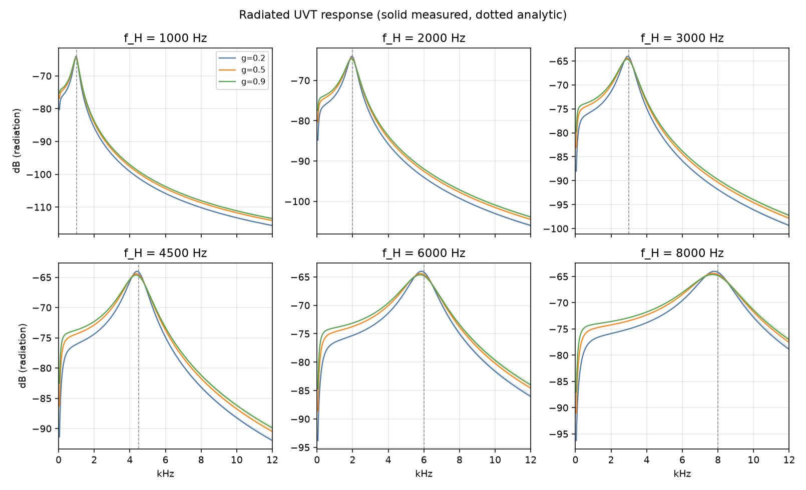
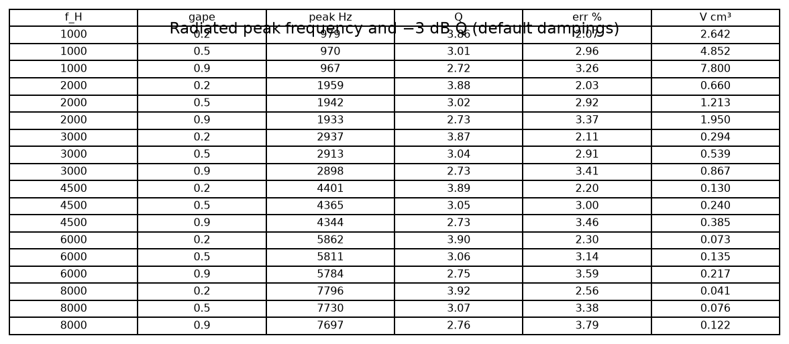
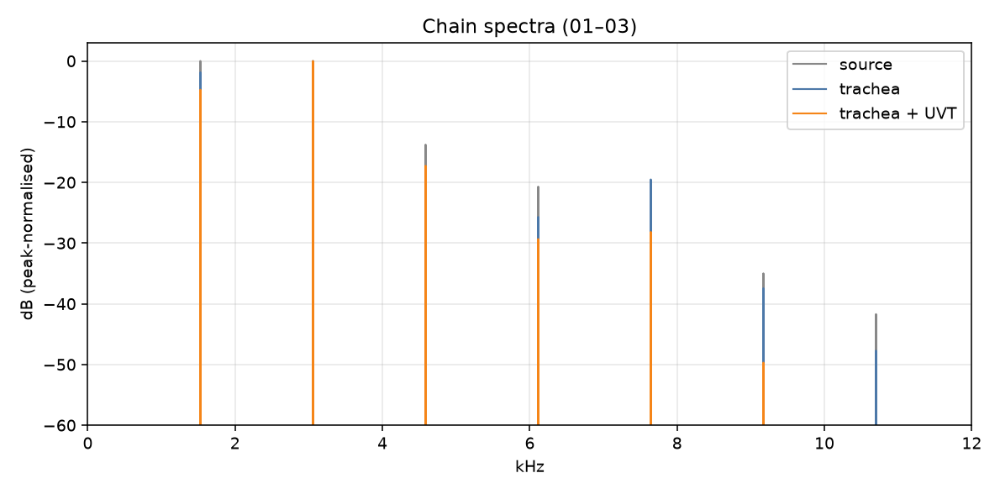

# WP-B3 report — Upper vocal tract: glottis – OEC – beak + radiation

| Field | Value |
|---|---|
| WP | WP-B3 |
| Status | done |
| Started | 2026-09-17 |
| Finished | 2026-09-17 |
| Agent | Cursor Grok 4.6 |
| Sessions | 1 |

## 1. Summary (plain language, 3–6 lines)

The labial source and trachea now go through a **mouth cavity** (OEC, a Helmholtz resonator the bird tunes) and a **beak**, then **radiation** (the +6 dB/octave tilt of sound leaving a small opening). This is the first complete anatomical bird sound (milestone M1). Loudness is calibrated so a reference note peaks at −6 dBFS. There is still no breath envelope, aspiration noise, or second syrinx side — attacks are on/off, and 07/08 will not yet match the real zebra finch.

## 2. What was built

| File / module | Purpose |
|---|---|
| `core/include/cuicui/model/upper_vocal_tract.hpp` | 3-state trapezoidal UVT; calibration `kUvtFlowCal` / `kUvtRadCal` |
| `core/include/cuicui/model/bird_voice.hpp` | chain: source → trachea → UVT mix → DC → decimate |
| `core/include/cuicui/io/offline_render.hpp` | wires `oec.*`, `beak.*`, `out.radiation` |
| `core/tests/test_upper_vocal_tract.cpp` | criteria 2–5, 7 |
| `python/cuicui/reference/uvt.py` | numpy twin + circuit / published TFs |
| `python/cuicui/analysis/uvt_response.py` | radiated family + peak/Q table |
| `python/tests/test_uvt_equivalence.py` | criterion 1 |
| `python/tests/test_uvt_parity.py` | criterion 6 |
| `python/bindings/module.cpp` | `uvt_process`, extra `render_labial` kwargs |
| `scripts/render_listening_b3.py` | nine listening items + real-clip A/B |

`params.def` already had the B3 IDs (A2). Defaults unchanged.

## 3. How to run it

```bash
./scripts/doctor.sh
./scripts/build.sh release
./scripts/test.sh
./scripts/check.sh

PYTHONPATH=python python/.venv/bin/python -m cuicui.analysis.uvt_response --out listening/B3/figs
python/.venv/bin/python scripts/render_listening_b3.py
./scripts/listen.sh B3
open "listening/B3/index.html"
```

## 4. Acceptance criteria

| # | Criterion (from the WP) | Result | Evidence (numbers, test name, file) |
|---|---|---|---|
| 1 | Published vs circuit analytic, < 1e-9 mag/phase, 20 freqs × 5 sets | PASS | `test_published_vs_circuit_analytic` |
| 2 | Discrete flow IR vs analytic H_uvt/R_b within 0.2 / 0.5 dB | PASS | `discrete flow response matches analytic H_uvt` |
| 3 | Radiated peak within ±5 % of f_H; peak/Q table | PASS | `radiated peak within 5 percent of oec.freq_hz` (worst ~3.8 %); `listening/B3/figs/uvt_peaks.json` |
| 4 | 10 s noise, LFO f_H and gape: finite, peak < 100× static | PASS | `UVT stability: 10 s noise, LFO f_H and gape` |
| 5 | Reference note −6 dBFS ±1 dB (ρ=1); ρ=0 RMS ±3 dB | PASS | `calibration: reference note -6 dBFS radiation and flow RMS` (peak −6.000 dBFS, RMS Δ ≈ 0 dB) |
| 6 | C++ vs numpy, 0.1 s, 3 sets, max abs < 1e-9 of peak | PASS | `test_uvt_parity_three_sets` |
| 7 | 10 s @ 48 kHz in < 0.2 s Release | PASS | `full voice CPU: 10 s at 48 kHz under 0.2 s` — **0.117 s** |
| 8 | Zero allocs in `process()`; `scripts/check.sh` | PASS | `BirdVoice labial process allocates nothing after prepare`; §5 |

## 5. Quality gate

```
100% tests passed, 0 tests failed out of 61
18 passed in 3.35s
TEST OK
All checks passed!
warning: clang-format not installed; skipping format check (brew install clang-format)
CHECK PASSED
```

## 6. Listening & results

- Page: `listening/B3/index.html` (rebuilt after listening feedback)
- Milestone **M1**. Chain 01–03 uses a **~1.5 kHz SNIC buzz** (α=0.16, β=0.05) and a broader OEC (z_h=0.35) so 03 stays a buzz, not a flute.

| File | What to listen for | Key metrics |
|---|---|---|
| `01_chain_source.wav` | Buzzy harmonics, no tube | shared peak; α=0.16, β=0.05, f₀≈1534 Hz |
| `02_chain_trachea.wav` | Hollow tube on the same buzz | r=+0.9, ℓ=0 |
| `03_chain_full.wav` | Same buzz; band around 4.6 kHz louder (vowel), still not a sine | f_H=4600 Hz, z_h=0.35 |
| `04_oec_sweep.wav` | Wah-wah: harmonics light up in turn | f_H 800→6000 |
| `05_gape_sweep.wav` | 2 s closed then 2 s open | gape 0 then 1 |
| `06_flow_vs_radiation.wav` | After 2 s: highs come in | gain from first 2 s |
| `07_stack_attempt.wav` vs real peep | Short falling tweet vs 7.828–7.994 s | 170 ms, β 0.55→0.08 |
| `08_high_note_attempt.wav` vs real alarm | Pitch **up** 2.7→4 kHz, swell, fade | 500 ms, β 0.22→0.75 |
| `09_tonal_glide_full.wav` | Pitch rises; around **1.7 s** it rings at 3 kHz | β −0.05→0.8 |

Key figures (`agent documents/reports/assets/B3/`):







## 7. Deviations from the spec

| Spec said | What I did | Why |
|---|---|---|
| Discrete flow vs analytic **H_uvt** | Compare \|FFT(i_b)\| to \|H_uvt\|/R_b | H_uvt is p_out = R_b i_b; the criterion is the **flow** response |
| 04: α just above onset, f₀≈600 Hz | α=**0.16**, β=0.05 → f₀≈1534 Hz (harmonics H1–H3) | α=0.12 is almost a sine; formants need a buzz |
| Listening trachea defaults | \|r\|=0.9, ℓ=0 on 01–03 (and most items) | r=+0.5 was inaudible on this source in B2 |
| Default oec.damping 0.1 on listening | z_h=**0.35** on listening renders | Q=0.1 turned 03 into a flute; broader peak keeps the buzz |
| 07 held note vs D1 stack | 170 ms falling tweet vs peep 7.828–7.994 s | Human: reference is a fast tweet, A was a drone |
| 08 constant high note | 0.5 s **rising** 2.7→4 kHz vs alarm 23.48–23.98 s | Human: A went down, B went up |
| D1 catalogue clips | Hand-picked from `22938.wav` outside the repo | D1 is still `optional`; no `data/raw/` ingest |

## 8. Contract changes (see decisions.md)

- None. B3 parameter IDs were already in `params.def`.
- Additive Python helpers: `uvt_process`, extra `render_labial(..., use_uvt=…)` kwargs.

## 9. Measurements & baselines

| Metric | Value | Conditions |
|---|---|---|
| Implied OEC volume | 0.539 cm³ | f_H=3000 Hz, gape=0.5, σ=1 |
| Worst radiated peak error | 3.79 % | f_H×gape grid, default dampings |
| kUvtFlowCal / kUvtRadCal | 25649535 / 1534.636 | reference note, 48 kHz, 0.2 s skip |
| Reference peak | −6.000 dBFS | ρ=1 |
| ρ=0 vs ρ=1 RMS | ≈ 0 dB | same note |
| CPU 10 s @ 48 kHz | 0.117 s | Release, Apple Silicon, 1 thread |

## 10. Known issues & limitations

- No respiratory dynamics or noise (B4). Attacks are square. Human: B3 **08** real alarm is metallic / fast-FM — that is B4 tension jitter, not the mouth.
- One syrinx side only (B5).
- Plugin default trachea is still r=+0.5, ℓ=0.3 (D-012); listening exaggerates the tube.
- 07 real clip is only ~170 ms; A/B is unfair on duration.
- `clang-format` still missing.

## 11. Tools / dependencies added

- None.

## 12. Handoff notes for the next agent

- Quote `"agent documents/…"`.
- Next WP: **B4** (respiration & noise). Loudness is already calibrated; don’t change `kUvtFlowCal` / `kUvtRadCal` unless you re-run the reference note.
- Chain: labial `x` → trachea → UVT → `(1−ρ) k_f U_b + ρ k_d dU_b` → 20 Hz DC → host `out.gain_db` → decimate. Dry source: `setTracheaEnabled(false)` + `setUvtEnabled(false)` (labial still uses the old `0.5 * DC` path).
- UVT matrices rebuild at most every 8 internal samples. `setParams` is immediate if ≥8 samples since last rebuild.
- `cuicui_core.uvt_process(x, rate, f_H, z_h, gape, z_b, size=1)` → `(flow, dflow)`.
- Real recordings still at `/Users/baptistebohelay/Dev/research/birds synth/data/annotations/`.

## 13. Partial — remaining work (only if status is partial)

## 14. Revision history (feedback rounds)

| Date | Human feedback | Changes |
|---|---|---|
| 2026-09-17 | 03 no formant (sine); 05/06 no opening on a sine; 07 drone vs tweet; 08 down vs up; 09 unclear | Re-rendered: 1.5 kHz buzz + broader OEC; 05/06 stepped 2 s A/B; 07 short falling tweet; 08 rising 2.7→4 kHz; 09 “swell at 1.7 s”. |
| 2026-09-17 | 08 more metallic, like fast FM; rest fine | Noted for B4 (`noise.beta_sigma`); no further B3 render. Ready to approve. |

## 15. Proposed commit message

```
WP-B3: upper vocal tract (OEC, beak, radiation)

Add the glottis–OEC–beak circuit and radiation mix after the trachea.
This is the first complete anatomical bird sound (M1). Output is
calibrated so the reference note peaks at −6 dBFS.

Report: agent documents/reports/WP-B3_report.md
```
