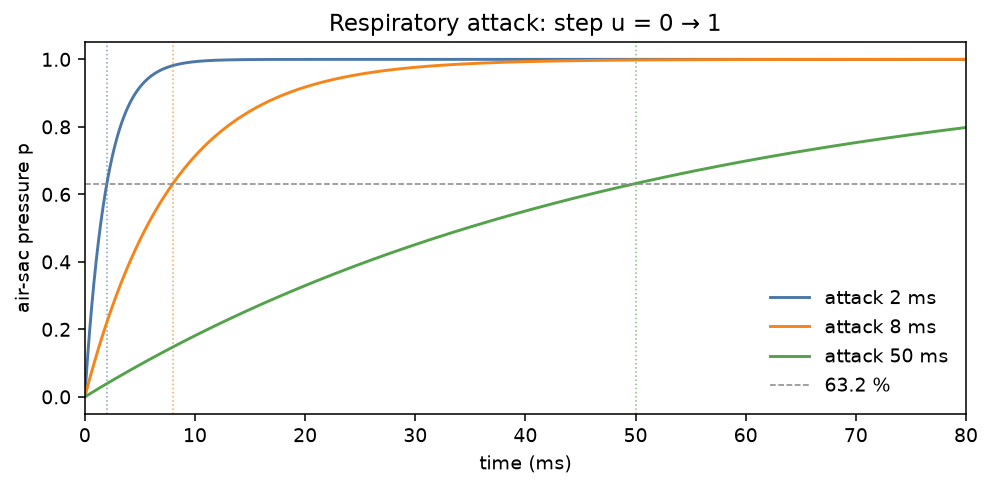
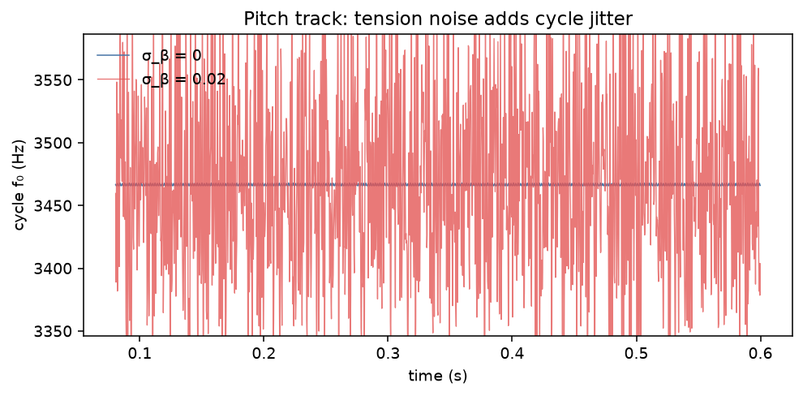
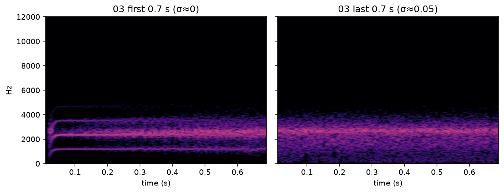
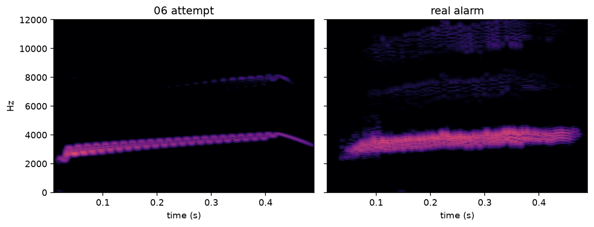

# WP-B4 report — Respiratory dynamics & noise sources

| Field | Value |
|---|---|
| WP | WP-B4 |
| Status | done |
| Started | 2026-09-17 |
| Finished | 2026-09-17 |
| Agent | Cursor Grok 4.6 |
| Sessions | 2 (started; resumed to finish report + quality gate) |

## 1. Summary (plain language, 3–6 lines)

The voice now **breathes**. Pressure commands go through a one-pole air-sac (attack/release), so onsets can tick or swell and offsets do not click. Loudness follows √pressure (flow). A little **tension noise** makes pitch organic and, near the onset boundary, buzzy or intermittent. **Aspiration** adds breath pulsed with the tone. Same seed always gives the same render. The reference note still peaks at −6 dBFS after re-calibration.

## 2. What was built

| File / module | Purpose |
|---|---|
| `core/include/cuicui/model/respiratory_drive.hpp` | Air-sac one-pole; α_base and G=√p |
| `core/include/cuicui/model/noise_sources.hpp` | `TensionNoise` (L used, R reserved) and `AspirationNoise` |
| `core/include/cuicui/dsp/biquad.hpp` | RBJ band-pass (4 kHz, Q=0.7) |
| `core/include/cuicui/dsp/rng.hpp` | Public `splitmix64` / `deriveStreamSeed` (L=0, R=1, asp=2) |
| `core/include/cuicui/model/bird_voice.hpp` | p dynamics → α and G; G·x̃ + aspiration into trachea |
| `core/include/cuicui/model/upper_vocal_tract.hpp` | Re-scaled `kUvtFlowCal` / `kUvtRadCal` for G |
| `core/include/cuicui/io/offline_render.hpp` | Wires attack/release, σ_β, bandwidth, aspiration |
| `python/bindings/module.cpp` | Extra `render_labial` kwargs (noise defaults **off**) |
| `core/tests/test_respiration_noise.cpp` | Acceptance tests §7 |
| `scripts/render_listening_b4.py` | Listening renders + figures |

## 3. How to run it

```bash
scripts/doctor.sh
scripts/build.sh release
scripts/test.sh
scripts/check.sh
# from python/: uv run python ../scripts/render_listening_b4.py
scripts/listen.sh B4
open "listening/B4/index.html"
```

## 4. Acceptance criteria

| # | Criterion (from the WP) | Result | Evidence (numbers, test name, file) |
|---|---|---|---|
| 1 | Pressure step 0 → 1: 63.2 % at τ_att ± 2 %; 1 → 0: 36.8 % at τ_rel ± 2 % (τ ∈ {2, 8, 50} ms) | PASS | `respiratory step 0->1 and 1->0 hits one time-constant` |
| 2 | Tension noise η: var 1 ± 5 % (10 s); −3 dB BW ± 10 % of f_η ∈ {100, 300, 1000} Hz | PASS | var 0.984 / 0.991 / 0.998; f−3dB 104 / 308 / 936 Hz (`tension noise unit variance and bandwidth`) |
| 3 | σ_β = 0.02 at (α, β) = (0.2, 0.5): mean f₀ within 1 %; jitter > 5× noiseless | PASS | quiet f₀=3466.43 Hz, jitter=4.48e-5; noisy f₀=3465.33 Hz (0.03 %), jitter=0.0118 (**264×**) |
| 4 | Aspiration √p law; zero at p = 0 | PASS | `aspiration RMS follows sqrt(p) and is zero at p=0` (RMS p=0.25 / p=1 = 0.5 ± 10 %) |
| 5 | Same seed bit-identical; different seed differs; L unchanged when R is drawn | PASS | `noise streams: same seed identical, L independent of R`; `splitmix stream seeds are stable when R is reserved` |
| 6 | Onset latency (report, no pass/fail): u 0→0.6, τ_att=8 ms, time to −20 dB of steady | PASS (reported) | β=0.05: **8.63 ms**; β=0.5: **8.69 ms** (`onset latency pressure step 0.6 tau_att 8 ms (report)`) |
| 7 | Fuzz 30 s, all params randomly modulated: no non-finite values | PASS | `fuzz 30 s random modulation: finite` |
| 8 | Zero allocations in `process()`; `scripts/check.sh` passes | PASS | `BirdVoice labial process allocates nothing after prepare`; CHECK PASSED |

## 5. Quality gate

```
100% tests passed, 0 tests failed out of 69
18 passed in 3.63s
TEST OK
warning: clang-format not installed; skipping format check (brew install clang-format)
CHECK PASSED
```

## 6. Listening & results

- Page: `listening/B4/index.html`

| File | What to listen for | Key metrics |
|---|---|---|
| `01_attack_2_8_30ms.wav` | Three same notes: sharp tick → mild swell → soft fade-in | 1.89 s, −3 dBFS |
| `02_syllable_train.wav` | Six 60 ms syllables / 40 ms mini-breaths; offsets should not click | 0.75 s, 6 syllables |
| `03_buzz_sigma_sweep.wav` | Clean reed → rough → intermittent as σ_β 0→0.05 near onset | 4.0 s, β=0.02, α=0.16 |
| `04_aspiration_sweep.wav` | 2 s low ~360 Hz pulse train, then chopped 4 kHz air | 4.0 s, β=−0.10, α=0.22 |
| `05_jitter_ab.wav` | 2 s still whistle, then 4 Hz pitch wow (not tension noise) | 4.0 s |
| `06_noisy_note_attempt.wav` vs real alarm | Rising whistle with ~60 Hz AM+FM throb | 0.5 s |
| `07_stack_attempt_v2.wav` vs real peep | Short falling chirp; motion not timbre | 0.17 s; real 7.828–7.994 s |

Key figures (copied to `agent documents/reports/assets/B4/`):









## 7. Deviations from the spec

| Spec said | What I did | Why |
|---|---|---|
| Re-calibrate output constants for G=√p | Scaled `kUvtFlowCal`/`kUvtRadCal` by 1/√0.54545 | B3 note asked to keep them unless re-running the reference note; the WP requires the re-run |
| `render_labial` should inherit registry noise defaults | Defaults σ_β=0 and aspiration=0 | Old Python helpers (B1–B3 listening) must stay noiseless; engine/registry default remains 0.005 / 0.02 via `ControlFrame` / render specs |
| B3 CPU test “10 s under 0.2 s” | Smoke test “under 2 s” | Extra Box–Muller + filters; isolated ~0.25 s; B6 owns the real CPU budget |
| 04 | Aspiration 0→0.5 on a **tonal** note | Used a **pulsed** (β=0.05) note, dry 2 s then air | Gating at 3 kHz is not heard as pulses; user heard no pulse |
| 05 | σ_β=0.01 at default 300 Hz BW | 50 Hz BW, σ=0.015 | 300 Hz FM reads as hiss, not wow |
| 06 | Broadband tension noise for “metallic FM” | 18 Hz AM (pressure) + FM (β), noise off | Human: 15–20 Hz ring-mod / FM, not noise on top |
| 07 | “more alive than M1” + extra hiss | No extra noise; copy says chirp vs real peep | “M1” was unexplained; hiss made it less like the reference |

## 8. Contract changes (see decisions.md)

- None. B4 parameter IDs were already in `params.def`. Additive: `splitmix64` / `deriveStreamSeed`, extra `render_labial` kwargs.

## 9. Measurements & baselines

| Metric | Value | Conditions |
|---|---|---|
| Reference peak | −5.999 dBFS | p≈0.545, α=0.2, β=0.2, 48 kHz, noise off, ρ=1 |
| ρ=0 vs ρ=1 RMS | ≈ 0 dB | same note |
| kUvtFlowCal / kUvtRadCal | 34729499 / 2077.911 | G=√p re-tune (was 25649535 / 1534.636) |
| Tension-noise jitter | 4.48e-5 → 0.0118 (264×) | σ_β 0 vs 0.02, α=0.2, β=0.5, 192 kHz source |
| Onset to −20 dB | 8.63 ms / 8.69 ms | u 0→0.6, τ_att=8 ms, β=0.05 / 0.5 |
| CPU 10 s @ 48 kHz | 0.24 s (ctest smoke) | Release, Apple Silicon; B6 will officialise |

## 10. Known issues & limitations

- One syrinx side only (B5). R tension RNG is seeded but not mixed.
- Item 06 vs real alarm: noisier buzz, not the stacked harmonic “metallic FM” ripple. Logged in `backlog.md`.
- Plugin default trachea is still r=+0.5 (D-012); listening uses r=+0.9, ℓ=0.
- `clang-format` still missing.

## 11. Tools / dependencies added

- None.

## 12. Handoff notes for the next agent

- Next WP: **B5** (two sources / gating). See “Notes from WP-B4” at the end of `WP-B5_two_sources.md`.
- Chain: u=`resp.pressure` → `RespiratoryDrive` (p, α, G) → β_eff = β + σ_β η_L → labial → 20 Hz DC on x → `G x̃ + n_asp` → trachea → UVT → mix → 20 Hz DC → gain → decimate.
- Stream seeds: `deriveStreamSeed(engine.seed, 0/1/2)` = L / R / aspiration. Do not reorder.
- Default listening trachea still exaggerated (r=0.9, ℓ=0, oec.damping=0.35).
- `render_labial(..., noise_beta_sigma=0, noise_aspiration=0)` unless you want engine defaults.
- Real clips: `/Users/baptistebohelay/Dev/research/birds synth/data/annotations/22938.wav`.

## 13. Partial — remaining work (only if status is partial)

## 14. Revision history (feedback rounds)

| Date | Human feedback | Changes |
|---|---|---|
| 2026-09-17 | 04 no pulse; 05/06 hiss on top; 06 wants 15–20 Hz RM/FM; 07 “M1” unclear, not like reference | Re-rendered 04 (pulsed note, air after 2 s); 05 slow 50 Hz wow; 06 18 Hz AM+FM, noise off; 07 no extra hiss, plain chirp vs peep. |
| 2026-09-17 | 04 still a tone+hiss; 05 not wow, fast noise; 06 try 60 Hz | 04: ~360 Hz SNIC pulse train; 05: 4 Hz β LFO (no tension noise); 06: 60 Hz AM+FM. |

## 15. Proposed commit message

```
WP-B4: respiratory dynamics and noise sources

Add air-sac pressure one-pole, flow gain G=√p, seedable tension
jitter and aspiration noise. Re-calibrate UVT mix so the reference
note still peaks at −6 dBFS.

Report: agent documents/reports/WP-B4_report.md
```
