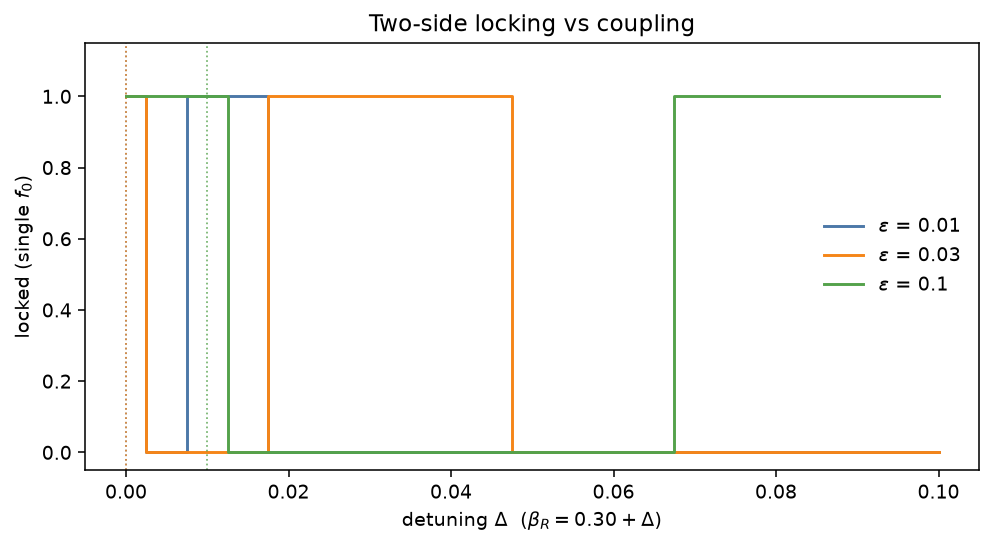
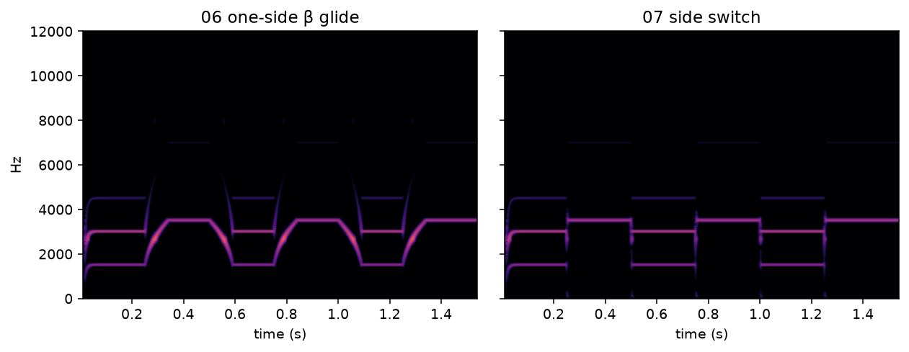
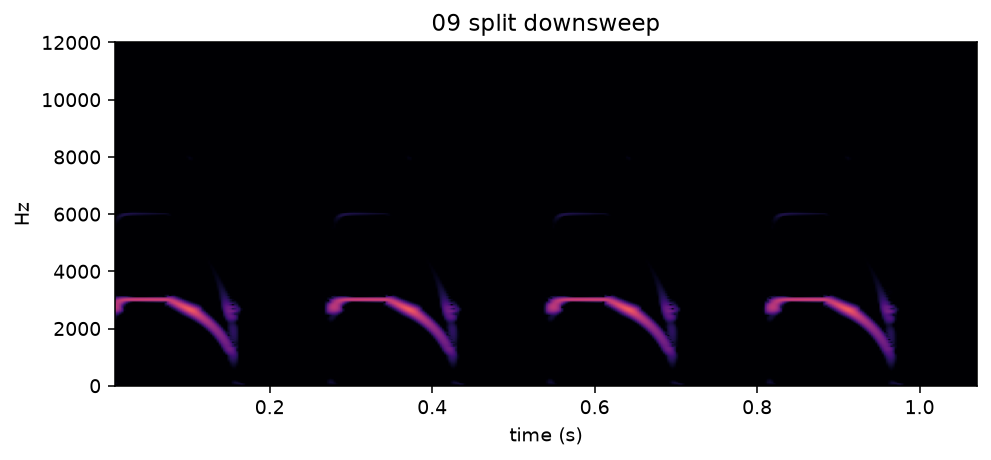

# WP-B5 report — Two sources: left/right labia, gating, side switching

| Field | Value |
|---|---|
| WP | WP-B5 |
| Status | done |
| Started | 2026-09-17 |
| Finished | 2026-09-17 |
| Agent | Cursor Grok 4.6 |
| Sessions | 2 (started; resumed to finish Python module, listening, report, quality gate) |

## 1. Summary (plain language, 3–6 lines)

The syrinx now has **two independent sides**. Each labium has its own tension, gate and α offset; they share air-sac pressure and the trachea. Close one side and it goes silent while still oscillating, so reopening has a physical onset. Open both and you hear two pitches at once. A little coupling can pull close pitches together (the lock range is small). A **side switcher** crossfades the gates in ~4 ms so a large pitch jump can hop instead of swoop.

## 2. What was built

| File / module | Purpose |
|---|---|
| `core/include/cuicui/model/bilateral_source.hpp` | Two oscillators, gating (Δα_close = 0.6), mix, joint RK4 coupling |
| `core/include/cuicui/control/side_switcher.hpp` | Equal-power gate crossfade; inactive β keeps tracking |
| `core/include/cuicui/model/bird_voice.hpp` | Uses `BilateralSource` (`labia_`); R tension stream; gates + coupling |
| `core/include/cuicui/model/labial_oscillator.hpp` | Public `deriv` / `setState` / `sanitize` for joint RK4 |
| `core/include/cuicui/io/offline_render.hpp` | Wires R β/offset/gates/coupling |
| `core/tests/test_bilateral_source.cpp` | Acceptance §7 |
| `core/tests/test_side_switcher.cpp` | Switcher unit tests |
| `core/tests/test_alloc.cpp` | Two-source `process()` allocates nothing |
| `core/tests/golden/b4_left_only_{quiet,noisy}.*` | B4 bit-identity goldens |
| `python/bindings/module.cpp` | `bilateral_source_only`, `SideSwitcher` |
| `python/cuicui/analysis/locking.py` | Locking plot vs ε |
| `scripts/render_listening_b5.py` | Listening renders + figures |
| `scripts/build.sh` | Copy nanobind out of `.venv` so ninja can write `.o` files |

`params.def` already listed the B5 IDs (`src.R.beta`, `src.R.alpha_offset`, `src.L.gate`, `src.R.gate`, `src.coupling`); they are now live.

## 3. How to run it

```bash
scripts/doctor.sh
scripts/build.sh release
scripts/test.sh
scripts/check.sh
# from python/:
uv run python -m cuicui.analysis.locking --out ../listening/B5/figs
python/.venv/bin/python ../scripts/render_listening_b5.py
scripts/listen.sh B5
open "listening/B5/index.html"
```

## 4. Acceptance criteria

| # | Criterion (from the WP) | Result | Evidence (numbers, test name, file) |
|---|---|---|---|
| 1 | Regression: R gate 0, ε = 0 bit-identical to B4 | PASS | `B4 golden left-only regression (R gate 0, coupling 0)` — 0 mismatches on `b4_left_only_{quiet,noisy}` |
| 2 | Closed side energy < −80 dB relative | PASS | `closed side energy is below -80 dB relative` |
| 3 | Two voices: both f₀ present; combination tones < −60 dB | PASS | `two voices: both fundamentals, combination tones low` |
| 4 | Coupling lock Δ vs ε monotone | PASS (reported) | C++ `coupling lock range is monotone in epsilon`; plot `listening/B5/figs/locking.json`: Δ\* = **0 / 0 / 0.01** for ε = 0.01 / 0.03 / 0.1 |
| 5 | Joint RK4 ε = 0 equals independent steps bit-for-bit | PASS | `joint RK4 with eps=0 equals independent stepping bit-for-bit` |
| 6 | Side switch without glide (f₀ gap, ≤ 8 ms) | PASS | `side switch without glide` (α = **0.16**; 1.5 kHz is unreachable at α = 0.2) |
| 7 | Reopening: no jump > 3× steady-state | PASS | `reopening a closed side has a physical onset` |
| 8 | Fuzz 30 s finite; zero allocations; check.sh | PASS | `fuzz 30 s all source params finite; zero alloc`; `BirdVoice two-source process allocates nothing after prepare`; CHECK PASSED |

## 5. Quality gate

```
100% tests passed, 0 tests failed out of 81
19 passed in 2.52s
TEST OK
warning: clang-format not installed; skipping format check (brew install clang-format)
CHECK PASSED
```

## 6. Listening & results

- Page: `listening/B5/index.html`

| File | What to listen for | Key metrics |
|---|---|---|
| `01_left_only.wav` | Single whistle ~1.8 kHz | 1.4 s, −3 dBFS; β_L=0.027 |
| `02_right_only.wav` | Single higher whistle ~2.4 kHz (fourth above 01) | 1.4 s; β_R=0.134 |
| `03_both_two_voice.wav` | Two independent pitches, not one harmonic stack | 1.4 s, both gates 1, ε=0 |
| `04_beating.wav` | Slow ~8 Hz beating | 3.0 s, Δf=8.0 Hz |
| `05_coupling_sweep.wav` | Same detune, ε 0→0.1 over 5 s; lock range is tiny — beating may only thin | 5.0 s |
| `06_jump_glide_single_side.wav` | Swoop 1.5↔3.5 kHz every 250 ms | 1.55 s, 90 ms β glide, α=0.16 |
| `07_jump_side_switch.wav` | Same rhythm, hop with no swoop | 1.55 s, 4 ms crossfade |
| `08_octave_trill_switch.wav` | Crisp two-level octave trill at 12 Hz | 1.6 s, 1600/3200 Hz |
| `09_broad_downsweep_split.wav` | Four falling cries; R then L, seam ~3 kHz | 1.08 s; **top ~4560 Hz**, not 6 kHz |

Key figures (copied to `agent documents/reports/assets/B5/`):







## 7. Deviations from the spec

| Spec said | What I did | Why |
|---|---|---|
| Side-switch demo at ~1.5 kHz with the usual α=0.2 | Test + listening 06–08 use **α=0.16** | At α=0.2 the oscillator is silent before 1.5 kHz (β hits the floor) |
| 09 downsweep 6 → 1.2 kHz | Reached **~4.56 → 1.2 kHz** at α=0.18 | 6 kHz is above this shared-α ceiling (β max) |
| Locking plot method unspecified | Period-jitter / contiguous lock from Δ=0, 0.005 grid (same idea as the C++ test) | Harmonic-peak / binary-search lock tests were not monotone |
| Fuzz test also “zero allocations” | Allocations checked in a separate TU (`test_alloc.cpp`); fuzz checks finite values | `alloc_counter.hpp` is one translation unit |
| 06 vs 07 shared loudness | Peak-normalised each to −3 dBFS | Comparing pitch motion, not level; 07 was ~6 dB quieter after a shared gain |

## 8. Contract changes (see decisions.md)

- None. B5 parameter IDs were already in `params.def` / `02_architecture.md` §7.1.

## 9. Measurements & baselines

| Metric | Value | Conditions |
|---|---|---|
| Lock Δ\* (ε = 0.01, 0.03, 0.1) | 0, 0, 0.01 | α=0.2, β_L=0.30, 0.005 grid, `locking.json` |
| Two-voice source f₀ | 1800 / 2400 Hz | α=0.2, β=0.0267 / 0.134 |
| Jump f₀ | 1500 / 3500 Hz | α=0.16, β=0.047 / 0.579 |
| 09 top f₀ | 4559.7 Hz (target 6000) | α=0.18, β max search |

## 10. Known issues & limitations

- Weak coupling barely locks: only ε=0.1 holds a 0.01 Δβ. Item 05 may not freeze to one pitch.
- Shared air-sac α cannot cover 1.2–6 kHz on one pressure. Wide jumps need a lower α (as here) or per-side offsets (C3).
- `VoiceState` still stores only the **left** labial `(x, y)`. Two-voice save/load is a B6 job.
- Plugin default trachea is still r=+0.5 (D-012); listening uses r=+0.9, ℓ=0.

## 11. Tools / dependencies added

- None. `scripts/build.sh` copies the already-installed nanobind package from the venv into `build/deps/nanobind` so compile object paths do not contain `.venv` (blocked in this agent sandbox).

## 12. Handoff notes for the next agent

- `BirdVoice` member is `labia_` (not `source_`) so it does not clash with `VoiceSource`.
- R tension uses `kStreamTensionR` (reserved in B4). Do not change L/aspiration seeds.
- `src.coupling` lives in `VoiceSettings` and is smoothed (20 ms); gates/β are in `ControlFrame`.
- Joint RK4 is in `BilateralSource::stepJoint`. ε=0 skips the coupling add and matches `stepIndependent` bit-for-bit.
- Goldens: `core/tests/golden/b4_left_only_{quiet,noisy}.{render.json,wav}` (default tract r=+0.5, noise off vs on).
- B6 must extend `VoiceState` to the right oscillator, DC blockers, RNGs and coupling smoother, or two-voice reloads will click.
- Next eligible WP: **B6** (D2 still waits on optional D1).

## 13. Partial — remaining work (only if status is partial)

## 14. Revision history (feedback rounds)

| Date | Human feedback | Changes |
|---|---|---|

## 15. Proposed commit message

```
WP-B5: two sources, gating, and side switching

Add left/right labial oscillators with per-side gates, optional coupling
(joint RK4), and an equal-power SideSwitcher so large pitch jumps skip the
glide. Left-only output stays bit-identical to B4 goldens.

Report: agent documents/reports/WP-B5_report.md
```
