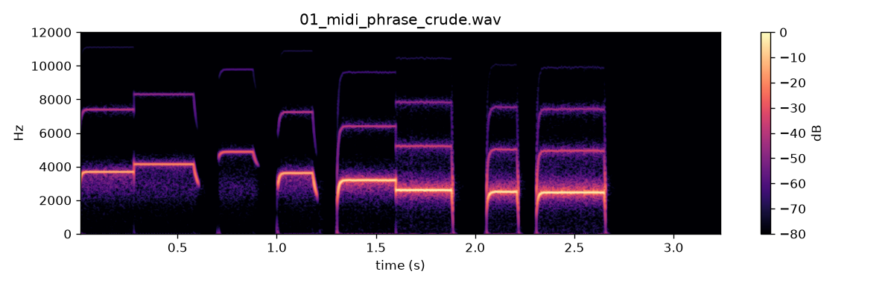
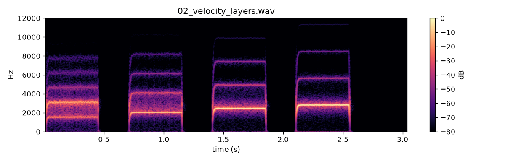
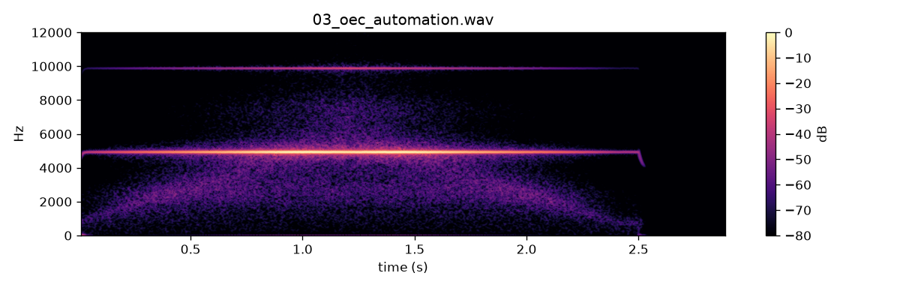
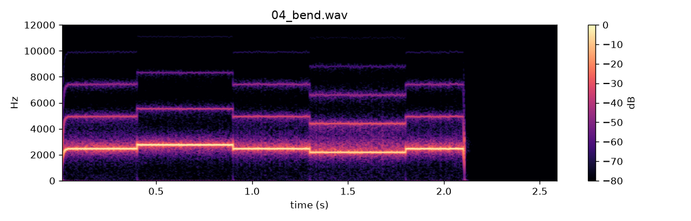
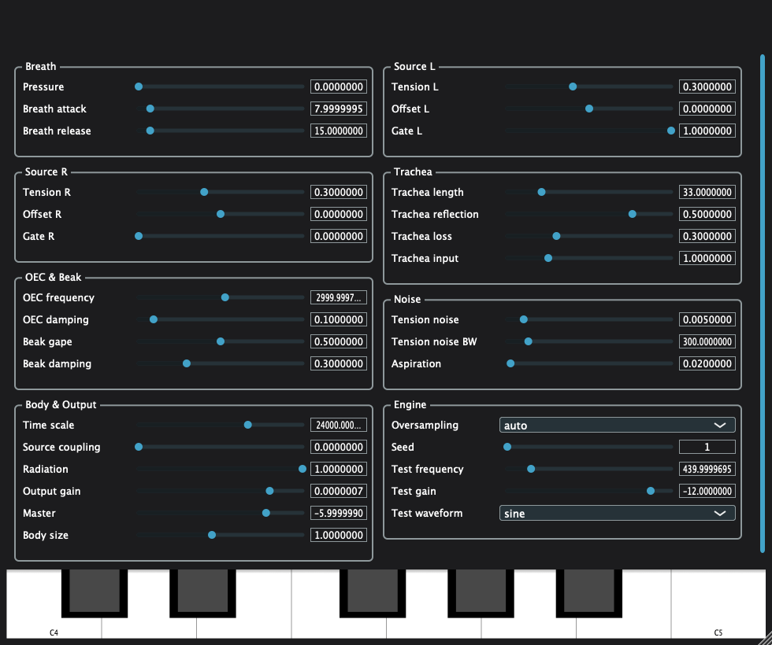

# WP-C1 report — Plugin shell (VST3 / AU / CLAP / Standalone) + offline plugin renderer

| Field | Value |
|---|---|
| WP | WP-C1 |
| Status | done |
| Started | 2026-09-17 |
| Finished | 2026-09-17 |
| Agent | Cursor Grok 4.6 |
| Sessions | 2 (implementation; finish tests/validation/listening/report) |

## 1. Summary (plain language, 3–6 lines)

Syrinx is now a real instrument plugin: VST3, AU, CLAP and a Standalone app. You can play it from a MIDI keyboard **or by clicking the piano at the bottom of the window** (C4–C5). Notes start and stop like breath, not a synth gate. Neighbouring keys and an octave now move pitch the way they should (C≠D, C4→C5 ≈ 2×), but this is still a **bird-range** map (C4 is about 2.5 kHz, not piano C4) — C3 will put it in concert tune. Every physiology knob is a host parameter, projects save and reload, and a safety clipper keeps the output from clipping. `plugin_render` renders the same engine from the command line for later listening WPs.

## 2. What was built

| File / module | Purpose |
|---|---|
| `cmake/Dependencies.cmake` | JUCE 8.0.15 + clap-juce-extensions `55525c9` |
| `plugin/CMakeLists.txt` | `juce_add_plugin(Syrinx)` AU/VST3/Standalone + CLAP; `plugin_render`; `syrinx_plugin_tests` |
| `plugin/Source/PluginProcessor.h/.cpp` | MIDI (last-note, empirical f0(β) invert), sub-blocks ≤32, master gain, limiter, state XML |
| `plugin/Source/ParameterLayout.h/.cpp` | APVTS from `params.def` (`versionHint` A=1…G=7) |
| `plugin/Source/PluginEditor.h/.cpp` | Temporary grouped sliders + 30 Hz telemetry + on-screen MIDI keyboard (C4–C5) |
| `plugin/Source/SafetyLimiter.h` | Unity below −1 dBFS; tanh knee; never above 0 dBFS |
| `apps/plugin_render/main.cpp` | Offline MIDI/notes/automation renderer; `--screenshot` for the editor PNG |
| `plugin/tests/test_processor.cpp` + `plugin/tests/main.cpp` | 10 Catch2 cases; `_Exit` after tests (see §7) |
| `scripts/get_pluginval.sh`, `scripts/validate_plugin.sh` | pluginval 1.0.4 + auval; restart AudioComponentRegistrar after copy |
| `scripts/render_listening_c1.py` | Listening WAVs + manifest |
| `core/include/cuicui/params.def` | `out.master_db` |
| `core/include/cuicui/params.hpp` | `versionHintFromSinceWP`, oversampling choice helpers |
| `CMakeLists.txt` | `LANGUAGES C CXX`, `CUICUI_BUILD_PLUGIN`, OBJC on Apple |

## 3. How to run it

```bash
export PATH="$PWD/tools/uv:$PATH"
scripts/build.sh release
scripts/test.sh
scripts/check.sh
scripts/validate_plugin.sh 5   # copies to ~/Library/Audio/Plug-Ins/{VST3,Components}
python/.venv/bin/python scripts/render_listening_c1.py
scripts/listen.sh C1
open "listening/C1/index.html"

# Standalone
open build/release/plugin/Syrinx_artefacts/Release/Standalone/Syrinx.app

# Offline phrase
./build/release/bin/plugin_render --notes "72:0.0:0.4:100" --sr 48000 --block 256 --tail 0.3 --seed 1 -o /tmp/syrinx.wav
```

AU type/codes: `aumu` / `Syrx` / `Cuic`. CLAP ID: `com.cuicuiinstruments.syrinx`.

## 4. Acceptance criteria

| # | Criterion (from the WP) | Result | Evidence (numbers, test name, file) |
|---|---|---|---|
| 1 | `scripts/build.sh release` builds VST3, AU, Standalone (and CLAP) | PASS | Artefacts under `build/release/plugin/Syrinx_artefacts/Release/` (`Syrinx.vst3`, `Syrinx.component`, `Syrinx.app`, `Syrinx.clap`). `scripts/check.sh` BUILD OK. |
| 2 | pluginval strictness 5 + auval | PASS | pluginval 1.0.4 VST3 `SUCCESS` (build tree). pluginval AU `SUCCESS` after install to `~/Library/Audio/Plug-Ins/Components/Syrinx.component`. `auval -v aumu Syrx Cuic` → **AU VALIDATION SUCCEEDED** (needs `killall AudioComponentRegistrar` after copy — now in `validate_plugin.sh`). No `clap-info` on PATH. |
| 3 | note-on/off + latency | PASS | `note-on produces sound, note-off dies, latency matches BirdVoice` |
| 4 | state round trip | PASS | `state round trip of 10 random parameters` |
| 5 | zero allocations in processBlock | PASS | `zero allocations in processBlock over 10 s of MIDI and param changes` (reused `MidiBuffer`) |
| 6 | limiter never exceeds 0 dBFS; transparent below −1 dBFS | PASS | `SafetyLimiter is bit-transparent below -1 dBFS and never exceeds 0 dBFS`; `limiter fuzz: output never exceeds 0 dBFS` |
| 7 | plugin_render deterministic + matches bird_render | PASS | `plugin_render is deterministic`; `processor matches BirdVoice render_offline within -60 dB (no MIDI)` |
| 8 | block-size robustness 32/256/1024 | PASS | `block-size robustness 32/256/1024` (< −60 dB) |
| 9 | CPU ≤ 1.5× B6 | PASS | Plugin 2.70 % of one core vs in-process BirdVoice 4.15 % (budget 6.23 %). `bird_bench` same machine: 1 voice @48 kHz **2.72 %** (B6). Ratio ≈ 1.0×. |
| 10 | `scripts/check.sh` passes | PASS | See §5. 97 C++ tests (96 core + `syrinx_plugin_tests`, 10 plugin cases) + 27 pytest. |

## 5. Quality gate

```
100% tests passed, 0 tests failed out of 97
27 passed in 3.27s
TEST OK
warning: clang-format not installed; skipping format check (brew install clang-format)
CHECK PASSED
```

## 6. Listening & results

- Page: `listening/C1/index.html` (opened)
- Items and what to listen for:

| File | What to listen for | Key metrics |
|---|---|---|
| `01_midi_phrase_crude.wav` | Eight notes, legato then detached. Onsets/releases are breath-like. Pitch should step: C≠D, C4 to C5 about an octave (still bird-range, not piano). | peak −3 dBFS, 3.25 s |
| `02_velocity_layers.wav` | Same key at 55 / 75 / 100 / 127. Later hits louder and brighter. (Vel 30 was a noisy printer-like onset — raised the floor.) | peak −3 dBFS, 3.05 s |
| `03_oec_automation.wav` | Held note, mouth-cavity frequency 800→6000→800 Hz. Colour should drift, not zipper. | peak −3 dBFS, 2.90 s |
| `04_bend.wav` | C4 (MIDI 60): bend up 2 st, centre, down 2 st, centre. Smooth, clearly audible glide. | peak −3 dBFS, 2.60 s |

Key figures (copied to `agent documents/reports/assets/C1/`):











Editor PNG is a JUCE off-screen paint of the generic UI (`plugin_render --screenshot`), not a live DAW screenshot.

## 7. Deviations from the spec

| Spec said | What I did | Why |
|---|---|---|
| clap-juce-extensions “pinned (latest that compiles)” | Commit `55525c9`, not tag `0.26.0` | 0.26.0 does not compile against JUCE 8.0.15 (missing VST2/LegacyAudioParameter). D-016. |
| CPU ≤ 1.5× B6 single-voice number | Test compares to in-process `BirdVoice` in the same binary (1.5×), and also checked `bird_bench` 2.72 % | Plugin ~2.70 % ≈ B6; sandbox/load made a naive `bird_bench` spawn misleading. |
| catch2 per-case ctest | One `add_test(syrinx_plugin_tests)` + custom `main` that `_Exit`s | Catch2+JUCE+`alloc_counter.hpp` SIGABRT in `DeletedAtShutdown::deleteAll` after “All tests passed”. |
| Screenshot of Standalone | Off-screen editor paint | Capturing a live window needs Accessibility / screen permission. |
| Crude Hopf $\beta=(2\pi f/\gamma)^2$ | Empirical $f_0(\beta)$ invert at playing α; C4–C5 ≈ 2× | Hopf on piano Hz sat near β=0.02 (C≈D). User: octave too small, C then D identical on the in-app keyboard. |
| `04_bend` note unspecified | MIDI 60 (was 96 while Hopf was in use) | Equal-tempered crude map: ±2 st at C4 is audible. |
| `plugin_render` flags | Extra `--screenshot` | Needed for the report figure. |
| 02 velocities 30/60/90/127 | 55/75/100/127 | Vel 30 sat in a noisy onset (printer-like). Same idea, quieter-to-louder, without that regime. |

## 8. Contract changes (see decisions.md)

- D-016 (accepted): pin JUCE `8.0.15` + clap-juce-extensions `55525c9`. Additive `out.master_db` (already in `02_architecture.md` §7.2).

## 9. Measurements & baselines

| Metric | Value | Conditions |
|---|---|---|
| Plugin CPU @48 kHz / 256 | 2.70 % of one core | Release, Apple Silicon, MIDI note held, OS default |
| BirdVoice in-process (same test) | 4.15 % | `maxBlockSize=256`, OS 0 (auto) |
| `bird_bench` 1 voice @48 kHz | 2.72 % | same as B6 |
| pluginval | VST3 + AU strictness 5 SUCCESS | skip-gui-tests, in-process |
| auval | SUCCEEDED | `aumu Syrx Cuic` after registrar restart |
| Crude MIDI C→D / octave | 1.12× / 2.00× | vel 100, ZC f0 of processor output |

## 10. Known issues & limitations

- Playing is **not concert-pitch**. C4 ≈ 2.47 kHz (bird range). C3 atlas replaces the table.
- Velocity still shifts pitch (α changes the $f_0(\beta)$ curve). Same key, different vel ≠ same f0.
- auval warning: `engine.seed` maximum does not retain (int32). Still PASS.
- pluginval AU warning: current program −1.
- JUCE compile warning: `JUCE_DISPLAY_SPLASH_SCREEN` ignored on this JUCE.
- CLAP not validated (`clap-info` missing).
- Temporary editor: JUCE sliders + on-screen MIDI keyboard (C4–C5, one model octave). No custom graphics yet (C6).
- UI keyboard notes take JUCE `MidiKeyboardState`’s short lock when merging into the MIDI buffer; the voice DSP stays lock-free.
- Processor tests skip JUCE static shutdown (`_Exit`).
- Newly copied AU is invisible to auval until `AudioComponentRegistrar` is killed.

## 11. Tools / dependencies added

- JUCE 8.0.15 (FetchContent, not committed)
- clap-juce-extensions commit `55525c9858d4b25687be7759a5e0f70eccef218e` (FetchContent)
- pluginval v1.0.4 into `tools/pluginval/` (gitignored)

## 12. Handoff notes for the next agent

- Next eligible: **C2** (atlas; depends only on B6, can run in parallel historically) or **C3** after C1 is approved **and** C2 is done.
- Plugin binaries: `build/release/plugin/Syrinx_artefacts/Release/{VST3,AU,CLAP,Standalone}/`.
- Installed copies (this machine): `~/Library/Audio/Plug-Ins/VST3/Syrinx.vst3` and `~/Library/Audio/Plug-Ins/Components/Syrinx.component`.
- Do **not** use `catch_discover_tests` on `syrinx_plugin_tests`.
- `clap-juce-extensions` tag 0.26.0 is broken with JUCE 8; keep `55525c9`.
- C3: replace the C1 $f_0(\beta)$ table with the atlas inverse; velocity still bends pitch via α.
- `plugin_render --notes "n:start:dur:vel,..."` and `--automation '{"id":[[t,v],...]}'`.
- Real-time: cache raw APVTS pointers; never construct `MidiBuffer` in `processBlock`.

## 13. Partial — remaining work (only if status is partial)

## 14. Revision history (feedback rounds)

| Date | Human feedback | Changes |
|---|---|---|
| 2026-09-17 | 02 vel 30 sounds like a printer, not a bird (detail). Add on-screen MIDI keyboard for testing without hardware. | Listening 02 now 55/75/100/127. Editor has a clickable C4–C5 keyboard (`MidiKeyboardState` merged in `processBlock`). |
| 2026-09-17 | In-app keyboard: an octave is far less than an octave; C then D often sound the same. | MIDI β inverts labial $f_0(\beta)$ at playing α. C4–C5 ≈ 2× (test: C→D 1.12×, octave 2.00×). Keyboard stays C4–C5. |

## 15. Proposed commit message

```
WP-C1: plugin shell (VST3/AU/CLAP/Standalone) + plugin_render

Wrap BirdVoice in a JUCE 8.0.15 instrument with APVTS from params.def,
crude MIDI (empirical f0(β) invert), SafetyLimiter, and offline plugin_render.
Report: agent documents/reports/WP-C1_report.md
```
