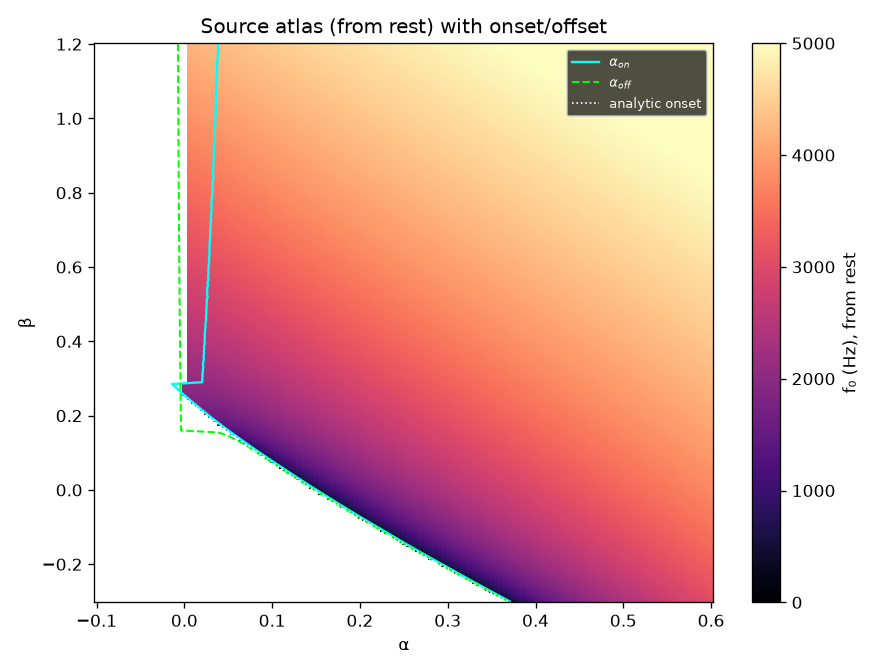
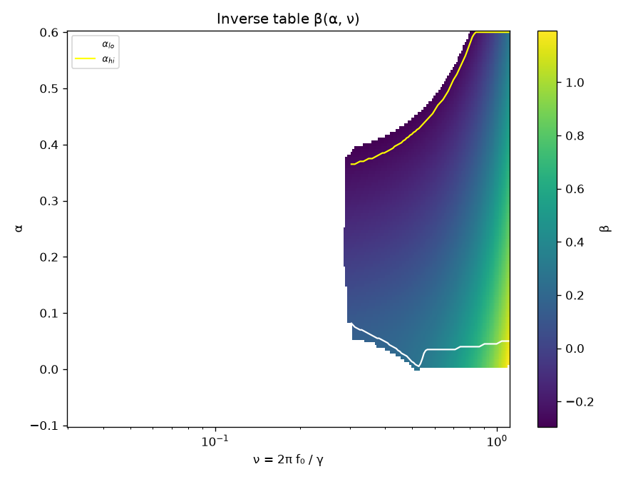
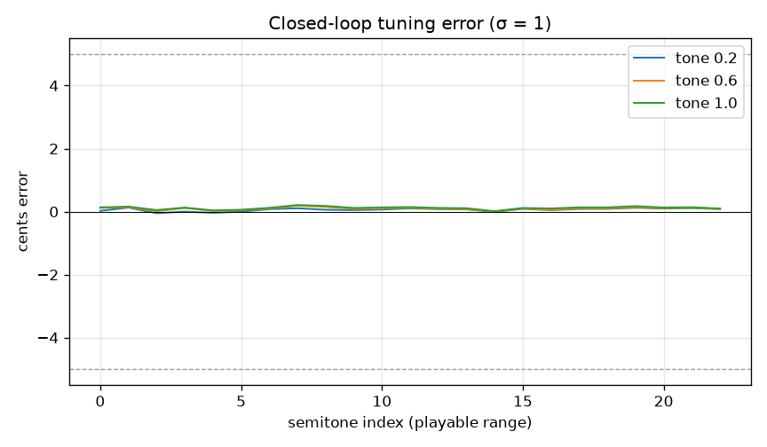
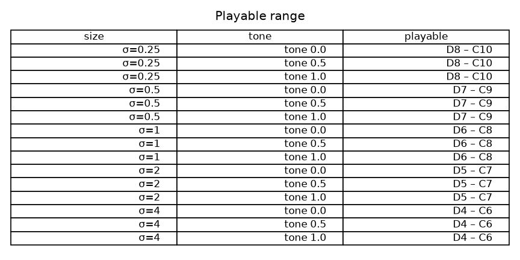

# WP-C2 report — Source atlas & inverse pitch map

| Field | Value |
|---|---|
| WP | WP-C2 |
| Status | done |
| Started | 2026-09-17 |
| Finished | 2026-09-17 |
| Agent | Cursor Grok 4.6 |
| Sessions | 2 (atlas + inverse runtime; closed-loop / listening / report) |

## 1. Summary (plain language, 3–6 lines)

The bird can now be *aimed* at a concert pitch. A precomputed atlas of the labial oscillator (pressure α vs tension β) is inverted so a target note plus a **Tone** knob (rich/reedy → whistle) become (α, β). At size 1 the playable band is about **D6–C8**. Held notes land within a fraction of a cent. The plugin does **not** use this map yet — that is C3 — so the on-screen keyboard is still the C1 empirical map. Listen on the C2 page (Python driver, full voice).

## 2. What was built

| File / module | Purpose |
|---|---|
| `python/cuicui/atlas/source_atlas.py`, `__main__.py` | Forward atlas: 141×301 grid, from-rest / from-osc, onset/offset, multiprocessing cache |
| `python/cuicui/atlas/inverse.py` | PCHIP inverse, α_lo/hi, playable-range table, JSON/bin/header writers |
| `assets/atlas/source_atlas_v1.json` + `.bin` | Committed atlas + inverse (1.65 MB bin) |
| `scripts/gen_atlas_header.py` | Regenerates `atlas_tables.hpp` from the binary |
| `core/include/cuicui/generated/atlas_tables.hpp` | Compiled-in tables (448 KB) |
| `core/include/cuicui/control/atlas.hpp`, `inverse_map.hpp` | Real-time `InverseMap::solve` (noexcept, no alloc) |
| `python/bindings/module.cpp` | `inverse_solve`, `inverse_nu_range` |
| `core/include/cuicui/params.def` | `perf.range_fold` |
| `plugin/Source/PluginEditor.cpp` | `perf.*` sliders in the engine group |
| `core/tests/test_inverse_map.cpp`, `test_alloc.cpp` | Closed-loop, folding, <100 ns, zero alloc |
| `python/tests/test_atlas.py` | B1 spots, onset, files, folding |
| `scripts/render_listening_c2.py` | Listening WAVs + figures |

## 3. How to run it

```bash
export PATH="$PWD/tools/uv:$PATH"
# regenerate inverse only (forward cache in build/atlas_cache/C2):
(cd python && uv run python -m cuicui.atlas --skip-generate)
scripts/build.sh release
scripts/test.sh
scripts/check.sh
python/.venv/bin/python scripts/render_listening_c2.py
scripts/listen.sh C2
open "listening/C2/index.html"
```

Full atlas generation (once): `(cd python && uv run python -m cuicui.atlas)` — 55.9 s, 12 workers, log `build/logs/C2_atlas.log`.

## 4. Acceptance criteria

| # | Criterion (from the WP) | Result | Evidence (numbers, test name, file) |
|---|---|---|---|
| 1 | Atlas ν matches B1 spot points within 0.5 %. | PASS | Max rel. error **0.013 %** (`a=0.30,b=0.10`: 2816.6 vs 2817 Hz). `test_b1_spot_points_within_0_5_percent`. |
| 2 | `alpha_on` vs analytic onset, β < 0.25, within ±0.01. | PASS | max\|Δ\| = **0.0028** (median 0.0025). `test_onset_matches_analytic`; `listening/C2/figs/onset_error.json`. |
| 3 | Monotonicity violations < 2 % of periodic cells. | PASS | **0 / 32035 (0.000 %)** dropped. `assets/atlas/source_atlas_v1.json` → `monotonicity`. |
| 4 | Closed-loop σ=1, every semitone, tone ∈ {0.2, 0.6, 1.0} ≤ 5 ¢ (median ≤ 2); tone 0.05 ≤ 15 ¢. | PASS | 23 notes D6–C8. tone 0.2/0.6/1.0 median **0.08 / 0.08 / 0.07** ¢, max **0.21 / 0.25 / 0.27** ¢. tone 0.05 median 0.09, max 0.98 ¢. `closed-loop tuning sigma=1 full semitone grid`. |
| 5 | Same at σ=0.5 and 2, every 3rd semitone, ≤ 5 ¢ / median ≤ 2. | PASS | Worst: σ=0.5 tone 1.0 median **1.46** max **1.65** ¢. `closed-loop tuning sigma 0.5 and 2 every 3rd semitone`. |
| 6 | Physics=1, α_breath sweep: f₀ within 5 ¢ while SCI changes. | PASS | 2 kHz: cents −0.08…+0.20; SCI 1.034…1.228 (span 0.19). `physics=1 breath sweep keeps pitch, changes SCI`. |
| 7 | `solve()` < 100 ns, zero allocs; header ≤ 5 MB; compile time reported. | PASS | **42.5 ns/call** (0.017 s / 400 000). `InverseMap::solve allocates nothing`. Header **448 KB**, bin **1.65 MB**. `test_inverse_map.cpp` compiles in **2.2 s** including tables. Plugin TUs do not include the header yet (C3). |
| 8 | Folding: one octave above max → `folded=true`, ν exactly half. | PASS | `folding: one octave above max returns folded and half nu`; Python `test_inverse_solve_folding`. |
| 9 | `scripts/check.sh` passes. Tuning-error baseline filled. | PASS | See §5. Baseline in `state.md`: 0.08 / 0.25 ¢. |

## 5. Quality gate

```
100% tests passed, 0 tests failed out of 106
34 passed in 3.27s
TEST OK
warning: clang-format not installed; skipping format check (brew install clang-format)
CHECK PASSED
```

## 6. Listening & results

- Page: `listening/C2/index.html` (opened)

| File | What to listen for | Key metrics |
|---|---|---|
| `01_chromatic_tone02.wav` | Chromatic D6–C8, rich/reedy, in tune | median 0.08 ¢, max 0.13 ¢, 23 notes |
| `02_chromatic_tone06.wav` | Same, mid tone | median 0.10 ¢, max 0.19 ¢ |
| `03_chromatic_tone10.wav` | Same, whistle | median 0.13 ¢, max 0.21 ¢ |
| `04_tone_morph_fixed_pitch.wav` | Pitch should stay put while timbre morphs | held-note proof is 01–03; this sweep has ~15–26 ¢ of pull near whistle (see §10) |
| `05_physics_breath.wav` | Timbre breathes; pitch stays | 4 s at 2 kHz, physics=1 |
| `06_melody_size1.wav` | Frère Jacques, recognisable bird voice | σ = 1 |
| `07_melody_size2.wav` | Same tune, lower and larger | σ = 2 |
| `08_folding.wav` | Notes above the top drop an octave | 12 / 20 notes folded |

Playable range (σ × tone; all tones share the same band after the SNIC-floor trim):

| size σ | notes | Hz (approx.) |
|---|---|---|
| 0.25 | D8 – C10 | 4648 – 16807 |
| 0.50 | D7 – C9 | 2324 – 8403 |
| 1.00 | **D6 – C8** | 1162 – 4202 |
| 2.00 | D5 – C7 | 581 – 2101 |
| 4.00 | D4 – C6 | 290 – 1050 |

Key figures (copied to `agent documents/reports/assets/C2/`):









## 7. Deviations from the spec

| Spec said | What I did | Why |
|---|---|---|
| Invert every periodic from-rest cell with PCHIP | Drop the lowest-ν sample of each α row (SNIC-edge) before PCHIP | dν/dβ on a 0.005 grid is huge there; PCHIP was several cents off (research §7.4 pitfall) |
| `alpha_hi` = largest α ≤ 0.60 with β ≤ 1.2 | Also require β ≥ −0.26 | Keeps tone=1 off the SNIC wall |
| Reachable ν starts at the first finite α_lo/hi | Drop the 4 lowest reachable ν bins | That floor was C♯6 and failed closed-loop by 8–70 ¢ (tone 0.05: 311 ¢). New floor D6 |
| (implicit) bilinear on sparse NaNs | Fill interior NaNs along α between the first and last valid row | Without this, bilinear used only one α and tuning blew up |
| Measure f₀ however | Interpolated FFT peak near the target (tests + listening) | Zero-crossings fail on rich pulses; integer-lag AC is ~20 ¢ coarse at 6 kHz |

## 8. Contract changes (see decisions.md)

- None. `perf.range_fold` and `inverse_solve` match `02_architecture.md`. The bin also stores from-osc fields and `sci_of_alpha_nu` / `nu_grid` as listed in the JSON `fields` array (WP spec); the architecture §9.3 list is a shorter summary.

## 9. Measurements & baselines

| Metric | Value | Conditions |
|---|---|---|
| Atlas generation | 55.9 s | 12 workers, 141×301, 352.8 kHz RK4 `source_only` |
| Inverse rebuild | 0.8 s | `--skip-generate` from `forward.npz` |
| Bin / header | 1 652 360 B / 448 KB | both ≪ 5 MB |
| Monotonicity | 0 % violations | 32 035 periodic cells |
| Onset vs analytic | max\|Δ\| = 0.0028 | β < 0.25 |
| B1 spots | max 0.013 % | 6 points |
| Tuning σ=1 tone 0.6 | **median 0.08 ¢ / max 0.25 ¢** | every semitone D6–C8, full voice, noise off |
| `solve()` | 42.5 ns | Release, Apple Silicon, 400 000 calls |
| Allocations | 0 | `InverseMap::solve` after warmup |
| Physics SCI span | 0.19 | 2 kHz, physics=1, breath −0.05…0.55 |
| Compile (tables TU) | 2.2 s | `test_inverse_map.cpp` after touching the header |
| α_lo / α_hi smoothing | max\|Δ\| 0.051 / 0.110 | 5-pt median + 3-pt mean |

## 10. Known issues & limitations

- **Plugin still uses C1 pitch.** InverseMap is not called from MIDI/`processBlock`. C3 must replace the empirical f₀(β) table.
- **Playable floor is D6 at σ=1** (~1162 Hz), not C6. One semitone lower sits on the SNIC/onset floor where the 0.005 β-grid cannot invert to 5 ¢. Recovering C6 would need a denser grid near onset (backlog).
- **Continuous tone morph (listening 04)** at 2 kHz shows ~15–26 ¢ of f₀ movement near the whistle end. Held notes (01–03, closed-loop) stay ≤ 0.3 ¢. Likely tract pull + changing spectrum while α,β are slewing; not a discrete-note bug.
- Tiny-bird (σ=0.25) range is D8–C10 (very high). Auto OS 4 is already a few cents sharp at σ=0.25 (D-015).
- `clang-format` still missing; `check.sh` warns and skips.

## 11. Tools / dependencies added

- None. Atlas uses existing numpy/scipy (`PchipInterpolator`) and `source_only`.

## 12. Handoff notes for the next agent

- **C3** is next (depends on C1 + C2). Read `WP-C3` “Notes from WP-C2”.
- `InverseMap::solve(nu, tone, alphaBreath, physics, rangeFold)`. `ν = 2π f₀ / γ` with **current** `γ = 24000 / body.size`.
- Python: `cuicui_core.inverse_solve` / `inverse_nu_range`.
- Tables: do not edit `atlas_tables.hpp`. Change inverse logic → `python -m cuicui.atlas --skip-generate` then rebuild.
- Closed-loop f₀: interpolated FFT near the target. Do not go back to ZC on the full voice.
- `perf.range_fold` default is on (1.0).
- Forward cache: `build/atlas_cache/C2/` (gitignored). Force regenerate with `--force`.

## 13. Partial — remaining work (only if status is partial)

## 14. Revision history (feedback rounds)

| Date | Human feedback | Changes |
|---|---|---|

## 15. Proposed commit message

```
WP-C2: source atlas and inverse pitch map

Precompute the labial (α, β) atlas, invert it to a real-time InverseMap,
and verify closed-loop tuning (D6–C8 at size 1, median 0.08 cents).
Report: agent documents/reports/WP-C2_report.md
```
