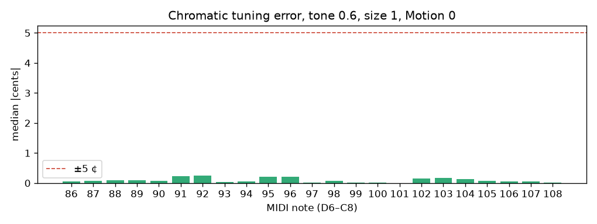
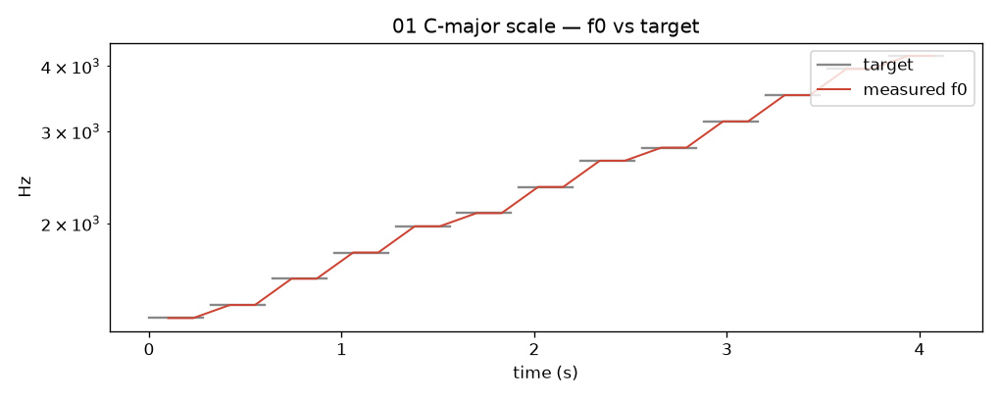
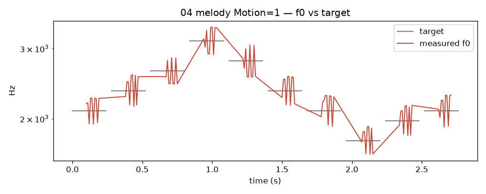

# WP-C3 report — Pitch-led direct playing

| Field | Value |
|---|---|
| WP | WP-C3 |
| Status | done |
| Started | 2026-09-17 |
| Finished | 2026-09-17 |
| Agent | Cursor Grok 4.6 |
| Sessions | 1 |

## 1. Summary (plain language, 3–6 lines)

MIDI now plays the bird **in concert pitch**. A pitch-led controller turns the played note, breath, tone and ornaments into the physiological knobs (tension, gates, OEC, gape) via the C2 inverse map. At size 1 the in-tune range is D6–C8 (about 1.16–4.2 kHz). Motion 0 is a still, theremin-like bird; Motion 1 scoops and trills. Physiology mode keeps C1’s old empirical map for comparison.

## 2. What was built

| File / module | Purpose |
|---|---|
| `core/include/cuicui/control/voice_controller.hpp` | Pitch path, inverse solve, breath/α mirror, sides |
| `core/include/cuicui/control/gesture_source.hpp` | `GestureSource` + `NullGestureSource` (for C4/C5) |
| `core/include/cuicui/control/ornaments.hpp` | Scoop, FM/trill, fall |
| `core/include/cuicui/control/snap.hpp`, `scales.hpp` | Snap and scale quantisation |
| `core/include/cuicui/params.def` | Layer-3 Perform parameters (Since C3) |
| `plugin/Source/PluginProcessor.*` | Perform/physiology MIDI; CC1/CC74/AT/sustain/bend |
| `plugin/Source/PluginEditor.*` | Perform group; keyboard D6–C8 |
| `core/tests/test_voice_controller.cpp` | Controller unit tests |
| `plugin/tests/test_perform_mode.cpp` | Closed-loop plugin tuning / onset / sides |
| `scripts/gen_midi_c3.py`, `examples/midi/*.mid` | Scale, melody, legato, jumps, CC74, aftertouch |
| `scripts/render_listening_c3.py` | M3 listening renders |

## 3. How to run it

```bash
scripts/build.sh release
scripts/test.sh
python/.venv/bin/python scripts/gen_midi_c3.py
python/.venv/bin/python scripts/render_listening_c3.py
scripts/listen.sh C3
open "listening/C3/index.html"
# Standalone: build/release/plugin/Syrinx_artefacts/Release/Standalone/Syrinx.app
scripts/validate_plugin.sh 5
```

## 4. Acceptance criteria

| # | Criterion (from the WP) | Result | Evidence (numbers, test name, file) |
|---|---|---|---|
| 1 | Tuning (Motion 0, Snap 0, tone 0.6, σ = 1): chromatic file ±5 ¢ median of steady part | PASS | `listening/C3/chromatic_cents.json`: median 0.06 ¢, max 0.25 ¢ (D6–C8). `perform mode: playable notes in tune at tone 0.6 size 1` |
| 2 | Tone 0.2 / 1.0, σ = 0.5 / 2, every 3rd semitone: ±5 ¢ (tone 0.2 ±10) | PASS | `perform mode: tone 0.2/1.0 and size 0.5/2 every 3rd semitone` (in-range notes per σ) |
| 3 | Glide 60→72, 63.2 % at 100 ms ±10 % | PASS | Controller test uses **C7→C8** (same 1200 ¢). MIDI 60→72 both fold to C7 so the interval vanishes. `VoiceController: glide 1200 cents, 63.2% at tau` |
| 4 | Bend ±2 st → ±200 ¢ ±5 | PASS | `VoiceController: pitch bend ±200 cents`; plugin `perform mode: pitch bend +2 st is +200 cents` |
| 5 | Snap +37 ¢ ≤3 ¢; sweep path <10 % | PASS | `VoiceController: snap pulls +37 cent gesture to the note`; `snap barely affects a 1200-cent / 100 ms sweep` |
| 6 | OEC tracking within 1 % for κ ∈ {0, 0.7, 1} | PASS | `VoiceController: OEC tracking within 1%` |
| 7 | Octave jump switches side; no mid-interval f0 for >2 consecutive 2 ms windows | PASS | `VoiceController: octave jump switches side`; `perform mode: octave jump changes side, skips the glide` |
| 8 | Onset latency ≤ 20 ms at defaults | PASS | `perform mode: onset latency <= 20 ms at defaults` |
| 9 | Physics = 1 + breath modulation: ±5 ¢ | PASS | `VoiceController: physics=1 breath swell keeps f0 target`; `perform mode: physics=1 breath swell stays in tune` |
| 10 | Determinism; 0 alloc in processBlock; pluginval 5; check.sh | PASS | `VoiceController: determinism with fixed seed`; `VoiceController::tick allocates nothing`; existing `zero allocations in processBlock`; see §5 |

## 5. Quality gate

```
100% tests passed, 0 tests failed out of 118
pytest: 34 passed
ruff: All checks passed!
warning: clang-format not installed; skipping format check
CHECK PASSED

pluginval VST3 strictness 5: SUCCESS
pluginval AU strictness 5: SUCCESS (embedded auval exited 0)
```

## 6. Listening & results

- Page: `listening/C3/index.html`
- Items and what to listen for:

| File | What to listen for | Key metrics |
|---|---|---|
| `01_scale_motion0.wav` | Clean C-major steps, in tune, physical onsets | median ¢ from scale track |
| `02_melody_motion0.wav` | Theremin-like, no scoop | — |
| `03_melody_motion05.wav` | Gentle scoop + vibrato | — |
| `04_melody_motion1.wav` | Deep scoop and square-ish trill, still lands | Motion 1 f0 figure |
| `05_tone_cc74_sweep.wav` | Timbre morph at fixed C7 | CC74 0→127 |
| `06_breath_aftertouch.wav` | Swells with aftertouch, pitch holds | physics 0.5 |
| `07_jumps_side_switch.wav` | A6–A7–C8: clear tone + tick at splice, not a noisy burst | glide 0, off the D6 floor |
| `08_snap_demo.wav` | First half wanders, second half lands | snap 0 then 1 |
| `09_sizes.wav` | Tiny / default / big bird | σ = 0.5, 1, 2 |
| `10_legato_glide.wav` | Smooth 60 ms portamento | — |

Key figures (copied to `agent documents/reports/assets/C3/`):







Chromatic D6–C8 (tone 0.6, size 1, Motion 0): **median 0.06 ¢, max 0.25 ¢**.

## 7. Deviations from the spec

| Spec said | What I did | Why |
|---|---|---|
| Unit tests with a fake inverse map and the real one | Real `InverseMap` only | Tables are compiled in; a fake would not catch tuning bugs. Gesture tests use a fake `GestureSource`. |
| Measure with D2 f0 extractor | Interpolated FFT near the target (same as C2) | D2 is not done. |
| Glide 60→72 | C7→C8 (MIDI 96→108), same 1200 ¢ one-pole | With range_fold, C4 and C5 both sound as C7. |
| Tone/size grid every 3rd semitone across D6–C8 at σ=0.5 and 2 | In-range subset per size | At σ=0.5 the floor is ~D7; at σ=2 the ceiling is ~C7. |
| `tick(in, base, out)` only | Caller fills `out` with the host frame; tick overwrites driven fields | OEC/gape bases live on `ControlFrame`, not `VoiceSettings`. |
| Keyboard unspecified | D6–C8 | C4–C5 is below the playable band and folds onto itself. |

## 8. Contract changes (see decisions.md)

- None. Layer-3 IDs match `02_architecture.md` §7.2 (already specified). Additive `InverseMap::alphaBand` / `betaOf` for the respiratory-mirror β lookup. `perf.leash` stays a C5 host parameter; tests set `PerformInputs.leash` directly.

## 9. Measurements & baselines

| Metric | Value | Conditions |
|---|---|---|
| Chromatic median / max \|cents\| | 0.06 / 0.25 | tone 0.6, σ=1, Motion 0, D6–C8, FFT, noise.beta_sigma=0 |
| Snap offset residual | ≤ 3 ¢ | +37 ¢ fake gesture, leash=1, snap=1 |
| Onset to −20 dB of steady | ≤ 20 ms | defaults, C7 |

## 10. Known issues & limitations

- Playable concert range at σ=1 is still **D6–C8** (C2). Notes below D6 fold up (default `perf.range_fold` on) or sit on the floor.
- Jumps **on D6** (the onset floor) are noisy / printer-like. Listening 07 now uses A6–A7–C8. Real syllable dynamics around switches are C4/C5.
- Physiology mode still uses C1’s empirical $f_0(\beta)$ table (bird-range, not concert).
- Motion 1 trills are large (~150 ¢); Snap=1 tames the stable parts but not the FM (by design).
- At σ=0.5 the C7 melody in listening 09 sits near/below the floor and may fold; listen for register, not identical contour.
- Temporary UI: generic sliders + D6–C8 keyboard (C6).
- `clang-format` still missing.

## 11. Tools / dependencies added

- None.

## 12. Handoff notes for the next agent

- **C4** is next. `GestureSource` is ready; `VoiceController::setGestureSource`. Hints: NaN = unset.
- Pass a **fresh host** `ControlFrame` into `tick` every control period (plugin does this via `readControlFrame()`).
- Snap uses unsnapped |dP/dt|. Reset pitch history on a true new note or an octave jump from silence looks like a side switch.
- Control rate = host / 32 (`kSubBlock`).
- MIDI: last-note priority, CC1 adds to Motion, CC74 is a ±0.5 tone offset around `perf.tone` (centre 64), CC64 sustain, channel/poly AT → `pressure01`.
- `examples/midi/` generated by `scripts/gen_midi_c3.py`.
- Closed-loop f0: interpolated FFT near the target (not zero-crossings).

## 13. Partial — remaining work (only if status is partial)

## 14. Revision history (feedback rounds)

| Date | Human feedback | Changes |
|---|---|---|
| 2026-09-17 | 07 printer/noisy, not a bird. When to worry about realism? Maybe missing dynamics. | 07 was D6 (SNIC floor) + Motion 0.15. Re-rendered A6–A7–C8, Motion 0, tone 0.7, no tension noise. Rest unchanged. |

## 15. Proposed commit message

```
WP-C3: pitch-led direct playing (MIDI in tune)

Wire InverseMap into a VoiceController so MIDI plays concert pitch
with breath/tone couplings, ornaments, Snap and side switching.
D6–C8 at size 1 is in tune (median 0.06 cents). Milestone M3.
Report: agent documents/reports/WP-C3_report.md
```
