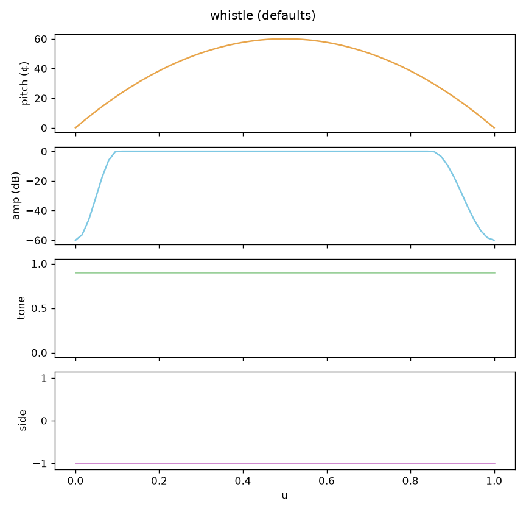
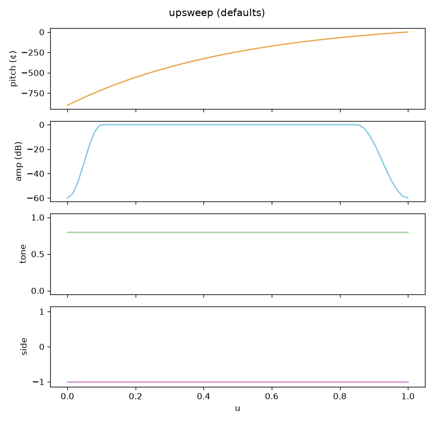
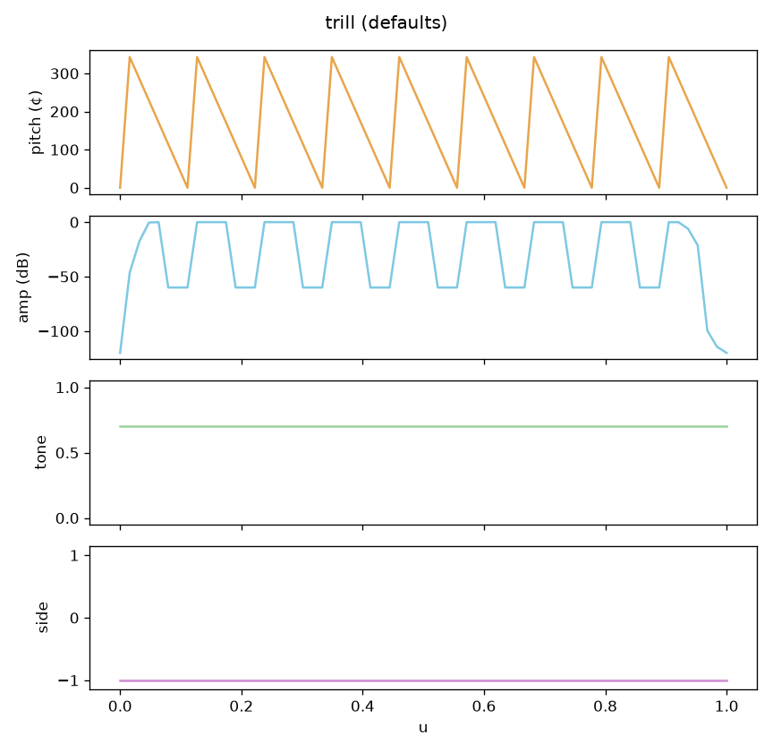
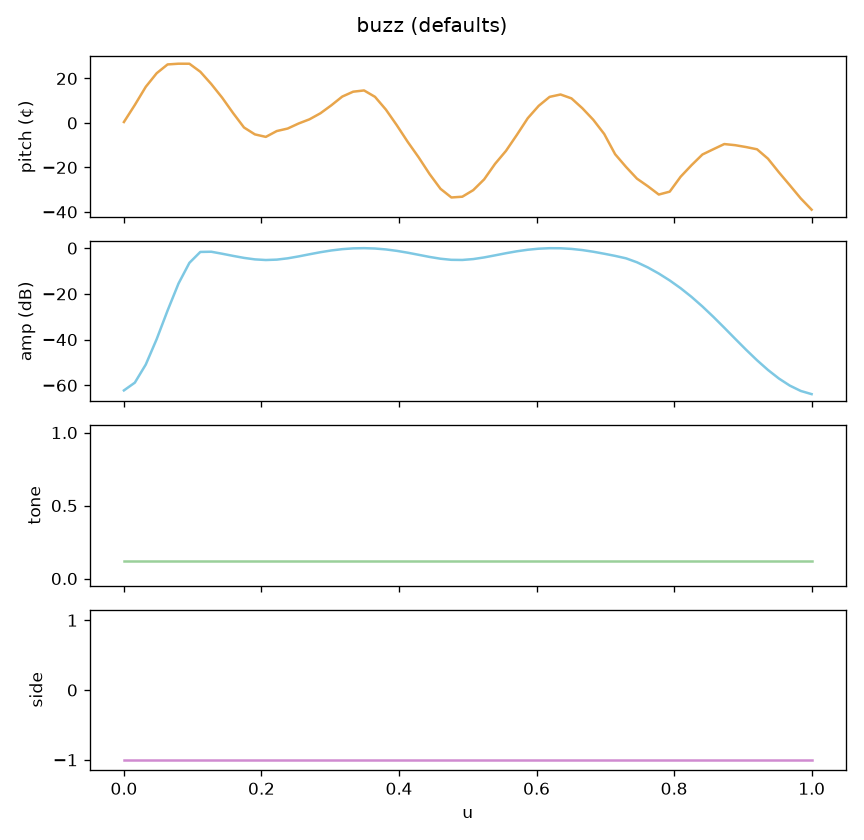
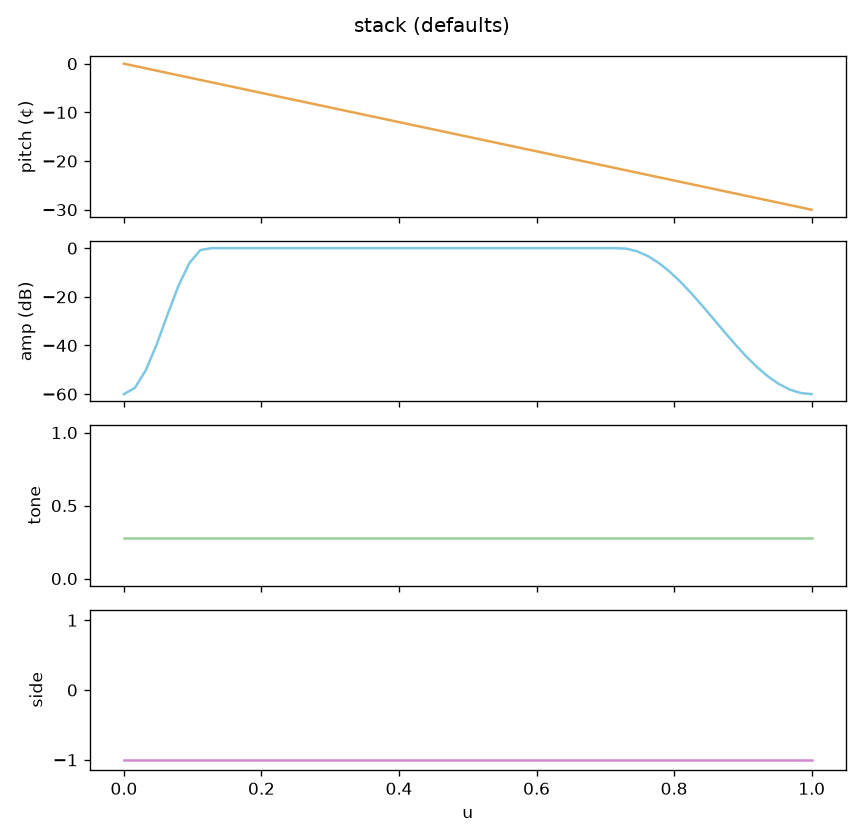
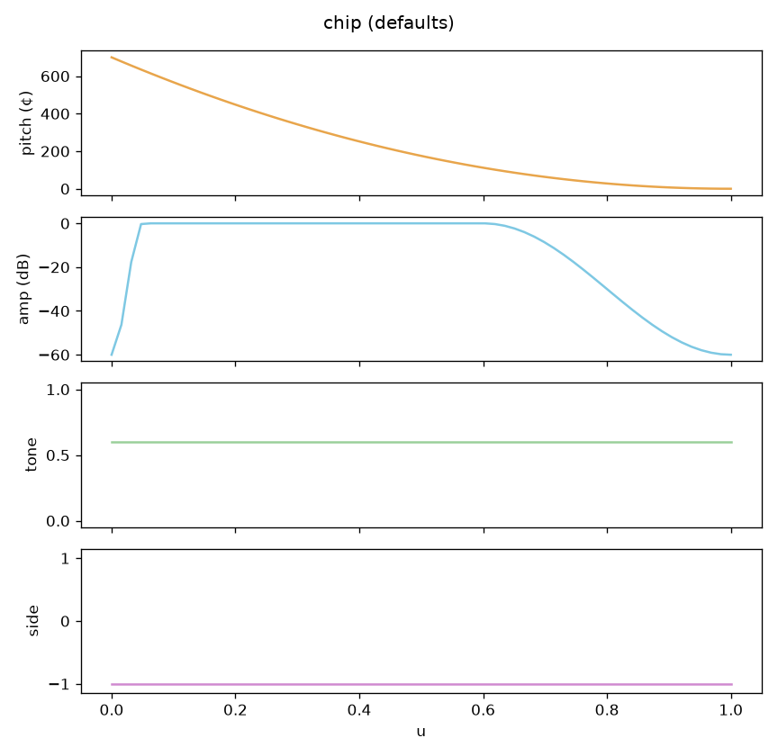
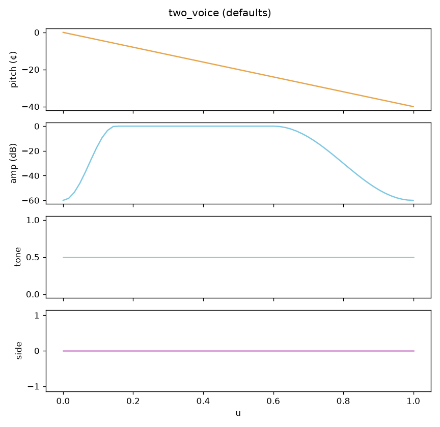
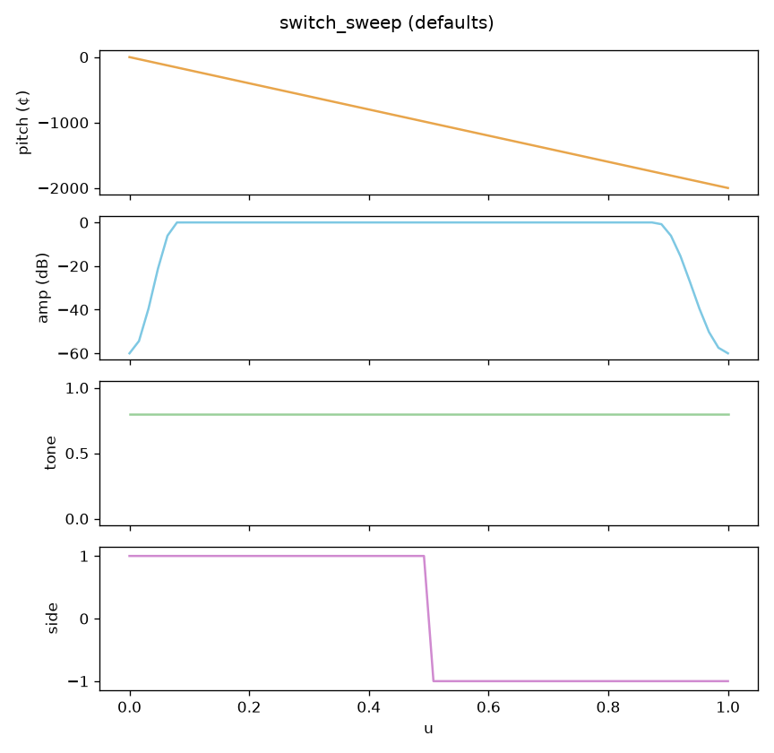
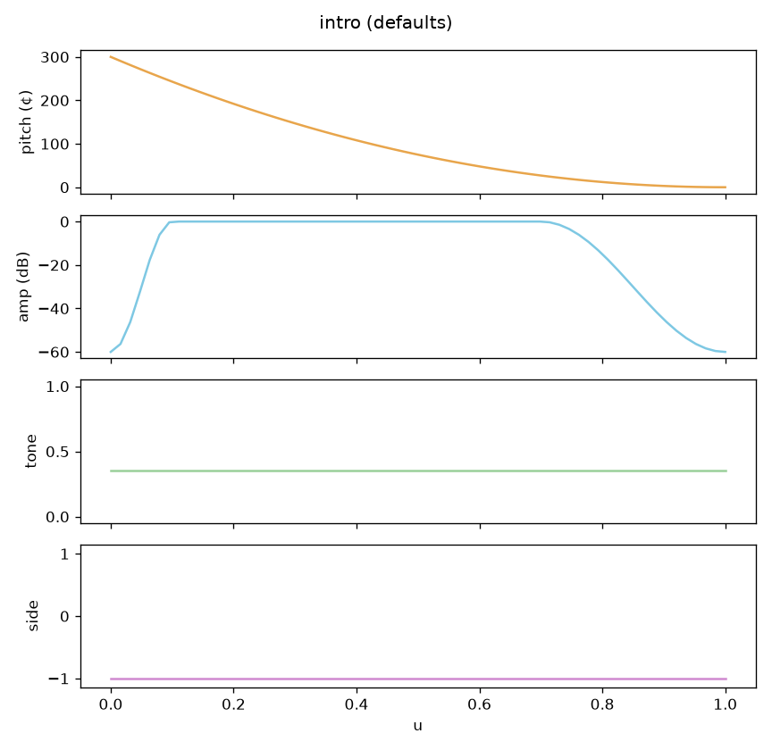

# WP-C4 report — Archetype library + gesture score format & player

| Field | Value |
|---|---|
| WP | WP-C4 |
| Status | awaiting approval |
| Started | 2026-09-18 |
| Finished | 2026-09-18 |
| Agent | Cursor Grok 4.6 |
| Sessions | 1 |

## 1. Summary (plain language, 3–6 lines)

Syrinx now has a small dictionary of **hand-designed bird sounds** (whistle, sweeps, trill, buzz, harmonic stack, chip, two-voice, side-switch, intro) and a **score file** that can play either those musical gestures or dense physiological control tracks. `bird_render file.gscore.json -o out.wav` renders them. A short phrase built only from archetypes is on the listening page. This is the vocabulary C5 will improvise with; nothing is learned from recordings yet.

## 2. What was built

| File / module | Purpose |
|---|---|
| `core/include/cuicui/control/gesture.hpp` | 64-sample curves, Fritsch–Carlson (PCHIP) eval, linear side |
| `core/include/cuicui/control/archetypes.hpp` | 11 generators, param ranges, `movementScore` |
| `core/include/cuicui/io/gesture_score.hpp` | `.gscore.json` read/write |
| `core/include/cuicui/control/score_player.hpp` | Physio + gesture player; `ScoreGestureSource` |
| `core/include/cuicui/control/voice_controller.hpp` | Uses `GestureSample.side` when set (equal-power gates) |
| `schemas/gesture_score.schema.json` | JSON schema |
| `apps/bird_render/main.cpp` | Accepts gesture scores; `--sr` |
| `python/bindings/module.cpp` | `archetype_*`, `generate_archetype`, `render_score` |
| `python/cuicui/gestures/score_tools.py` | Compose scores in Python |
| `examples/scores/*.gscore.json` | Gallery, song, B6-as-physio |
| `core/tests/test_archetypes.cpp`, `test_gesture_score.cpp` | C++ tests |
| `python/tests/test_scores.py` | Schema, f₀, two-voice |
| `scripts/gen_scores_c4.py`, `scripts/render_listening_c4.py` | Examples + listening |

## 3. How to run it

```bash
scripts/build.sh release
scripts/test.sh
python/.venv/bin/python scripts/gen_scores_c4.py
python/.venv/bin/python scripts/render_listening_c4.py
scripts/listen.sh C4
open "listening/C4/index.html"
# render a score:
build/release/bin/bird_render examples/scores/song_from_archetypes.gscore.json -o /tmp/song.wav
```

## 4. Acceptance criteria

| # | Criterion (from the WP) | Result | Evidence (numbers, test name, file) |
|---|---|---|---|
| 1 | Every archetype at defaults and 50 random sets: finite; amp peak 0 dB ± 0.01; tone/side in range; pitch jumps < 400 ¢ except trill resets | PASS | `every archetype at defaults…`; `every archetype at 50 random parameter sets within range` |
| 2 | Same params + seed → identical; buzz differs with seed | PASS | `same params + seed produce identical curves; buzz differs with seed` |
| 3 | JSON write→read→write byte-identical; jsonschema on examples; invalid scores error clearly | PASS | `gesture score JSON write-read-write is byte-identical`; `test_example_scores_validate`; `invalid scores produce clear errors` |
| 4 | Physio-track playback bit-identical to `render_controls` | PASS | `physio-track playback is bit-identical to render_controls` |
| 5 | Gesture f₀ vs target ≤ 15 ¢ (whistle, upsweep, downsweep, arch, tone ≥ 0.6); two-voice shows both pitches | PASS | C++ `gesture-event whistle f0…`; pytest `test_whistle_upsweep_downsweep_arch_tuning`; `test_two_voice_has_both_pitches` |
| 6 | Trill 22 Hz: measured element rate within ±5 % | PASS | `trill at 22 Hz: measured element rate within 5%` (9 elements / 0.4 s = 22.5 Hz, +2.3 %) |
| 7 | Zero alloc while playing; `check.sh` | PASS | `ScorePlayer::process allocates nothing after prepare`; see §5 |

## 5. Quality gate

```
100% tests passed, 0 tests failed out of 137
pytest: 41 passed
ruff: All checks passed!
warning: clang-format not installed; skipping format check
CHECK PASSED
```

## 6. Listening & results

- Page: `listening/C4/index.html`
- Items and what to listen for:

| File | What to listen for | Key metrics |
|---|---|---|
| `01_gallery_whistle.wav` … `11_gallery_intro.wav` | Default / low / high, 300 ms gaps. Is each type recognisable and bird-like? | 11 types |
| `12_song_from_archetypes.wav` | Slower phrase; stack should be a dark note not hiss; buzz a rattle not noise; two-voice a short syllable | retuned after feedback |
| `13_same_song_size2.wav` | Same, bigger bird; two-voice must not turn into an organ dyad | σ = 2 |
| `14_physio_score.wav` | B6 four-syllable demo as physio tracks | `examples/scores/zf_like_motif.gscore.json` |

Key figures (copied to `agent documents/reports/assets/C4/`):



















## 7. Deviations from the spec

| Spec said | What I did | Why |
|---|---|---|
| D2 two-voice detector flags two-voice | Simple two-peak spectral test in pytest (same idea: two non-harmonic peaks) | D2 is not done |
| Measure f₀ with D2 extractor | Interpolated FFT near the time-varying target (C3 method) | D2 is not done |
| `01_gallery_<archetype>.wav` | Numbered `01`–`11` plus the name | One file per type, stable order |
| Gesture `side` unused in C3 controller | NaN = unset; when set, equal-power gates from side | Otherwise `switch_sweep` would not hop at the crossover |
| Amp envelope only specified for some types | Default `env(0.1, 0.15)` on the others | Avoid clicks on starts/ends |
| Buzz = random walk + tone 0.05 | Tone 0.12 + 18 Hz AM/FM rattle | 0.05 sat in the tension-noise boost and read as white noise |

## 8. Contract changes (see decisions.md)

- D-017 (proposed): additive Python APIs + `bird_render` gesture scores; `GestureSample.side` NaN = unset.

## 9. Measurements & baselines

| Metric | Value | Conditions |
|---|---|---|
| Trill element rate | 22.5 Hz (+2.3 %) | defaults, 400 ms, `round(22·0.4)=9` |
| Physio vs `render_controls` | bit-identical | 200 control ticks @ 1 kHz → 48 kHz |
| ScorePlayer allocs in `process` | 0 | after `prepare`, 64-sample chip |

## 10. Known issues & limitations

- Gallery **high** variants of upsweep / switch_sweep can leave D6–C8 and fold or sit on the floor (backlog).
- Physiology-mode MIDI in the plugin is unchanged; scores are offline / test-harness for now (C5/C6 wire them into playing).
- `clang-format` still missing.
- Listening 14 is a 1 kHz sampling of the B6 automation, not a bit-copy of the original render-spec (should sound the same).
- Hand-designed archetypes still will not match a real zebra finch motif; that is D1/E/F. C4 can only get closer to “could be a bird” than “synth demo”.

## 11. Tools / dependencies added

- None (jsonschema already in the Python env).

## 12. Handoff notes for the next agent

- **C5** is next. `ScoreGestureSource` is the plug-in point (`VoiceController::setGestureSource`). Leash still defaults to 0 in the plugin; C5 sets it.
- Build scores with `cuicui.gestures.score_tools.sequence` / `generate_archetype`. `movementScore` is RMS of dP/du (cents).
- Player: physio tracks win if both sections are present (warning on stderr in `bird_render`). Gesture playback uses leash=1, Motion=0, `perf.breath` from settings (default 0.7), gate off between events.
- Anchors in examples stay in D6–C8 at σ=1 (stack at G6 ~1568 Hz, switch_sweep from C8).
- Do not include `alloc_counter.hpp` from a second test TU (definitions live in `test_alloc.cpp`).

## 13. Partial — remaining work (only if status is partial)

## 14. Revision history (feedback rounds)

| Date | Human feedback | Changes |
|---|---|---|
| 2026-09-18 | 12 not bird-like, too fast; 4th and 7th white-noise; 8th (~1.5 s) machine-like. 13: that 8th even more synthetic. Resemblance missing. | Slowed the phrase (longer notes + gaps). Stack off the D6 noise floor, tone 0.28. Buzz: 18 Hz AM/FM rattle, less hiss. Two-voice: shorter, 220 ¢, stronger envelope, less pure. Rebuilt 12/13 (and gallery 06/07/09). |

## 15. Proposed commit message

```
WP-C4: archetype library and gesture score player

Hand-designed songbird gestures (whistle, sweeps, trill, buzz, stack,
chip, two-voice, side-switch, intro), .gscore.json I/O, and a player
for physio tracks and gesture events. bird_render and Python bindings
render scores. Report: agent documents/reports/WP-C4_report.md
```
