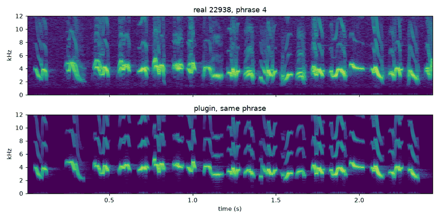
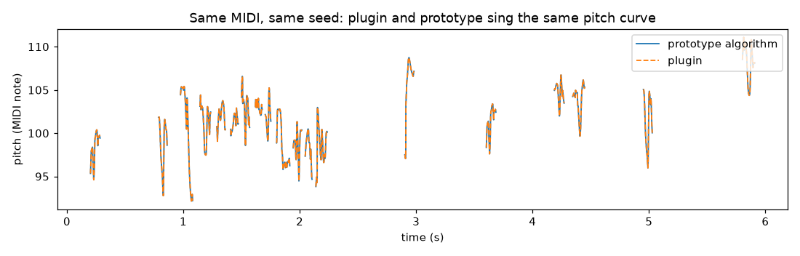
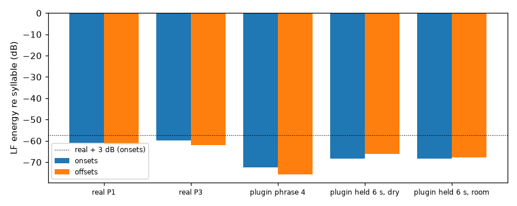
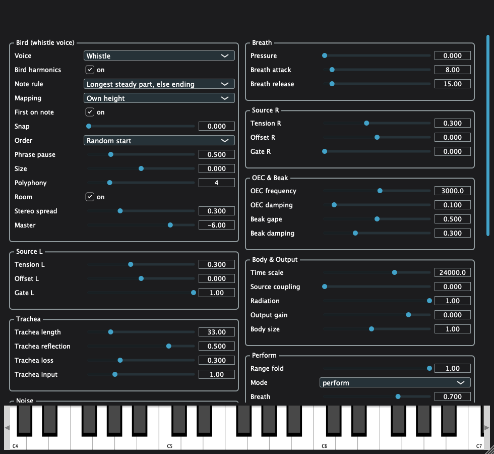

# WP-R1 report — Real syllables, whistle voice and playing modes A + B in the plugin

| Field | Value |
|---|---|
| WP | WP-R1 |
| Status | done (tag `wp-R1`; all 9 criteria PASS) |
| Started | 2026-10-11 |
| Finished | 2026-10-12 |
| Agent | Claude Opus 5.5 (Claude Code desktop) |
| Sessions | 1 |

## 1. Summary (plain language, 3–6 lines)

The plugin now sings with your zebra finch's **real syllables**: all 123 of them, in their 12 real phrases. The default voice is the **whistle**: a sine that follows the real pitch and loudness, plus the bird's own harmonics (−30 / −33 dB), with a light room.

How it plays:
- **Tap a key:** one syllable.
- **Hold:** the bird keeps singing its real phrases around the note.
- **Release:** the current syllable finishes.

It is the web prototype, ported: same bank, same note rule and mapping, same choices. On the same MIDI and seed, the plugin's output equals a sample-by-sample port of the prototype to −138 dB. The anatomical engine is still there, as the "Anatomical (experimental)" voice.

## 2. What was built

| File / module | Purpose |
|---|---|
| `assets/voicebanks/zf_22938/bank.json` | The factory bank: 123 syllables, 12 phrases, 1 ms pitch + amplitude, anchors for 4 note rules, centres; 0.204 MB, hash `09b16ee69ac8`; identical content to the PROTO1 bank |
| `schemas/syllable_bank.schema.json` | Format `cuicui.syllable_bank` v1 (D-026) |
| `python/cuicui/bank/` (`build.py`, `validate.py`, `__main__.py`) | Bank builder (PROTO1 recipe, any recording / species), validation, CLI `python -m cuicui.bank` |
| `python/cuicui/analysis/f0_track.py` | The R0 tracker, moved into the package unchanged (outputs bit-identical); `scripts/review/track.py` re-exports it |
| `scripts/studies/proto1_make.py` | The prototype page now embeds the committed bank (one bank for prototype and plugin); `--rebuild` rebuilds it |
| `core/include/cuicui/control/syllable_bank.hpp`, `io/syllable_bank_io.hpp` | `SyllableBank` (the WP's "VoiceBank") + JSON loader with validation (never on the audio thread) |
| `core/include/cuicui/control/placement.hpp` | Target note (own height / follow, size), pitch shift (first on note, snap), velocity gain |
| `core/include/cuicui/control/phrase_order.hpp` | Random start / phrase start / shuffled; exact, portable random helpers |
| `core/include/cuicui/control/playing_mode.hpp` | `PlayingMode` interface (events in → syllable requests out), for modes C, D, E later |
| `core/include/cuicui/control/mode_ab.hpp` | Modes A + B (per-key singers, sample-accurate scheduling, sustain, mod wheel, polyphony) |
| `core/include/cuicui/model/whistle_voice.hpp` | The whistle (prototype synthesis + 2.5 ms edge fades) |
| `core/include/cuicui/dsp/fft.hpp`, `dsp/room.hpp` | The prototype's room (same IR recipe, Web Audio level, −21 dB wet), partitioned FFT convolution with no added latency |
| `core/include/cuicui/control/syllable_engine.hpp` | The whistle path: mode → bank → placement → voice pool → room; used by plugin, Python and tests |
| `plugin/Source/PluginProcessor.*`, `ParameterLayout.cpp`, `PluginEditor.*`, `CMakeLists.txt` | Whistle path as default voice; bank compiled in (BinaryData); constant latency; voice switch fades; new parameters; "Bird (whistle voice)" editor group |
| `core/include/cuicui/params.def`, `params.hpp` | 9 new parameters, polyphony default 4 (D-025) |
| `apps/plugin_render/main.cpp` | `--syllable-log out.json` (every syllable start) |
| `python/bindings/module.cpp` | `cuicui_core.sing(...)`: the core whistle path from Python |
| `python/cuicui/reference/singing.py` | Python port of the prototype's playing logic and voice (criterion 6 reference) |
| `core/tests/test_syllables.cpp`, `test_whistle.cpp`, `test_alloc.cpp` (+1 case), `test_params.cpp` (+1) | C++ tests |
| `plugin/tests/test_whistle_path.cpp`, `test_helpers.h` | Plugin tests; old tests now select the anatomical voice explicitly |
| `python/tests/test_r1_whistle.py` | Bank, reference vs C++, plugin vs prototype |
| `scripts/render_listening_r1.py` | Listening page renders + measurements (criteria 4, 5) |
| `scripts/studies/r1check_make.py`, `r1check_analyze.py`, `agent documents/studies/R1CHECK_plugin_birdness.md`, `studies/data/R1CHECK/` | The blind test for criterion 8 (pre-registered) and its data |

## 3. How to run it

```bash
scripts/build.sh release && scripts/test.sh            # or scripts/check.sh
python/.venv/bin/python scripts/render_listening_r1.py  # renders + metrics → listening/R1/
scripts/listen.sh R1 && open "listening/R1/index.html"
python/.venv/bin/python scripts/studies/r1check_make.py # blind test → listening/R1/mushra/index.html
python/.venv/bin/python scripts/studies/r1check_analyze.py ~/Downloads/r1check_results_*.json
build/release/bin/plugin_render --notes "69:0.1:3.0:100" --syllable-log starts.json -o out.wav
PYTHONPATH=python python/.venv/bin/python -m cuicui.bank --wav <rec>.wav --annotations <rec>.json \
    --name <name> --species "<species>" --out assets/voicebanks/<name>/bank.json
```

## 4. Acceptance criteria

| # | Criterion (from the WP) | Result | Evidence |
|---|---|---|---|
| 1 | **A:** a 30 ms tap produces exactly one syllable, starting ≤ 5 ms after note-on | PASS | Core: `mode A: a 30 ms tap…` gives 1 request at the note-on sample (blocks 32/256/1000). Plugin: `whistle A: …` (blocks 64/256/1024): first non-zero sample 36 samples after the note-on (latency 35 + 1), audible (> −80 dBFS) after 53 samples = **1.1 ms**. Listening 01/02: 14 taps → 14 syllables, max start delay 0.73 ms. |
| 2 | **B:** hold 2 s from a seed → real order, real onset gaps ±1 ms; release mid-syllable → it completes, nothing after; release in a pause → silence | PASS | Core: `mode B: holding 2 s…`, `mode B: release mid-syllable…`. Plugin: `whistle B: hold 2 s…` (phrase order 0 → 1 → …, gaps within ±1 ms, i.e. sample-exact; the sound ends at the last syllable's end) and `whistle B: a release during the phrase pause is silent`. |
| 3 | **Placement:** the first syllable's rule-anchor on the target ±2 c; own height = octave nearest the bird; follow = note + 36 | PASS | Arithmetic: anchor + shift − target = **0.00 c** on 48 taps (own height and follow; core tests 1e-9). Octave choice and follow: `placement: own height…` (incl. the prototype's tie rule). Audio: the plugin's pitch follows the bank contour + shift on the first syllables' note spans: median **0.33 c** per frame. p99 12.6 c on fast sweeps; this comes from the 1 ms analysis window, since the synthesis is exact, see #6. |
| 4 | **Voice colour:** H2/H3 = −30/−33 dB ± 1 on a steady syllable (track.py); no breath noise | PASS | Steadiest syllable (#11 "Lswipe", 117 ms steady), track.py median over 168 frames: **H2 −30.01, H3 −33.01 dB**. A 6 s hold, all 3033 voiced frames: −30.06 / −33.14 dB. With harmonics off: −84 / −101 dB. No breath: the voice has no noise source, and the plugin equals the noise-free prototype voice to **−137.8 dB** (items 08/09). |
| 5 | **No clicks:** LF (< 1.5 kHz) energy at onsets/offsets ≤ real + 3 dB (engine_gate_poc metric) | PASS | Real recording: P1 −61.0 / −61.8 dB, P3 −59.9 / −62.1 dB (onset / offset). Plugin: phrase 4 **−72.4 / −75.8 dB**; 6 s hold dry −68.4 / −66.1; with room −68.4 / −67.7. That is 6–14 dB cleaner than the bird (`fig_clicks.png`). |
| 6 | **Equivalence with the prototype:** same bank, seed, MIDI → plugin pitch within 5 c of the prototype algorithm (Python reference) | PASS | `test_plugin_pitch_curve_matches_the_prototype_algorithm`: same 21 syllables at the same samples; per-ms pitch difference median 2e-6 c, **max 1.3e-5 c**; waveform difference 3.9e-8. `test_cpp_core_plays_exactly_the_reference_syllables` (4 scenarios: taps, holds, chords, shuffled, follow, size, sustain, mod wheel, landing rule, polyphony 2): identical syllables, samples and shifts. The Python voice was also checked against the prototype's own JavaScript `Voice.render` in a browser: **−147 to −150 dB** (pure whistle) on 5 syllables. With harmonics, −89 dB, because the prototype rounds the harmonic gains (0.0316 / 0.0224). |
| 7 | **Real time:** zero allocations in `processBlock` over 60 s; CPU for 6 voices reported | PASS | `whistle: zero allocations in processBlock over 60 s of playing` (6-key polyphony, random MIDI, CC1, CC64) and the core `SyllableEngine::process allocates nothing over 60 s…`. CPU: **≈ 1.15 % of one core** with 6 keys held, room on (48 kHz / 256, Release, Apple Silicon). |
| 8 | **Birdness gate (listening):** the human rates the plugin against the real recording (MUSHRA); whistle path ≥ 90 on average | PASS | R1CHECK (pre-registered, design `85a01b5ef034`), human run 2026-10-12. `plugin_natural` **100 / 100 (mean 100)**; `plugin_default` 100 / 100; R0 whistle 100 / 100. Hidden reference 100 / 100; anchor 31 / 11 (lowest), so the listener check passes. Ceiling effect: the test cannot rank the four top versions. Data: `agent documents/studies/data/R1CHECK/`; study doc `agent documents/studies/R1CHECK_plugin_birdness.md` §4. |
| 9 | pluginval 5 (VST3 + AU), auval, `scripts/check.sh` | PASS | `build/logs/R1_validate_plugin.log`: pluginval VST3 SUCCESS, pluginval AU SUCCESS, "AU VALIDATION SUCCEEDED". `scripts/check.sh`: CHECK PASSED (§5). |

## 5. Quality gate

```
BUILD OK (release)
100% tests passed, 0 tests failed out of 170
54 passed in 5.63s
TEST OK
All checks passed!
warning: clang-format not installed; skipping format check (brew install clang-format)
CHECK PASSED
```

## 6. Listening & results

- Page: `listening/R1/index.html`. Blind test: `listening/R1/mushra/index.html`.
- Items (peak-normalised to −3 dBFS, except 08/09, which share one gain):

| File | What to listen for | Key metrics |
|---|---|---|
| `01_melody_own.wav` / `02_melody_follow.wav` | A tapped tune (Frère Jacques). Each tap = one real syllable, on the note. Own height folds the tune near A7; follow keeps its shape (C7–G7). | 14/14 syllables, start ≤ 0.73 ms, note error 0.00 c |
| `03_held_6s.wav` | Key A held 6 s: real phrases (3, 4, 5) from a random start, 0.5 s pauses. After the release the syllable finishes. | 27 syllables |
| `04_chord_4_keys.wav` | Four keys held: four independent birds, slightly spread. | 111 syllables, pans −0.23…+0.23 |
| `05/06/07_snap_*.wav` | The same phrases, snap 0 (natural melody), 0.5, 1 (every note on A). | notes in cents listed in metrics |
| `08_plugin.wav` / `09_prototype_algorithm.wav` | Should be indistinguishable. | same 19 syllables, difference −137.8 dB |
| `10_real_phrase4.wav` / `11_plugin_phrase4.wav` | The real phrase vs the plugin playing it from one held key (first on note off). | clicks −61.0 vs −72.4 dB |
| `12_steady_syllable.wav` | The colour check: clean whistle, faint brightness. | H2 −30.01, H3 −33.01 dB |

Key figures:






## 7. Deviations from the spec

| Spec said | What I did | Why |
|---|---|---|
| A `VoiceBank` class / "voice-bank asset" | Class `SyllableBank`, format `cuicui.syllable_bank`, file `assets/voicebanks/zf_22938/bank.json` | `cuicui.voice_bank` (§9.5) and `VoiceBankSource` already name the F2 learned model; a separate name avoids a clash (D-026) |
| Bank export "extends `proto1_make.py`" | The recipe moved into `python/cuicui/bank` (tested, lint-clean); `proto1_make.py` embeds the committed bank | One bank for prototype and plugin; R3 can ingest recordings with one command. The tracker moved into the package with bit-identical outputs |
| The voice path goes "through the existing `VoiceAllocator`" | A voice pool inside the core `SyllableEngine`, with the same policies: polyphony limit, 5 ms fade on steal, equal-power pan × `out.stereo_spread` | The C5 allocator is bound to BirdVoice + VoiceController + GestureEngine. Leaving it untouched keeps the anatomical path as it was. Pan is random per key, as in the prototype |
| Prototype timing (JS timers, 250 ms lookahead, 5 ms release window) | Each next syllable is decided when the previous one starts and starts on its exact sample. Release cancels anything not yet started | Sample-accurate (WP pitfall). Snap / rule / pause changes apply from the next syllable |
| `Math.random()` | Per-key xoshiro streams seeded from `engine.seed` (or `perf.seed`) | Reproducible renders, identical for any host block size |
| Room "as in the prototype" | Same IR recipe and Web Audio level, own FFT convolution, seeded noise. The prototype's output compressor was not ported | The plugin has its safety clipper (transparent below −1 dBFS); the master default stays −6 dB |
| Harmonics −30 / −33 dB | Exactly −30 / −33 dB | The prototype's literals 0.0316 / 0.0224 differ by < 0.01 dB |
| A "no breath" measurement | Evidence = identity with the noise-free prototype voice (−138 dB) | A between-harmonics noise figure measured the contours' own modulation (−36 dB with harmonics off; the real bird −26 dB), not noise |
| (not asked) | `cuicui_core.sing()` + `plugin_render --syllable-log` | Needed to compare the C++ with the reference event by event |

## 8. Contract changes (see decisions.md)

- **D-025 (proposed):** 9 new parameters. `perf.snap`, `perf.polyphony`, `out.stereo_spread`, `out.master_db` and the seeds are reused. **`perf.polyphony` default 1 → 4.** Version hint 8 for "R".
- **D-026 (proposed):** syllable bank format `cuicui.syllable_bank` v1, location and builder; the factory bank is compiled into the plugin.
- **D-027 (proposed):** additive APIs (core modules, `cuicui_core.sing`, `cuicui.bank`, `cuicui.reference.singing`, `--syllable-log`, the tracker's new home). Constant plugin latency: the whistle is delayed to the engine's 35 samples.

## 9. Measurements & baselines

| Metric | Value | Conditions |
|---|---|---|
| Whistle CPU, 6 keys held, room on | ≈ 1.15 % of one core (1.14–1.17 % over runs) | 48 kHz / 256, Release, Apple Silicon, plugin test |
| Plugin latency | 35 samples (0.73 ms) | 48 kHz, unchanged (engine's decimation latency) |
| Tap → first sound | 36 samples (first non-zero), 53 samples to > −80 dBFS | 48 kHz |
| Plugin vs prototype | events identical; pitch ≤ 1.3e-5 c; waveform 3.9e-8 (−138 dB) | dry, same seed |
| Blind test vs the real bird (R1CHECK) | plugin 100 / 100 (hidden reference 100 / 100, anchor 31 / 11) | human, 2 passages |
| H2 / H3 | −30.01 / −33.01 dB | steadiest syllable, track.py |
| Clicks (onset / offset LF) | plugin −72.4 / −75.8; real −61.0 / −61.8 dB | phrase 4 / passage P1 |
| Bank | 123 syllables, 12 phrases, 13.5 s of contours, 0.204 MB | zf_22938 |

## 10. Known issues & limitations

- **The blind test hit a ceiling:** every version except the anchor scored 100, so it shows "indistinguishable from the bird" but cannot rank the voices against each other.
- **First syllable on the note (the default):** the first syllable moves onto the note while the rest of the phrase stays placed around the bird's centre. With a random start, the first syllable can therefore sit up to an octave away from its natural place in the phrase. This is the prototype's behaviour (D-020); "first on note off" gives the natural phrase.
- **Own height folds melodies** at the bird's centre ± a tritone (by design; use "follow").
- **28 of 123 syllables are flagged `hop`:** a pitch step of more than 300 c in 1 ms, probably tracker voice hops. They are kept, as in the prototype.
- **The mod wheel now adds to snap** when the whistle is selected; it still adds to Motion in the anatomical voice.
- **The editor is minimal** (plain sliders, combos, toggles). The full Perform UI is R4.
- **Parameters are read once per host block.** Changes apply from the next syllable.
- **The whistle is delayed by 0.73 ms,** so the reported latency stays the same for both voices.
- **The bird's measured harmonics are lower** (−32.7 / −34.2 dB over all syllables) than D-022's −30 / −33 dB, which the voice uses (backlog).
- **`clang-format` is not installed.** `check.sh` skips the format check, as before.

## 11. Tools / dependencies added

- None. All used libraries already existed (numpy, scipy, soundfile, jsonschema; JUCE BinaryData for the embedded bank). Pillow, which ships with matplotlib, was used once to shrink a report figure.
- During the session the built-in browser served `listening/` through a temporary `.claude/launch.json`; it was removed and is not committed.

## 12. Handoff notes for the next agent

- **The whistle path is one core class: `control::SyllableEngine`.** It chains mode → bank → placement → `WhistleVoice` pool → `dsp::Room`. The plugin wraps it in `processWhistle()`, which handles MIDI → `PlayEvent`, the 35-sample delay, the master gain and the clipper. Python reaches it with `cuicui_core.sing()`.
- **A new playing mode (C, D, E):** implement `control::PlayingMode` (events in, `SyllableRequest`s out, real-time safe), then `engine.setMode(&myMode)`. ModeAB shows sample-accurate scheduling: handle events and due syllables in time order, input first on ties.
- **Determinism:** each key press draws a 64-bit seed from the master stream. Voices are summed oldest first, so the output is bit-identical for any host block size; keep it that way (`test_whistle_path.cpp`).
- **The reference** `python/cuicui/reference/singing.py` replays the RNG bit for bit. If ModeAB's draw order changes, change the reference too, or `test_r1_whistle.py` fails, as it should.
- **Banks:**
  - Build: `python -m cuicui.bank`. Check: `validate_bank` / C++ `parseSyllableBank`.
  - The plugin compiles one bank (`plugin/CMakeLists.txt`); a second bank needs a parameter or file loading (R3/R4).
  - The bank's `t_ms` are real onsets; amplitude is normalised per phrase.
- **Old anatomical tests** call `useAnatomicalVoice()` (`plugin/tests/test_helpers.h`) because the default voice and polyphony changed.
- **Fragile spots:**
  - `processBlock`'s voice-switch fade renders the anatomical path into a preallocated tail buffer.
  - The room relies on its pre-delay (4 ms) to hide its 128-sample block (sample rates ≥ 32 kHz). Below that, the block shrinks (minimum 16).
- **Blind test:** `scripts/studies/r1check_analyze.py <results.json>` checks the design hash and prints the pre-registered verdict. Paste the results into `R1CHECK_plugin_birdness.md` §4 and into this report.

## 13. Partial — remaining work (only if status is partial)

- n/a

## 14. Revision history (feedback rounds)

| Date | Human feedback | Changes |
|---|---|---|
| 2026-10-12 | Listening page: "it all sounds great in terms of 'like a bird'"; follow (02) "sounds like Frère Jacques more than [own height] by far"; snap 0/0.5/1 "coherent"; 08/09 "indistinguishable, almost perfect"; 10/11 "they match". Blind test R1CHECK run: plugin 100/100, criterion 8 PASS. | No code changes. Recorded the blind-test results (criterion 8 → PASS) in this report, the study doc and `studies/data/R1CHECK/`; note for R4 about the follow mapping. |

## 15. Proposed commit message

```
WP-R1: real syllables, whistle voice and playing modes A+B in the plugin

The plugin now plays the zebra finch's 123 real syllables (bank
assets/voicebanks/zf_22938, format cuicui.syllable_bank) with the whistle voice
(sine on the real pitch/loudness + the bird's harmonics, light room). Tap = one
syllable, hold = real phrases around the note, release = finish. Modular core
(SyllableBank, Placement, PhraseOrder, PlayingMode/ModeAB, WhistleVoice, Room,
SyllableEngine), new parameters (D-025), constant latency; the anatomical engine
stays as an experimental voice. Plugin output equals a port of the PROTO1
prototype to -138 dB on the same MIDI and seed; blind test against the real
recording (R1CHECK): plugin rated 100/100.
Report: agent documents/reports/WP-R1_report.md
```
