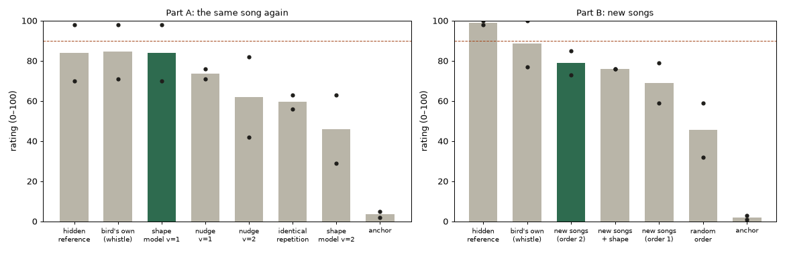
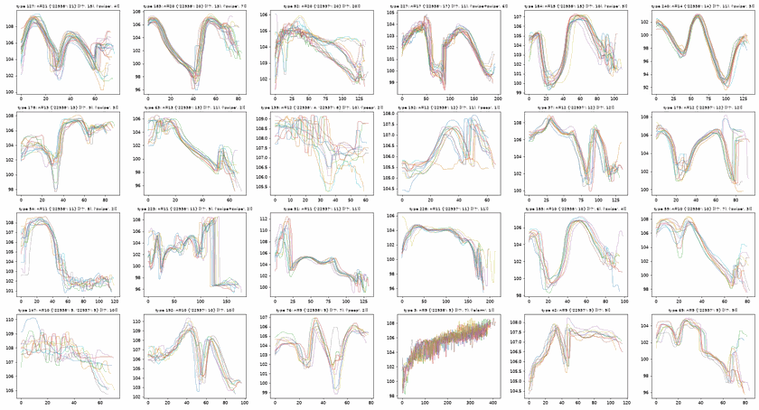

# WP-R3 report — Variations within the bird's style

| Field | Value |
|---|---|
| WP | WP-R3 |
| Status | done (tag `wp-R3`; all 8 criteria PASS) |
| Started | 2026-10-13 |
| Finished | 2026-10-14 |
| Agent | Claude Opus 5.5 (Claude Code desktop) |
| Sessions | 1 (two days) |

## 0. Decisions taken with the human during the WP

| When | What the human said | What it decided |
|---|---|---|
| start (scoping) | "1b, but add '22937 - House Finch.wav' only" | Ingest **one** new recording, `recordings/22937 - House Finch.wav` (then 240 s; the human later cleaned it to 108 s, 44.1 kHz, 16 bit). Its syllables are marked automatically and checked by the human on a by-ear page. The other two MP3s stay out. |
| start | "2b" | **22938 is a house finch**, not a zebra finch (D-035 corrects D-023). |
| start | "3b" | "Within the style" = **the species**: syllables and statistics of other house finches are allowed. |
| start | "4c" | Both the identical syllables and the identical phrases are a problem today. |
| start | "the shape model and the new order are my favorite. i have low hope for Blend and we can discard it, and Nudge would probably also work instead of the model. Nudge is less interesting but a safe backup. Nudge and Shape model should be anyway compared blindly." | Options: **shape model**, **new order**, **nudge** (backup). **Blend dropped.** Shape model vs nudge in a blind test. |
| INGEST1 preparation | "i just cleaned a bit the audio file 22937"; "these sub 40ms fragments could very well be from ambiant noise. there are some far away birds… phrases are long and clear blocks separated by 500ms or more. background noises are pretty low." | Marker: pieces under 40 ms dropped, faint blocks (more than 20 dB below) dropped; 22937's phrases = blocks ≥ 500 ms apart. |
| INGEST1 results | (results file) 3 syllables "whistle wrong"; comment on the long final calls: "the orginal sound in those case feels richer, denser, to have more low frequencies… this has to be investigated at some point" | Banks built from the checked syllables; the long calls → known issue + backlog. |
| VARY1 results | "1a 2a 3c but keep the data separated. the merge should happen when running. i want to be able to separate later when necessary, and to correct only one file if needed." | **Shape model, Variation 0–1** · **no new order** · **both birds, separate files, merged when the plugin starts** (D-036). |
| listening page | "03: the third syllable sounds bit low in term of volume… i feel the variations could be a bit increased"; then "1b 2a" | No loudness variation; draws capped at ±2 sd; VARY2 (100 / 130 / 160 %). |
| VARY2 results | "i cannot tell the difference between the synthesising versions"; "variations are not critical. a little bit would be enough… only syllable duration… and frequency amplitude around the note… make me a test"; "let's go from 60 to 200%" | STRETCH1 page built. |
| STRETCH1 answers | length 80–160 %, range 60–160 %; "swipes could actually get a lenght stretch up to 200%"; "that's working nicely" | **The plugin's Variation = length and pitch range** (D-036 amended); shape model off. |

Working log, kept for a resumed session:
- **2026-10-13, scoping and material.**
  - Read protocol, state, spec, R1/R4/R5 reports, D-018…D-034, approach review §10.
  - Found that the human annotation of 22938 stops at 53.3 s (the other 134 s are one SILENCE segment, with ~313 more syllables).
  - New marker `cuicui.bank.segment`; found and fixed the 44.1 kHz frame drift; the human cleaned 22937.
  - INGEST1 pre-registered, built and run.
- **2026-10-14, understanding, test, build.**
  - Spread and order measured.
  - `cuicui.variation` (types, nudge, shape model, new order) built.
  - VARY1 pre-registered, built from the INGEST1 banks and run; the human chose 1a 2a 3c.
  - The shape model was ported to the core (`control/variation.hpp`), with bank merging, the parameter, the Song card, the display, tools, tests, the listening page and the documents.
- **2026-10-14, feedback round.**
  - Loudness variation removed and draws capped; VARY2 run (the shape model is not audible).
  - STRETCH1 built and answered.
  - Length and pitch-range variation built into the core (`drawStretch`, `rangeScale`, real gaps kept) and the plugin; tests, page and documents updated.
- A temporary `.claude/launch.json` served `listening/` to the built-in browser during the session. It is removed before staging.

## 1. Summary (plain language, 3–6 lines)

- **The plugin sings two house finches now:** 22938 (all of it, 436 syllables; you had annotated 123) and 22937 (358). The two banks stay separate files and are merged when the plugin starts.
- **New knob "Variation"** (Song card), **100 % by default**: each syllable is a little shorter or longer (80–160 %; swipes up to 200 %) and has a narrower or wider sweep around its note (60–160 %). These are the spans you chose by ear (STRETCH1). The next syllable waits for a longer one; loudness and notes stay real. 0 % = the real syllables.
- **What the blind tests taught us:**
  - repeating one syllable identically sounds less alive (VARY1);
  - the shape model's own changes are too small to hear (VARY2);
  - so the shape model is kept in the files but off.
- **At Snap to note 100 % ("Finch, melody") every syllable still lands exactly on its key.** New songs (recombined phrases) are not in, as you chose.

## 2. What was built

| File / module | Purpose |
|---|---|
| `python/cuicui/bank/segment.py` | **new**: the automatic syllable marker (tseg JSON; keeps a human annotation's segments); checked against the human's 22938 annotation |
| `python/cuicui/bank/build.py`, `__main__.py` | `read_mono` (analysis at 48 kHz), `BuildSettings.variation` / `--variation`, `--phrase-gap-s` |
| `python/cuicui/variation/__init__.py` | **new**: types, nudge, shape model, new order (`Model`, used by the studies); `attach_section` (the bank's shape model); `variant` (the plugin's reference) |
| `assets/voicebanks/hf_22938/{bank,annotation}.json` | **new bank**: 22938 whole (436 syllables, 36 phrases, 23 type models; hash `e31f5f894593`). Its first 12 phrases equal `zf_22938` |
| `assets/voicebanks/hf_22937/{bank,annotation}.json` | **new bank**: 22937 (358 syllables, 23 phrases, 19 type models; hash `735c09b9fe6b`) |
| `schemas/syllable_bank.schema.json` | the optional `variation` section and per-syllable `type` / `model` / `scores` (D-036) |
| `core/include/cuicui/control/variation.hpp` | **new**: `drawStretch` + `StretchSpans` (the plugin's variation: length and pitch range), `stretchedLengthMs`, `makeVariant` (stretch, range, and the shape model, off in the plugin), `variantDraws`, `variantSeed`, `resampleLinear` (real-time safe) |
| `core/include/cuicui/control/syllable_bank.hpp`, `io/syllable_bank_io.hpp` | type models, birds, `find(Query)` (R6), per-syllable bird / type / model / scores / peak / sweep; `mergeBanks`; the loader reads the model |
| `core/include/cuicui/control/playing_mode.hpp`, `mode_ab.hpp` | `SyllableRequest`: variation, variantSeed, lengthScale, rangeScale, shape, snapK, variantNoteCents; `PlayContext::variation`, `spans`; per-singer variant seeds; the next syllable waits for a stretched one |
| `core/include/cuicui/control/syllable_engine.hpp`, `model/whistle_voice.hpp` | the engine makes the variant into per-voice buffers (allocated in prepare) and cancels snapK × its note change; `WhistleVoice::startCurve` |
| `core/include/cuicui/params.def` | `perf.natural_variation` (0–1, default 1, "R3") |
| `plugin/CMakeLists.txt`, `PluginProcessor.*` | both banks compiled in and merged at start; `useBankFiles` |
| `plugin/Source/ui/PlayPage.*`, `SongDisplay.*`, `SyllableFeed.h`, `ParamHelp.h` | the Variation knob (Song card; Pause becomes a small slider); the display draws the varied curve (rebuilt from the seed); header "HOUSE FINCH · 2 BIRDS · 794 SYLLABLES"; help text |
| `apps/plugin_render/main.cpp` | `--bank a.json[,b.json]`; syllable logs gain variation, variant_seed, variant_note_cents, bird |
| `python/bindings/module.cpp` | `sing(bank_path or [paths], …, perf.natural_variation)`, `variant`, `variant_draws`, `bank_summary` |
| `assets/presets/*.preset.json` | `voice_bank` = "hf_22938+hf_22937" (informative) |
| `core/tests/test_variation.cpp`, `test_alloc.cpp` (+1), `plugin/tests/test_whistle_path.cpp` (+2, updated), `test_presets.cpp` (updated), `python/tests/test_r3_variation.py` (18), `test_r1_whistle.py` (bank pinned) | tests |
| `scripts/studies/r3_material.py`, `ingest1_*`, `r3_banks.py`, `r3_render.py`, `vary1_*`, `vary2_*`, `stretch1_*` | the material, INGEST1, the banks, VARY1, VARY2, STRETCH1 |
| `scripts/render_listening_r3.py` | the listening page |
| `agent documents/studies/INGEST1_new_syllables.md`, `VARY1_variations.md`, `VARY2_how_much_variation.md`, `STRETCH1_length_and_range.md` + `studies/data/` | the studies (INGEST1, VARY1, VARY2 pre-registered), with results and raw data |

## 3. How to run it

```bash
# material → INGEST1 → banks → VARY1 (needs the recordings; the human's 22938 folder and recordings/)
python/.venv/bin/python scripts/studies/r3_material.py
python/.venv/bin/python scripts/studies/ingest1_make.py          # page: listening/R3/ingest1/
python/.venv/bin/python scripts/studies/ingest1_analyze.py <ingest1_results.json> --write
python/.venv/bin/python scripts/studies/r3_banks.py              # assets/voicebanks/hf_22938, hf_22937
python/.venv/bin/python scripts/studies/vary1_make.py            # page: listening/R3/vary1/
python/.venv/bin/python scripts/studies/vary1_analyze.py <vary1_results.json>
# one bird's bank by hand
PYTHONPATH=python python/.venv/bin/python -m cuicui.bank --wav <rec>.wav --annotations <ann>.json \
  --name hf_X --species "house finch" --variation --out assets/voicebanks/hf_X/bank.json
# listening page, checks
python/.venv/bin/python scripts/render_listening_r3.py && scripts/listen.sh R3
scripts/check.sh && scripts/validate_plugin.sh 5 --gui
build/release/bin/plugin_render --notes 64:0.1:10:100 --params p.json -o out.wav        # both birds
build/release/bin/plugin_render --bank assets/voicebanks/zf_22938/bank.json --notes ... -o r5.wav  # the R5 bank
```

## 4. Acceptance criteria

The spec had none; these were proposed at the start (§0 of the first draft) and are listed here as evaluated.

| # | Criterion | Result | Evidence |
|---|---|---|---|
| 1 | New recording ingested: marked automatically, checked by the human by ear; a bank built with rule E that validates | **PASS** | INGEST1: 674 new syllables (22938 after 53 s + 22937), 3 rejected, check round 9/10. `hf_22937` (358 syllables) and `hf_22938` (436) validate (`validate_bank`, C++ loader). Marker vs the human's annotation: all 123 syllables found (3 merges, 4 extras). |
| 2 | The bird's spread measured; a short study doc with numbers | **PASS** | `VARY1_variations.md` §2: 41 types; note ±26 c, length ±2.5 %, loudness ±1.5 dB, shape 52 c RMS (3 modes = 91 %), gaps ±4.3 ms, song ±11 c; order statistics per bird. Figure `assets/R3/types_top.png`. |
| 3 | Blind test(s) pre-registered and analysed as registered; only options the rule keeps go in | **PASS (the rules kept nothing → the human chose)** | VARY1 §5: the human chose 1a / 2a. VARY2 §5: nothing kept; "i cannot tell the difference". The human then chose length and pitch range by ear (STRETCH1, not blind): "that's working nicely". |
| 4 | One Variation control: 0 = the real syllables; 1 = within the spans chosen | **PASS** | `perf.natural_variation`. At 0: scales exactly 1, the R1 / R5 playing draw for draw (R1 reference tests at Variation 0; core test "…keeping the bird's real gaps"). At 1: every scale within 80–160 % (swipes 200 %) / 60–160 %, the hop syllables never widened, log-uniform medians (core test "…spans the human chose"; `test_variation_stretches_length_and_range_within_the_spans`). The range scales around the note (core test, error < 1e-6 c). The real gaps are kept after a stretched syllable (±1 ms). C++ = Python reference (`test_cpp_variant_equals_the_python_reference`, with length and range). Caveat: the default sound is no longer R5's, because the default banks changed (decision 3c). |
| 5 | For R6: the amount per request; families and lengths can be queried | **PASS** | `SyllableRequest::variation`, `lengthScale`; `SyllableBank::find(Query)` (label, length, sweep, bird): `variation: queries for playing modes (R6)…` |
| 6 | The display draws the new shapes | **PASS** | The editor rebuilds each varied curve with the same `makeVariant` from the request's scales (`SongDisplay::update`); screenshot `assets/R3/editor.png`. |
| 7 | Real-time safe; CPU measured | **PASS** | 0 allocations: core `SyllableEngine allocates nothing while singing new renditions`, plugin stress (11 250 blocks, 0 allocations, worst block 0.244 ms of 5.333 ms). CPU 6 keys: 1.20 % of one core (R1: 1.15 %). |
| 8 | `scripts/check.sh` and `scripts/validate_plugin.sh 5 --gui` pass | **PASS** | §5 |

## 5. Quality gate

```
100% tests passed, 0 tests failed out of 189
99 passed in 13.82s
TEST OK
All checks passed!
warning: clang-format not installed; skipping format check (brew install clang-format)
CHECK PASSED
---
AU VALIDATION SUCCEEDED.
note: no clap validator (clap-info) on PATH; CLAP built but not validated
VALIDATE_PLUGIN OK (strictness 5, with GUI tests)
```

## 6. Listening & results

- Page: `listening/R3/index.html` (studies: `listening/R3/ingest1/`, `listening/R3/vary1/`)

| File | What to listen for | Key metrics |
|---|---|---|
| `01–03` (22937), `04–06` (22938) | The bird's own renditions of one syllable (01/04), then one rendition repeated identically (02/05: Variation 0), then that rendition at Variation 100 % (03/06): each repeat a little shorter or longer, with a narrower or wider sweep. | STRETCH1 spans |
| `07`, `08` | Key E held 10 s, Variation 0 then 100 %. The same syllables; lengths and sweeps vary, and the next syllable waits for a longer one. | same first choice |
| `09–12` | 22938 alone, 22937 alone, both (the second bird comes in at about 16 s), the R5 bank: 25 s each | both: 66 % / 34 % of phrases over 5 min |
| `13`, `14` | Frère Jacques legato with "Finch, melody" at Variation 100 %, and the tune on a soft tone. Every note on its key; lengths and sweeps vary. | 48 syllables, all varied, note error 0.0 c |

Key figures (copied to `agent documents/reports/assets/R3/`):





## 7. Deviations from the spec

| Spec said | What I did | Why |
|---|---|---|
| Options 1–4 (nudge, blend, shape model, new order) | Blend dropped; the shape model is **per syllable type** (clusters of renditions), not per family (swipe / peep) | The human dropped blend. The bird's renditions form tight types, and families are too mixed (swipe covers rises, falls and U shapes). The labels of the new syllables are only proposals. |
| "Ask the human where [the recordings] are" | One recording added (22937), and the rest of 22938 marked automatically | The human, at scoping. The rest of 22938 had never been annotated. |
| Each option checked by a blind test; only options rated close to the real bird stay | The rule kept nothing (absolute bar 90; the hidden reference got 70 on one screen). The human chose on the full results. | As pre-registered ("ask the human"). |
| Variation = the bird's natural spread (shape model, after VARY1) | Variation = random length (80–160 %, swipes 200 %) and pitch range (60–160 %) per syllable; the shape model is kept but off | The listening page and VARY2: the shape model's loudness changes sounded like errors; without them it could not be heard. The human chose length and range by ear (STRETCH1). |
| Variation 0 = R1 | Variation 0 = the real syllables of the default banks (two birds now). The R5 sound = the `zf_22938` bank (`--bank`), which Variation leaves real. | Decision 3c changed the default banks. |

## 8. Contract changes (see decisions.md)

- **D-035 (accepted):** 22938 is a house finch (corrects D-023); new tool `cuicui.bank.segment`; recordings not at 48 kHz are analysed at 48 kHz.
- **D-036 (accepted; amended after STRETCH1: the variation is length and pitch range):**
  - bank format v1 additive (the shape model);
  - two factory banks merged at load (zf_22938 no longer compiled in);
  - new parameter `perf.natural_variation` (0–1, default 1);
  - core APIs (`variation.hpp`, SyllableBank, SyllableRequest, PlayContext, WhistleVoice, mergeBanks);
  - tools and bindings;
  - presets' `voice_bank`.

## 9. Measurements & baselines

| Metric | Value | Conditions |
|---|---|---|
| Marker vs human annotation (22938, 7.6–53.3 s) | 123 / 123 found; 3 merges, 4 extras | `cuicui.bank.segment` defaults |
| New syllables checked by ear (INGEST1) | 674; 3 rejected; check round 9 / 10 | 12 min |
| Bird's natural spread (median of 41 types) | note ±26 c; length ±2.5 %; loudness ±1.5 dB; shape 52 c RMS, 3 modes = 91 % | non-hop renditions |
| VARY1 part A (same song again) | real 84.5, shape1 84.0, nudge1 73.5, nudge2 62.0, same 59.5, shape2 46.0, anchor 3.5 | 2 screens |
| VARY1 part B (new songs) | real 88.5, order2 79.0, order2+shape 76.0, order1 69.0, shuffle 45.5, anchor 2.0 | 2 screens |
| VARY2 (same song again) | real 80.5, v130 75.5, v160 75.0, same 73.0, v100 71.0, anchor 8.5 | 2 screens; the shape model without loudness changes |
| STRETCH1 (the human's spans) | length 80–160 % (swipes 200 %), pitch range 60–160 % | 12 syllables, 2 phrases |
| Whistle CPU, 6 keys, room on, Variation 1 | 1.20 % of one core | plugin test (R1: 1.15 %) |
| Audio thread with variation | 0 allocations; worst block 0.244 ms of 5.333 ms | plugin stress test |
| C++ shape model vs Python reference | ≤ 1e-6 c, amplitude ≤ 1e-5 relative | 18 syllables × 4 settings × 2 banks |
| Banks | hf_22938 0.76 MB, hf_22937 0.66 MB; merged: 794 syllables, 59 phrases, 42 type models; centre 10579.2 c | |

## 10. Known issues & limitations

- **The long final calls sound thinner than the bird** (INGEST1, the human: "richer, denser, more low frequencies"). 3 calls of 22937 were left out for this. Backlog.
- **"Sometimes misses a bit of timbre complexity"** (VARY1 comment). The whistle's colour is the topic, not variation. Backlog.
- **The new syllables' notes are rule E only** (no ear check like TUNE1); their labels are proposals (swipe vs peep right about 2 in 3). "alarm" (the release call) was proposed for long rising sounds and accepted as proposed.
- **The length and range variation was chosen by ear, not tested blind** (STRETCH1 is a listening tool). "Some sounds sound higher the bigger the range": likely high spikes over a lower body, or tracker jumps. Jump syllables ("hop") are now only narrowed. Untested by ear since.
- **"Swipe" = the label contains "swipe".** The new syllables' labels are proposals (swipe vs peep right about 2 in 3), so some peeps may stretch to 200 % and some swipes only to 160 %.
- **The shape model is in the bank files and the core but off** (VARY2: not audible). Long stretches are clamped to 2048 ms.
- **The default sound changed:** two birds and Variation 1. At Snap to note 0 (own height) the bird sits 33 c lower than in R5 (the merged centre is higher). The R5 sound needs `--bank zf_22938` (offline); there is no bird selector in the plugin yet (backlog).
- **With a short hold, one bird can dominate by chance** (10 s of key E at seed 7: 62 of 63 syllables from 22938); over 5 minutes, 66 % / 34 % of phrases.
- **The VARY1 renders used the banks before the shape-model section** (hashes `5bc449a1d4c4` / `39c926b8b0cb`): same syllables, the model fitted by the study code, with loudness changes (which made the difference audible).
- **`types_top.png` was drawn from the provisional banks** (before INGEST1 removed 3 calls).
- `clang-format` is not installed; CLAP is built but not validated (no clap-info).

## 11. Tools / dependencies added

- None. numpy / scipy / soundfile / matplotlib (already used) for the studies; JUCE BinaryData for the second bank.

## 12. Handoff notes for the next agent

- **Banks.**
  - One file per bird: `assets/voicebanks/hf_22938/`, `hf_22937/`, each a `bank.json` (with its shape model) and the `annotation.json` it was built from.
  - Rebuild both with `scripts/studies/r3_banks.py`. It passes the TUNE1 corrections for 22938 and checks that its first 12 phrases equal `zf_22938`.
  - To correct one bird: edit its `annotation.json` and rebuild that bank.
  - The plugin compiles both (`plugin/CMakeLists.txt`, `SYRINX_FACTORY_BANKS`; copied to unique BinaryData names) and merges them in the processor's constructor.
- **A new recording:**
  1. `cuicui.bank.segment.annotate(wav)`;
  2. an INGEST1-style check page (`scripts/studies/ingest1_make.py`; point `BANKS` / `REC` at it);
  3. `ingest1_analyze.py --write`;
  4. `python -m cuicui.bank … --variation`;
  5. add it to `SYRINX_FACTORY_BANKS` and to the processor's merge.
- **The variation.**
  - `control::drawStretch(seed, v, swipe, hop, spans)` gives each request its length and range scales. ModeAB draws them from the request's variant seed and schedules the next syllable after the stretched length (`stretchedLengthMs`); the engine renders them with `makeVariant`.
  - The spans are `StretchSpans` (constants; `PlayContext::spans`).
  - Python `cuicui.variation.variant` is the reference. C++ `control::makeVariant` must stay equal to it (`test_cpp_variant_equals_the_python_reference`).
  - The shape model (`SyllableRequest::shape`, 0) and `cuicui.variation.Model` (clustering, new order) are kept for later.
- **Determinism.**
  - Variant draws come from `variantSeed(singer seed, request count)`, never from the order stream. Variation 0 is R1 / R5 draw for draw.
  - The editor rebuilds the curve from the request's scales (and the seed, for the shape model).
- **R6:** see `work_packages/WP-R6_playing_feel.md` § Notes from WP-R3 (per-request variation and lengthScale, `find(Query)`, the vocabulary).
- **Fragile:**
  - the engine copies the variant into a per-voice buffer (`kMaxVariantMs` = 2048 ms); longer requests are clamped;
  - the scratch buffer is a member array (24 KB) of `SyllableEngine`.
- **What I would do next** (backlog): an ear check of the new notes (TUNE1-style); the long calls' timbre; a bird selector.

## 13. Partial — remaining work (only if status is partial)

- n/a

## 14. Revision history (feedback rounds)

| Date | Human feedback | Changes |
|---|---|---|
| 2026-10-13/14 | (during the WP) see §0 | the studies and choices in §0 |
| 2026-10-14 | Listening page: "03: the third syllable sounds bit low in term of volume. why? 06 same… also i feel the variations could be a bit increased. 11: both birds is better than 12. 14: kinda ok". Then "1b 2a". | Cause: a rare loudness draw (−2.5 sd), a loudness spread inflated by the per-phrase normalisation, and a pull toward the type's average. **Loudness variation removed**; draws capped at ±2 sd (Python + C++; test `test_variant_keeps_the_real_loudness_and_caps_the_draws`). VARY2 pre-registered and built (100 / 130 / 160 %). |
| 2026-10-14 | VARY2: "i cannot tell the difference between the synthesising versions. did you add variation?" Means: real 80.5, v130 75.5, v160 75.0, same 73.0, v100 71.0. Then: "which part of the shape are you changing? … variations are not critical. a little bit would be enough. let's try a last one… only syllable duration, 80% to 130%, and frequency amplitude around the note… make me a test so i hear the differences on a dozen syllables" | VARY2 analysed as registered (nothing kept; ask the human). STRETCH1 built (`scripts/studies/stretch1_*`, `listening/R3/stretch1/`): 12 syllables × length and pitch range 80–130 %, two phrases in context, the listener writes the ranges. |
| 2026-10-14 | STRETCH1 answers: length 80–160 %, range 60–160 %; "swipes could actually get a lenght stretch up to 200%. make sure to do the pitch range around the syllable pitch. some sounds sound higher the bigger the range…"; "that's working nicely. what's next?" | The plugin's Variation = length and pitch range (`drawStretch`, `rangeScale`, real gaps kept, hop syllables only narrowed); the shape model is off. Tests, listening page, D-036 amendment, report and state updated. |
| 2026-10-14 | "approve" | Committed and tagged `wp-R3`; D-035, D-036 accepted |

## 15. Proposed commit message

```
WP-R3: variations within the bird's style — length and pitch range, two house finches

The plugin now sings two house finches (22938 whole: 436 syllables; 22937:
358), separate bank files merged when it starts (D-036). New syllables were
marked automatically (cuicui.bank.segment, checked against the human's
annotation: 123/123) and checked by ear (INGEST1: 3 of 674 rejected).
New control Variation (perf.natural_variation, default 1): each syllable a
little shorter or longer (80-160 %, swipes up to 200 %) and with a narrower
or wider sweep around its note (60-160 %), the spans the human chose by ear
(STRETCH1); the next syllable waits for it, notes and loudness stay real.
Blind tests: identical repetition sounds less alive (VARY1); the bird's own
shape variation is not audible (VARY2), so the shape model (stored in the
banks) is off. New songs not adopted. Snap 100 % still lands every syllable
on its key. Core control/variation.hpp (real-time safe, = Python
reference), per-request length and range for R6, SyllableBank queries.
22938 is a house finch (D-035); recordings analysed at 48 kHz.
Report: agent documents/reports/WP-R3_report.md
```
