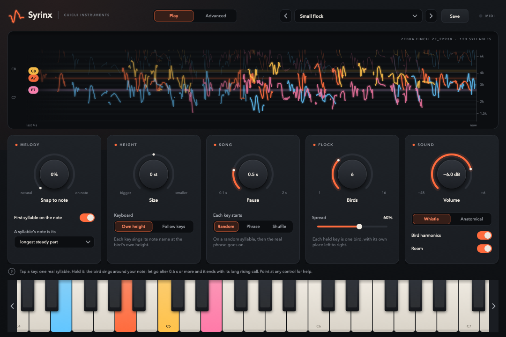
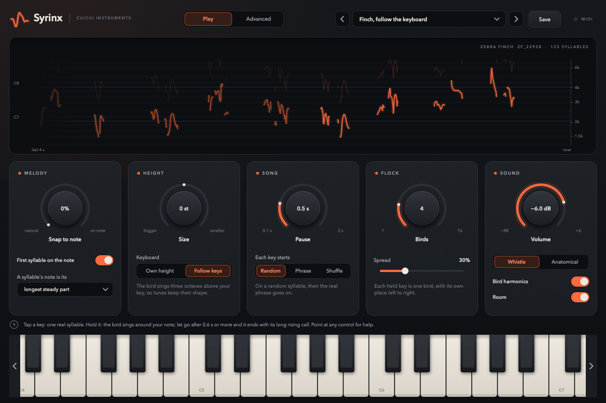
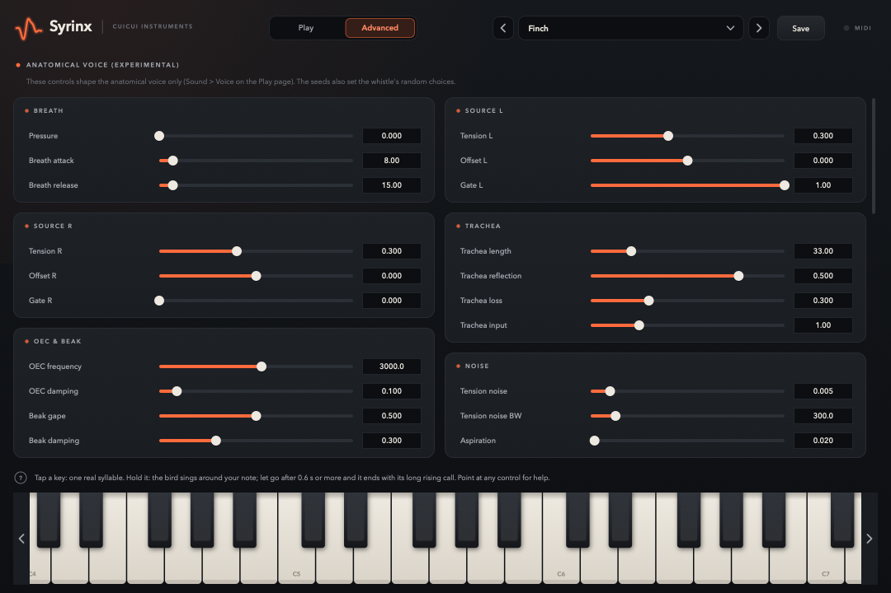

# WP-R4 report — Perform UI and presets (revised C6)

| Field | Value |
|---|---|
| WP | WP-R4 |
| Status | done (tag `wp-R4`; criteria 1–8 PASS; criterion 9 not run, approved by the human before the play test) |
| Started | 2026-10-12 |
| Finished | 2026-10-12 |
| Agent | Claude Opus 5.5 (Claude Code desktop) |
| Sessions | 1 |

## 0. Scope agreed with the human (2026-10-12, before starting)

The WP spec is short (no acceptance criteria, no listening section). The human answered six scoping questions:

| # | Question | Answer |
|---|---|---|
| 1 | The ~50 anatomical sliders | **Move them, as they are, to a second tab** "Advanced: anatomical (experimental)" |
| 2 | Presets | **The 4 spec presets plus a few more** (e.g. "Solo bird", "Sparse", "Dry"), **and saving your own** |
| 3 | MIDI learn (old C6) | **Skip** (DAWs do it; the mod wheel already drives Melody) |
| 4 | Look | **Put effort into a designed look now** |
| 5 | Where the human plays it | **Standalone app first**, a DAW later |
| 6 | Layout mock-up before building | **No mock-up: build directly** |

Acceptance criteria used (proposed in the discussion, adapted from WP-C6 §7; results in §4):
1. pluginval strictness 5 with editor open/close passes (VST3 and AU), auval passes.
2. Preset round trip: every factory preset loads → exports JSON → reloads with all parameter values equal (±1e-6).
3. Preset JSON files validate against `schemas/preset.schema.json`.
4. Audio never waits for the UI: editor open, rapid preset switching and parameter changes → zero allocations in `processBlock`, worst block < 50 % of its duration.
5. Editor idle CPU ≤ 5 % of one core (reported).
6. Every parameter visible in the UI has a one-line help text (test iterates the registry).
7. The sound does not change: the R1 plugin-vs-prototype tests still pass with the default state.
8. `scripts/check.sh` passes.
9. Human play test (Standalone, MIDI keyboard, ~15 min) against a checklist written before the test.

## 1. Summary (plain language, 3–6 lines)

Syrinx now has a real instrument window instead of a wall of sliders.
- **Play page:** a live display shows each syllable's real pitch curve as the bird sings, one colour per bird. Below it, five cards: Melody, Height, Song, Flock and Sound.
- **Advanced page:** the anatomical engine's controls, unchanged.
- **Keyboard:** a pressed key lights in its bird's colour.
- **Presets:** 10 factory presets, a preset bar to browse them, and saving your own.
- **Look:** dark, the beak's orange as accent, Avenir Next. Every control has a help sentence shown at the bottom.

**One playing change, asked by the human during the review (D-030):** the bird's long rising call (the "alarm") is now kept for the end of a long key press.
- It never appears in taps or phrases.
- When a key that sang at least 0.6 s is released, the bird ends with one call.

Otherwise the sound is R1's. With that rule off, the plugin still equals the prototype, and the default preset equals no preset, sample for sample.

## 2. What was built

| File / module | Purpose |
|---|---|
| `plugin/Source/SyllableFeed.h` | Lock-free FIFO of syllable starts (audio thread → editor) + whistle clock, mod wheel, pedal, external MIDI notes |
| `plugin/Source/Presets.h/.cpp` | `PresetManager`: factory presets (BinaryData), user presets (one JSON file each), load / capture / save / browse, "modified" detection, plugin-state attributes |
| `assets/presets/01…10_*.preset.json` | 10 factory presets (Finch, Finch natural, on the note, follow the keyboard, Solo bird, Small flock, Sparse, Chatty, Big bird, Dry) |
| `schemas/preset.schema.json` | Format `cuicui.preset` v1 (D-028) |
| `plugin/Source/ParamHelp.h` | One help sentence per registry parameter (66) |
| `plugin/Source/StandaloneMidi.h/.cpp` | Standalone only: switch MIDI inputs on at first open if none is chosen |
| `plugin/Source/ui/Theme.h` | Palette (dusk greys; beak orange; cheek amber for the mod wheel), six bird colours, fonts (Avenir Next) |
| `plugin/Source/ui/LookAndFeel.h/.cpp` | Vector look for every JUCE control used (knobs, sliders, combo boxes, menus, buttons, switches, groups, scroll bars, dialogs) |
| `plugin/Source/ui/Widgets.h/.cpp` | Card, Knob (value inside, captions, mod-wheel arc), Segmented, Switch, MiniSlider, ChoiceBox (parameter attachments, help texts) |
| `plugin/Source/ui/SongDisplay.h/.cpp` | The live display: piano-roll grid, real contours as they play, 2nd harmonic, held keys' note lines + tags, "now singing" chips, idle hints. The still layer is cached as an image, the song area alone repaints. |
| `plugin/Source/ui/BirdKeyboard.h/.cpp` | Drawn keyboard (C2–C8, C4–C7 visible); pressed keys take their bird's colour |
| `plugin/Source/ui/PresetBar.h/.cpp` | ◀ name ▾ ▶ Save; menu by category; save / replace dialogs inside the plugin window |
| `plugin/Source/ui/PlayPage.*`, `AdvancedPage.*` | The two pages |
| `plugin/Source/PluginEditor.h/.cpp` | Rewritten: 1080 × 720 design scaled as a whole (0.75–1.5×), header (mark from a real syllable, tabs, presets, MIDI light), help line, keyboard |
| `plugin/Source/PluginProcessor.*` | Feed wiring, external-note count, presets + `uiPage` in the state |
| `core/include/cuicui/control/playing_mode.hpp`, `mode_ab.hpp` | `SyllableRequest.note`, `.targetCents`, `.releaseAlarm` (additive); D-030 in `ModeAB`: release calls scheduled per key (hold time, lead-in, cancel on re-press, pedal) |
| `core/include/cuicui/control/syllable_bank.hpp`, `phrase_order.hpp` | D-030: release syllables (label prefix "alarm"), the bird's lead-in silence before them; phrase order skips them and closes the gap |
| `core/tests/test_syllables.cpp` (+8 cases) | D-030: calls only after long presses, the 0.6 s threshold, timing, pedal, cancel, closing up, block-size independence |
| `apps/plugin_render/main.cpp` | `--preset`, `--screenshot-page`, `--screenshot-scale`, `--no-release-alarm`; screenshots after a render show its last seconds; log fields `key`, `target_cents`, `release_alarm` |
| `python/bindings/module.cpp` | `sing()` starts gain `key`, `target_cents`, `release_alarm`; settings `release_alarm`, `release_alarm_hold_s` |
| `scripts/validate_plugin.sh` | `--gui`: pluginval's editor tests too |
| `scripts/render_listening_r4.py` | Preset renders, metrics, screenshots, default-sound check; the five real alarms and four release-call demos |
| `plugin/tests/test_presets.cpp` (8 cases), `test_editor.cpp` (5 + 2 hidden), `test_whistle_path.cpp` (+1) | Presets, feed, editor, stress test; D-030 through the plugin; hidden: UI CPU, dialog picture |
| `python/tests/test_presets_schema.py` (13) | Factory presets vs schema and registry |
| `agent documents/studies/R4PLAY_play_test.md` | The play-test checklist and decision rule, written before the test |
| `.gitignore` | `recordings/`, `*.mp3` (raw recordings never committed, D-011) |

## 3. How to run it

```bash
scripts/build.sh release && scripts/test.sh             # or scripts/check.sh
open build/release/plugin/Syrinx_artefacts/Release/Standalone/Syrinx.app
python/.venv/bin/python scripts/render_listening_r4.py   # presets → listening/R4/ (+ screenshots)
scripts/listen.sh R4 && open "listening/R4/index.html"
scripts/validate_plugin.sh 5 --gui                       # pluginval incl. editor tests, auval
build/release/bin/syrinx_plugin_tests "[.ui-cpu]"        # UI CPU, a window opens for ~20 s
build/release/bin/plugin_render --preset "Small flock" --notes "69:0.1:4:100,64:0.6:3.5:90" \
    --screenshot shot.png --screenshot-scale 2 -o out.wav
```

## 4. Acceptance criteria

| # | Criterion | Result | Evidence |
|---|---|---|---|
| 1 | pluginval 5 with editor tests (VST3, AU) + auval | PASS | `build/logs/R4_validate_plugin.log`: VST3 SUCCESS, AU SUCCESS with "Editor", "Open editor whilst processing", "Editor Automation"; "AU VALIDATION SUCCEEDED" |
| 2 | Preset round trip ±1e-6 | PASS | `presets: round trip load -> export JSON -> reload…`: all 10 factory presets, worst normalised difference ≤ 1e-6 (checked per preset); also user presets through the plugin state (`presets: user presets save, list, browse…`) |
| 3 | JSON presets validate against the schema | PASS | `python/tests/test_presets_schema.py`: 10 presets valid, names unique, IDs in the registry; schema rejects 5 bad cases. C++: every factory preset parses with 0 unknown IDs |
| 4 | Audio never waits for the UI | PASS | `editor: open, play, switch presets and pages, close…`: 60 s (11 250 blocks) with up to 6 keys, a preset change every 37 blocks, knob changes every 11, page switches, editor closed/reopened 5× → **0 allocations** in `processBlock`, worst block **0.09–0.10 ms of 5.33 ms (1.7–1.9 %)** over 3 runs (`build/logs/R4_stress.log`). Found and fixed on the way: JUCE's ListenerList grows a vector on its first listener call; the keyboard now makes that call on the message thread. |
| 5 | Editor idle CPU ≤ 5 % | PASS | Real window on screen (Retina), message thread: **2.0–2.3 % at rest**. While four birds sing: **8–10 %** (reported; reduced from 15 % by caching the still layers, an opaque display, partial repaints, one path per bird). `build/logs/R4_ui_cpu.log` |
| 6 | Help text for every visible parameter | PASS | `editor: every parameter has a help sentence` (66/66); `editor: every control on both pages carries help text` (all controls, 0 missing) |
| 7 | The sound does not change (except the human's D-030 rule) | PASS | Default preset vs no preset, same 19.5 s test: **max difference 0.0** over 936 000 samples (`listening/R4/metrics.json`). With D-030 off, R1's plugin-vs-prototype and reference tests pass unchanged (`test_r1_whistle.py`, C++ `whistle` / `mode` cases). D-030 has its own tests (8 core, 1 plugin, 1 Python). |
| 8 | `scripts/check.sh` | PASS | §5 |
| 9 | Human play test | NOT DONE (accepted) | The human approved R4 before the play test (2026-10-12). The checklist stays in `agent documents/studies/R4PLAY_play_test.md` (tasks a–h, questions, decision rule fixed before the test) for a later session |

## 5. Quality gate

```
BUILD OK (release)
100% tests passed, 0 tests failed out of 178
68 passed in 6.13s
TEST OK
All checks passed!
warning: clang-format not installed; skipping format check (brew install clang-format)
CHECK PASSED
```
(`build/logs/R4_check.log`, after the D-030 round. ctest 178 = 170 + 8 new core cases. The plugin test binary is one ctest entry: 44 cases incl. 14 new. pytest 68 incl. 14 new. pluginval with editor tests re-run after D-030: VST3 and AU SUCCESS, auval OK.)

## 6. Listening & results

- Page: `listening/R4/index.html`. Every factory preset plays the same 19.5 s test:
  - 0.2–6.2 s: A held;
  - 6.8–11.4 s: Frère Jacques tapped on C4–G4 (0.15 s taps);
  - 12–18 s: C4 E4 G4 held together.

  Not normalised: the presets' own levels. Each item has an A/B toggle against "Finch".
- Figures on the page and here: the three screenshots below.

| Preset | Syllables/s (hold) | Tune syllables | Chord syllables | Median note | 5–95 % | Pan | RMS |
|---|---|---|---|---|---|---|---|
| Finch | 4.50 | 19 | 85 | 3164 Hz | 2045–4585 | 0.28 | −29.5 dBFS |
| Finch, natural | 4.50 | 19 | 85 | 3165 Hz | 1939–4585 | 0.28 | −29.5 |
| Finch, on the note | 4.50 | 19 | 85 | 3136 Hz | 2637–4186 | 0.28 | −29.5 |
| Finch, follow the keyboard | 4.50 | 19 | 85 | 2674 Hz | 1587–3700 | 0.28 | −29.5 |
| Solo bird | 4.50 | 19 | 28 | 3310 Hz | 2438–4584 | 0.00 | −31.0 |
| Small flock | 4.50 | 19 | 85 | 3164 Hz | 2045–4585 | 0.56 | −29.6 |
| Sparse | 2.50 | 19 | 52 | 3150 Hz | 2133–4581 | 0.28 | −30.4 |
| Chatty | 6.00 | 17 | 112 | 3421 Hz | 2165–4824 | 0.28 | −29.1 |
| Big bird | 4.50 | 19 | 85 | 2236 Hz | 1322–3475 | 0.28 | −29.5 |
| Dry | 4.50 | 19 | 85 | 3164 Hz | 2045–4585 | 0.28 | −28.9 |

What the numbers say:
- "On the note" narrows the pitch spread (2637–4186 Hz against 2045–4585).
- "Small flock" doubles the pan width.
- "Sparse" and "Chatty" change the density (2.5 and 6.0 syllables/s against 4.5).
- "Big bird" sits a fifth lower.
- "Solo bird" sings 28 chord syllables instead of 85: one bird.

The 11 taps of the tune give 19 syllables, because a 0.15 s tap often outlasts a short syllable, and mode B then starts the next one (D-021).

The presets were designed, not tuned by ear (the agent cannot listen); the human judges them.





### Release call (D-030), added in the review

| File | What to listen for | Result |
|---|---|---|
| `11_real_alarms.wav` | The five real alarms of 22938 (23.48, 28.51, 36.24, 46.04, 52.27 s), normalised | — |
| `12_long_press.wav` | A held 2.5 s: phrases with no alarm; at the release, the call | 1 call |
| `13_short_presses.wav` | Presses of 0.1 / 0.3 / 0.55 / 0.65 s: only the last calls, after its sounding syllable | 1 call, 182 ms after release |
| `14_let_go_in_a_pause.wav` | Let go between two phrases: the call at once | 1 call, 0 ms |
| `15_chord_released.wav` | Three keys let go together: three calls, each after its own syllable | 3 calls, 0 / 57 / 103 ms |

With D-030 the preset renders change a little:
- The holds are slightly denser (4.67 instead of 4.50 syllables/s), because the calls are no longer inside phrases.
- Each long press ends with a call: at 6.2 s after the held key, and at 18 s after the chord.

## 7. Deviations from the spec

| Spec said | What I did | Why |
|---|---|---|
| R4: "Big controls … voice, start/order, pause, room, polyphony" | All present, grouped in 5 cards. The knob labels are "Snap to note", "Size", "Pause", "Birds", "Volume" | The card titles carry the topic (Melody, Height, Song, Flock, Sound). The host parameter names are unchanged (D-029; renaming them is a backlog item) |
| C6: Physiology page, Settings page, MIDI learn | Not built: the anatomical controls moved as they were to "Advanced"; no MIDI learn | The human's answers 1 and 3 |
| C6: ≥ 16 factory presets in 8 categories | 10 presets in 4 categories (Finch, Flock, Character, Studio) | The human's answer 2 ("the 4 plus a few") |
| C6: repaint ≤ 30 fps | 30 fps while something sings; nothing repaints at rest | — |
| (not asked) | `plugin_render --preset / --screenshot-page / --screenshot-scale`; `validate_plugin.sh --gui`; Standalone MIDI switch-on | Renders through the real preset loader; screenshots for review; editor validation; "Standalone first" |
| (not asked) | `.gitignore`: `recordings/`, `*.mp3` | Three MP3s appeared in `recordings/` during the session; D-011 forbids committing raw recordings |
| (asked by the human during review) | D-030: the release call in the playing mode (core) | A playing rule, not UI. Done inside R4 as a feedback round at the human's request |

## 8. Contract changes (see decisions.md)

- **D-028 (accepted):** the preset format `cuicui.preset` v1 and where presets live. A preset sets every parameter, listed ones to their value and the rest to their defaults. Factory presets are compiled in; user presets are saved in the user folder. Plugin-state attributes `presetName`, `presetUser`, `uiPage`.
- **D-030 (accepted):** the bird's long rising call ends a long key press (≥ 0.6 s), and only that.
- **D-029 (accepted):** additive APIs.
  - `SyllableRequest.note` and `targetCents`.
  - `SyllableFeed` and `PresetManager`.
  - The editor's architecture (fixed design, scaled) and the Standalone MIDI switch-on.
  - UI labels that differ from three host parameter names.
  - New `plugin_render` and `validate_plugin.sh` options.

## 9. Measurements & baselines

| Metric | Value | Conditions |
|---|---|---|
| Editor CPU at rest | 2.0–2.3 % of one core | message thread, window on screen, Retina, Apple Silicon, 30 Hz timer |
| Editor CPU, four birds singing | 8–10 % of one core | same, display animating at 30 fps |
| Audio with the editor open, presets switching | 0 allocations, worst block 0.09–0.10 ms / 5.33 ms | 60 s stress test, 48 kHz / 256 |
| Default preset vs R1 sound | max difference 0.0 | 936 000 samples, same MIDI and seed |
| pluginval with editor tests | VST3 SUCCESS, AU SUCCESS, auval OK | strictness 5 |

## 10. Known issues & limitations

- **Criterion 9 waits for the human** (play test, Standalone).
- **The display costs 8–10 % of one core while birds sing.** At rest it uses 2 %. A scrolling-image renderer would cut it (backlog).
- **The Standalone's automatic MIDI switch-on was not tried with a MIDI device**: none was connected during the session. If your keyboard is silent, use Options > Audio/MIDI Settings once.
- **Three host parameter names differ from the UI labels** ("Snap" / "Snap to note", "Polyphony" / "Birds", "Master" / "Volume"). This is visible in a DAW's automation lanes only.
- **The presets were designed from the parameters**, not by ear. Expect a voicing round.
- **D-030:**
  - **Threshold:** the 0.6 s threshold is fixed, not a control.
  - **Chords:** a chord let go together gives one call per bird.
  - **Prototype and reference:** the PROTO1 web prototype and the Python reference do not have the rule. Their comparisons run with it off.
  - **Tracker hops:** none of the five calls is flagged `hop` (their largest 1 ms step is 212–265 c; the flag starts at 300 c). The 28 flagged syllables (R1) are unchanged.
- **The display's time follows the audio clock.** If audio stops (no device), the display freezes. When the anatomical voice is selected, the display shows a hint instead of curves.
- **Untested here:** popup menus and dialogs in DAWs (keyboard focus can differ by host). The save dialog is drawn inside the plugin window.
- **`clang-format` is still not installed** (check.sh warns, as before).

## 11. Tools / dependencies added

- None. Avenir Next is a macOS system font (not embedded or distributed). Pillow, which ships with the existing matplotlib, optimises the report images.

## 12. Handoff notes for the next agent

**Editor structure.** `PluginEditor` owns a 1080 × 720 `Canvas` that is scaled as a whole.
- Coordinates are design units: see the constants at the top of `PluginEditor.cpp` (`kHeader`, `kPage`, `kHelp`, `kKeys`).
- Pages are `ui/PlayPage` and `ui/AdvancedPage`; the look is `ui/LookAndFeel` + `ui/Theme.h`.
- `setLookAndFeel` is called **last** in the editor constructor. Text boxes created before a component is attached keep their old colours otherwise (a test checks this).

**Adding a control to the Play page** (e.g. Variation in R3):
- add a `Knob`, `Switch`, `Segmented`, `MiniSlider` or `ChoiceBox` in `PlayPage`;
- give it its help with `setHelp(*w, "param.id")`;
- add the help sentence to `ParamHelp.h`, or the test fails.

**Live data.**
- The audio thread pushes every syllable start into `SyllableFeed`, with key, target, singer, shift and sample. The editor reads it in `SongDisplay::update()` (30 Hz).
- Draw new live views from the feed. Never read engine state from the UI.

**Display performance.**
- The still layer (panel, piano roll, labels) is an image, rebuilt only when the size, scale or axis changes.
- The display is opaque: the canvas background shows through its corners via `setBackgroundPainter`.
- Only the song area repaints each frame, plus the chip row when it changes.
- Text shaping is slow in JUCE 8: cache widths (`tagWidths_`); skip text that is clipped.

**Presets.**
- `PresetManager` (message thread only).
- Factory files: `assets/presets/NN_*.preset.json`, picked up by a CMake glob (re-run CMake after adding one).
- To test a preset by ear: `plugin_render --preset "<name>"`.
- User presets: `~/Library/Application Support/Cuicui Instruments/Syrinx/Presets/`.

**Measuring.**
- `syrinx_plugin_tests "[.ui-cpu]"` opens a real window for about 20 s (hidden test).
- The stress test is a normal test.
- Profiling: use `/usr/bin/sample <pid>`. `sample` on PATH is an Anaconda script.

**Catch2 test names with commas** need a wildcard filter (commas are OR separators).

**D-030 (release call).**
- The rule lives in `ModeAB`: `scheduleFinal`, `emitFinal`, the `finals_` array.
- The bank marks the calls (`SyllableBank::isReleaseSyllable`, label prefix "alarm") and their lead-in (`releaseGapMs`).
- `PhraseOrder` skips calls when its `reserve` flag is set.
- `PlayContext::releaseAlarm = false` restores R1 / PROTO1 playing, draw for draw. Use it, or `--no-release-alarm`, for prototype comparisons.

**Recordings.** `recordings/` (3 "House Finch" MP3s, added by the human on 2026-10-12) is git-ignored. They are probably for R3.

## 13. Partial — remaining work (only if status is partial)

- n/a

## 14. Revision history (feedback rounds)

| Date | Human feedback | Changes |
|---|---|---|
| 2026-10-12 | "approve" (before the play test) | Committed and tagged `wp-R4`; D-028…D-030 accepted; criterion 9 left open |
| 2026-10-12 | The long rising "alarm" should play "only if the key has been pressed more than 600ms, and only on key release. it should not be triggered with a short press." Also "yes" to cutting the real alarms for listening. | D-030 in the core playing mode (+ bank, phrase order). Tests: 8 core, 1 plugin, 1 Python; R1 tests run with the rule off. Help texts mention the call. Listening page: the five real alarms + four demos; presets re-rendered. |

## 15. Proposed commit message

```
WP-R4: Perform UI and presets — the instrument window

A designed editor for the whistle voice: Play page with a live display of the
bird's real syllable curves (one colour per bird, held notes, now-singing
chips), five cards (Melody, Height, Song, Flock, Sound), a drawn keyboard and
a help line; the anatomical controls on an Advanced page. 10 factory presets
and user presets (cuicui.preset v1, D-028), preset bar, state. Lock-free
syllable feed to the UI; 0 allocations on the audio thread with the editor
open while switching presets; pluginval 5 incl. editor tests.
D-030 (human): the bird's long rising call ("alarm") now ends a key press of
0.6 s or more, after the sounding syllable; never in taps or phrases.
Report: agent documents/reports/WP-R4_report.md
```
