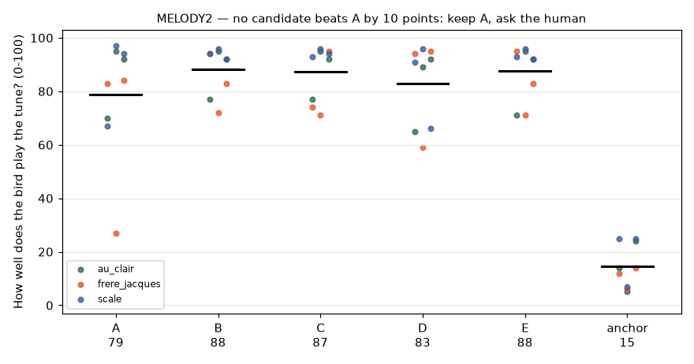

# WP-R5 report — Melodies that sound right: syllable notes and held keys

| Field | Value |
|---|---|
| WP | WP-R5 |
| Status | done (tag `wp-R5`; criteria 1, 2, 4–7 PASS; criterion 3 FAIL, accepted by the human) |
| Started | 2026-10-12 |
| Finished | 2026-10-13 |
| Agent | Claude Opus 5.5 (Claude Code desktop) |
| Sessions | 1 (two days) |

## 0. Decisions taken with the human during the WP

| When | What the human said | What it decided |
|---|---|---|
| after MELODY2 | "1. ok a should be the default" | **Rule E** (loudness-weighted mean) is the default note rule. MELODY2's pre-registered rule had no winner (B +9.5 < 10) and said "ask the human" (D-031). |
| after MELODY2 | "let's get rid of notes that are not analysed properly. i want a test that goes through every note tuned at the same pitch, and i can correct the pitch of the wrong ones. the corrected pitch should dominate any type of pitch decision" + hear every rule per syllable | A new study, **TUNE1**, and notes set by ear in the bank (D-032) |
| after TUNE1 | "1a 2a" | **Keep the 11 notes set by ear**; check the new bank blind, together with "taps avoid very wide sweeps" (**MELODY3**) |
| after MELODY3 + the held-key page | "Held keys in tunes, generally c is better" | **(c): the factory preset "Finch, melody"**; (a) and (b) are not shipped (D-033) |
| after the listening page | "for now i am ok to accept the fail. i need to move on to improve the performing part." | Criterion 3's FAIL is accepted; tap strategies go to the backlog; the WP is approved |

Working log, kept for a resumed session:
- **2026-10-12.**
  - Read the protocol, state, spec, MELODY1, PITCH1/2, D-019…D-031 and the code.
  - Candidates A–E in `cuicui.bank`, with tests.
  - MELODY2 pre-registered, built and opened.
  - Held-key options (a)/(b) prototyped behind off switches.
- **2026-10-13, studies.**
  - MELODY2 results; the human chose E.
  - TUNE1 pre-registered, built and run.
  - Bank builder: rule E and the corrections.
- **2026-10-13, bank and checks.**
  - Bank rebuilt (`9e0e08577e5a`).
  - The D-032 "not for taps" flags in C++.
  - MELODY3 pre-registered and run; the held-key page built; the human chose (c).
  - Preset added; (a)/(b) removed.
  - Listening page; check.sh and pluginval pass.
- A temporary `.claude/launch.json` served `listening/` to the browser pane during the session. It is removed before staging and not committed.

## 1. Summary (plain language, 3–6 lines)

- **The bird's notes are right now.** Each syllable's note is the pitch of its loud part (rule E), not its quiet ending.
  - You tuned 11 syllables by ear, and your values win over every rule.
  - In your tuning test (TUNE1), rule E agreed with your ear within a semitone for 98 % of the syllables; the old rule did for 47 %.
- **Tapped tunes come out on their notes**, and the R1 bank's "ending goes up" is gone. Blind, the new bank beat the old one on every screen (+18 points).
  - But a tapped tune with one random syllable per key is still recognised only on some draws (criterion 3: FAIL).
- **New factory preset "Finch, melody"** (your choice): follow the keyboard, Snap to note 100 %, one bird. With held keys, every syllable lands on your note.
- **The bird itself is unchanged:** same syllables, same timing; at Snap to note 0 the whole bird sits 43 cents lower, because its centre moved with the new notes.

## 2. What was built

| File / module | Purpose |
|---|---|
| `python/cuicui/bank/build.py` | Note rules A–E (`note_candidates`), default rule E (`BuildSettings.note_rule`), the −20 dB floor for every note, notes set by ear (`load_corrections`, `apply_corrections`), recorded in `build` / `stats` |
| `python/cuicui/bank/__main__.py` | `--note-rule`, `--corrections`, `--created-by` |
| `python/cuicui/bank/validate.py` | `schema_path(name)` for the new schema |
| `schemas/note_corrections.schema.json` | **new format** `cuicui.note_corrections` v1 (D-032) |
| `schemas/syllable_bank.schema.json` | `rule_used` may be "loud ending", "whole", "ear" |
| `assets/voicebanks/zf_22938/note_corrections.json` | the 11 notes you set by ear (TUNE1) |
| `assets/voicebanks/zf_22938/bank.json` | rebuilt: rule E + the 11 ear notes, hash `09b16ee69ac8` → `9e0e08577e5a` |
| `core/include/cuicui/control/syllable_bank.hpp`, `io/syllable_bank_io.hpp` | bank flags `no_note` / `no_tap` → `isTapSyllable`, `tapSyllables()` (D-032) |
| `core/include/cuicui/control/phrase_order.hpp` | a flagged syllable never starts a key press (redraw from the singer's own stream; phrase starts move on) |
| `assets/presets/05_finch_melody.preset.json` | **new factory preset "Finch, melody"** (D-033); presets 05–10 renumbered 06–11 |
| `plugin/Source/ParameterLayout.cpp`, `ui/PlayPage.cpp`, `ParamHelp.h` | the default note rule is called "Loud part"; help text |
| `python/tests/test_r5_melodies.py` | 11 tests: rules on synthetic contours, corrections, schema |
| `core/tests/test_syllables.cpp` | 3 tests on the flags (+ the new bank's centres) |
| `plugin/tests/test_presets.cpp` | "Finch, melody": its values, and a held legato tune with every syllable on its note, one bird |
| `python/tests/test_r1_whistle.py` | the bank rebuild test uses the corrections |
| `scripts/studies/melody2_*.py`, `melody2_page.html` | MELODY2: candidate banks + proxy, page, analysis |
| `scripts/studies/tune1_*.py`, `tune1_page.html` | TUNE1: the tuning page (voice synthesised in the page), analysis → corrections file |
| `scripts/studies/melody3_*.py`, `melody3_page.html` | MELODY3: page (MELODY2's + two ticks), analysis |
| `scripts/studies/r5_heldkeys.py` | the held-key comparison page |
| `scripts/render_listening_r5.py` | the R5 listening page and its measurements |
| `scripts/studies/proto1_make.py` | `--rebuild` now uses rule E + the corrections (it would have dropped them) |
| `agent documents/studies/MELODY2_*.md`, `TUNE1_*.md`, `MELODY3_*.md` + `studies/data/` | the three studies, pre-registered, with results and raw data |

## 3. How to run it

```bash
# rebuild the bank exactly (needs the recording; the test does the same)
cd python && PYTHONPATH=. .venv/bin/python -m cuicui.bank \
  --wav "/Users/baptistebohelay/Dev/research/birds synth/data/annotations/22938.wav" \
  --annotations "/Users/baptistebohelay/Dev/research/birds synth/data/annotations/22938.json" \
  --name zf_22938 --species "zebra finch" --created-by WP-R5 \
  --description "$(python3 -c "import json;print(json.load(open('../assets/voicebanks/zf_22938/bank.json'))['description'])")" \
  --corrections ../assets/voicebanks/zf_22938/note_corrections.json --out ../assets/voicebanks/zf_22938/bank.json
# the studies (from the repository root)
python/.venv/bin/python scripts/studies/melody2_banks.py && python/.venv/bin/python scripts/studies/melody2_make.py
python/.venv/bin/python scripts/studies/tune1_make.py
python/.venv/bin/python scripts/studies/melody3_make.py
python/.venv/bin/python scripts/studies/<study>_analyze.py <results.json>
# listening page, checks
python/.venv/bin/python scripts/render_listening_r5.py && scripts/listen.sh R5
scripts/check.sh && scripts/validate_plugin.sh 5 --gui
build/release/bin/plugin_render --preset "Finch, melody" --notes 60:0.3:0.4:100,62:0.72:0.4:100 -o out.wav
```

## 4. Acceptance criteria

| # | Criterion (from the WP) | Result | Evidence |
|---|---|---|---|
| 1 | MELODY2 run by the human and analysed exactly as pre-registered; the decision recorded (D-031 accepted) | **PASS** | `studies/MELODY2_note_rule.md` §7, `studies/data/MELODY2/`. Listener check 9/9; means A 78.8, B 88.3, C 87.4, D 83.0, E 87.6. No candidate beat A by 10 → rule 4: asked; the human chose E. D-031 updated (accepted with this commit). |
| 2 | Default rule: ≥ 90 % of playable syllables within ±2 st of their loudness-weighted pitch (today 75 %) | **PASS** | final bank: **99.2 %** (R1: 74.6 %); beyond 4 st: 0 % (R1: 9.3 %). The one outside is #97, moved +250 c by ear. The ear agrees: TUNE1, E within ±100 c for 97.6 %. |
| 3 | Tapped Frère Jacques (follow, 60 ms taps), 5 seeds: the human recognises the tune in all 5, and its end no longer goes up | **FAIL — accepted by the human** ("for now i am ok to accept the fail") | MELODY3 (blind, seeds 501–505): recognised on 2 of 5. Screen 1's ticks were not filled ("did not see the checkboxes"): 2 of 4 answered. "The ending goes up" on 1 (501). By the loudness measure, every note now lands on its target (mean 0.07 st; R1 bank 1.86 st, last G +6 st: `listening/R5/metrics.json`). Listening page: "until 09 every new note system sounds much better than the old note". |
| 4 | Bank rebuilt and committed; same syllables in the same order (count, order, labels checked against the old bank); R1 / R4 tests pass; reference comparisons with D-030 off | **PASS** | 12 phrases, 123 syllables; order, labels, onsets, curves and phrase starts identical (check in the session; `test_bank_rebuild_is_reproducible`). `test_r1_whistle.py` (C++ = Python reference, `release_alarm 0`) and all R4 plugin tests pass: ctest 181/181, pytest 80/80. |
| 5 | The held-key choice implemented, with tests for each part picked | **PASS** | (c) picked → `05_finch_melody.preset.json`; plugin test `presets: 'Finch, melody' is for tunes…` (91 assertions: values, plus a held legato tune where every syllable lands on its key's note and only the newest key sings). (a)/(b) not picked → removed (the engine files are back to their committed state). |
| 6 | Birdness unchanged: the natural phrase render (R1CHECK `plugin_natural`) differs only in the first syllable's shift | **PASS** (with a constant shift) | `metrics.json` → `criterion_6`, phrase 4 from MIDI. Natural setup: the same 21 syllables at the same samples, every one moved by **−42.8 c** (the own-height centre moved +42.8 c with the new notes). Default setup: the first syllable −2.6 c, the others −42.8 c. Nothing else changes (same curves, voice, room). Listening items 14–15. |
| 7 | `scripts/check.sh` and `scripts/validate_plugin.sh 5 --gui` pass | **PASS** | §5 |

## 5. Quality gate

```
100% tests passed, 0 tests failed out of 181
80 passed in 6.76s
TEST OK
All checks passed!
warning: clang-format not installed; skipping format check (brew install clang-format)
CHECK PASSED

pluginval VST3 strictness=5 (with editor tests): SUCCESS
pluginval AU strictness=5 (with editor tests): SUCCESS
AU VALIDATION SUCCEEDED.
note: no clap validator (clap-info) on PATH; CLAP built but not validated
VALIDATE_PLUGIN OK (strictness 5, with GUI tests)
```

## 6. Listening & results

- Page: `listening/R5/index.html`.
- Study pages:
  - `listening/R5/melody2/` (blind, done);
  - `listening/R5/tune1/` (the tuning page, done);
  - `listening/R5/melody3/` (blind, done);
  - `listening/R5/held/` (the held-key comparison).

| Items | What to listen for | Key metrics |
|---|---|---|
| 01–03 Frère Jacques taps: tune / old notes / new notes | Same syllables, seed 7 (MELODY1's take): with the old notes, the last G jumps up; with the new notes, it repeats E F G as it should | loud part vs note: old 1.86 st (last three −0.5, +0.5, **+6.0**), new 0.07 st |
| 04–06 Au clair de la lune taps | Same, on another tune | old 1.74 st, new 0.09 st |
| 07–09 C major scale taps | The 7th step (B) was 6 semitones high with the old notes | old 1.79 st (B +6.0), new 0.07 st |
| 10–11 Frère Jacques held 0.35 s: today / "Finch, melody" (plugin) | Today the bird adds its own melody between your notes; the preset puts every syllable on the note | 3.1 syllables per key; on the note 39 % → 100 % |
| 12–13 Frère Jacques legato: today / "Finch, melody" | Same, keys held to the next note; the long call after the two long notes stays (D-030) | 3.9 per key; 35 % → 100 %; 2 calls |
| 14–15 Phrase 4 from MIDI, natural setup: old / new bank | The same bird: the same 21 syllables at the same times, all 43 cents lower | shift −42.8 c for every syllable |




**The three studies in one line each:**
- **MELODY2:** A 79, B 88, C 87, D 83, E 88. No pre-registered winner, then the human's choice: E.
- **TUNE1:** 112 of 123 syllables on the note under E; 11 small corrections (median 65 c); repeatability gate passed (32 c). E matches the ear (97.6 % within a semitone); "high", the idea from MELODY2, is the furthest (40.7 %).
- **MELODY3:**
  - new bank 67 vs old 49 (better on 5 of 5);
  - "taps avoid very wide sweeps" not adopted (+4.8);
  - criterion 3 fails.

**The held-key comparison (2026-10-13, new bank, seed 7).** Each cell gives syllables per key / on the note / release calls. (a) and (b) were rendered with prototype switches, removed after the choice.

| Tune, style | today | (a) 0.4 s | (a) 0.5 s | (b) 150 ms | (a)+(b) | **(c) chosen** |
|---|---|---|---|---|---|---|
| Frère Jacques held | 3.1 / 39 % / 0 | 1.0 / 100 % / 0 | 1.0 / 100 % / 0 | 3.1 / 39 % / 0 | 1.0 / 100 % / 0 | 3.1 / 100 % / 0 |
| Frère Jacques legato | 3.9 / 35 % / 2 | 2.5 / 49 % / 2 | 1.5 / 71 % / 2 | 3.8 / 36 % / 1 | 1.4 / 75 % / 1 | 3.9 / 100 % / 2 |
| Au clair held | 3.0 / 36 % / 0 | 1.0 / 100 % / 0 | 1.0 / 100 % / 0 | 3.0 / 36 % / 0 | 1.0 / 100 % / 0 | 3.0 / 100 % / 0 |
| Au clair legato | 4.2 / 33 % / 3 | 2.9 / 41 % / 3 | 2.1 / 57 % / 3 | 4.0 / 32 % / 1 | 1.9 / 57 % / 1 | 4.2 / 100 % / 3 |
| scale held | 3.2 / 38 % / 0 | 1.0 / 100 % / 0 | 1.0 / 100 % / 0 | 3.2 / 38 % / 0 | 1.0 / 100 % / 0 | 3.2 / 100 % / 0 |
| scale legato | 3.5 / 38 % / 1 | 2.1 / 50 % / 1 | 1.3 / 79 % / 1 | 3.5 / 38 % / 1 | 1.3 / 79 % / 1 | 3.5 / 100 % / 1 |

## 7. Deviations from the spec

| Spec said | What I did | Why |
|---|---|---|
| All candidates drop the frames below −20 dB; A = today's rule unchanged | A keeps every voiced frame | A is the control: it must be today's sound. B–E drop the frames. |
| "Loudness-weighted" | weights = amplitude² (energy) | as PITCH1's "energy" rule and MELODY1's proxy, so the proxy and the rules agree |
| Each melody as taps 0.42 s apart | Au clair de la lune on a 0.42 s beat with its own rhythm (two-beat E and D, a long last C); Frère Jacques with R1's timing; the scale even | the tunes stay recognisable; the same timing for every version |
| §3.3: if the winner is not one of the four Melody-card choices, it replaces the default and the label is reworded | done for E: the default choice now says "Loud part"; with E, the other three choices also drop the −20 dB frames (median change 20 c) | the floor is a tracker limit, true for every rule |
| §4.3: the human chooses the held-key options from renders; implement only what was picked | as specified, plus two studies the human asked for: **TUNE1** (notes by ear) and **MELODY3** (blind check of criterion 3 + "avoid very wide sweeps") | MELODY2 had no pre-registered winner; the human designed TUNE1 and chose MELODY3 ("2a") |
| — | the D-032 "not for taps" flags in the core | TUNE1's pre-registration promised that "no clear note" syllables never start a key press, and MELODY3 needed the same mechanism. Unused by the committed bank (no flags) |
| Criterion 6: "differs only in the first syllable's shift" | measured in both setups; in both, all following syllables also move by the constant centre change (−42.8 c) | the own-height centre is the median of the notes, which changed; a 43-cent transposition of the whole bird |

## 8. Contract changes (see decisions.md)

- **D-031** (rule part): E is the default note rule (proposed with this WP; the order part was already accepted).
- **D-032 (proposed):**
  - the new file format `cuicui.note_corrections` v1 (schema);
  - bank format v1, additive: `rule_used` values, flags "ear" / "no_note" / "no_tap", `build` / `stats` fields;
  - bank builder default rule E with the −20 dB floor, and new CLI options;
  - core API `SyllableBank::isTapSyllable` / `tapSyllables()` and the first-syllable rule;
  - host choice text "Loud part" (index unchanged, so automation and old sessions keep working).
- **D-033 (proposed):**
  - new factory preset "Finch, melody";
  - presets 05–10 renamed 06–11 (presets are found by name; the CMake glob picks them up).

## 9. Measurements & baselines

| Metric | Value | Conditions |
|---|---|---|
| Playable syllables within ±2 st of their loud part | 99.2 % (R1 bank 74.6 %) | final bank, 118 playable |
| Rule within ±1 st of the ear (TUNE1) | E 97.6 %, loudest 87.8 %, D 84.6 %, average 81.3 %, C 73.2 %, B 54.5 %, landing 48.8 %, A 47.2 %, high 40.7 % | 123 syllables, A7, tone before |
| Listener repeatability (TUNE1 check round) | median 32 c (corrected items 45 c) | 10 items |
| Tapped tunes, loud part vs note | 0.07–0.09 st (R1 bank 1.74–1.86 st) | seed 7, three tunes |
| Blind tune ratings (MELODY3) | new 67.2, old 49.4, no_wide 70.8, anchor 18.2 | Frère Jacques, 5 seeds |
| Bird centre | 10545.7 c (R1 10502.9 c) | rule anchors' median |

## 10. Known issues & limitations

- **Item 11's end sounds high** (the human). Its last syllable is #97, the one TUNE1 moved +250 c; in the check round the human set it at +65 c. The first-pass value, used as pre-registered, probably overshoots. Re-checking it is one line in `note_corrections.json` plus a rebuild (backlog).
- **Legato with "Finch, melody"** is clearer than today, but less recognisable than taps (the human: "acceptable for now").
- **Criterion 3 fails (accepted).** A tapped tune with one random syllable per key is recognised on some draws only (MELODY3: 2 of 4 answered screens), although every note is right on its own.
  - Likely cause: neighbouring syllables have unrelated shapes (one starts 4 semitones low, the next falls 5), and the steps get lost.
  - Narrow syllables only partly explain it (r = −0.41 over 14 screens).
  - Route for tunes today: held keys with "Finch, melody". Candidate tap strategies are in the backlog.
- **MELODY3's first screen had no ticks** (the listener did not see them). The criterion fails with or without that screen.
- **The 11 ear corrections are small and only partly repeatable** (4 of 6 back to zero in the check round). They pass the pre-registered gate; their effect on tunes is small either way.
- **At Snap to note 0, the bird sits 43 cents lower than in R1** (its centre moved with the new notes). Not audible as a change of bird (criterion 6), but the "natural" height moved a quarter-tone.
- **The other note-rule choices** ("steady parts", "landing", "average") moved by a median 20 c with the −20 dB floor. Whether they are still useful is a backlog question.
- **With Birds 1**, a long press's release call can overlap the next key's first syllable (backlog).
- **The web prototype (PROTO1)** carries the new bank but not D-030 or D-032 playing (as before: its playing logic is out of scope).
- `clang-format` is still not installed (check.sh warns). CLAP is built but not validated (no clap-info).

## 11. Tools / dependencies added

- None. The study pages use the PROTO1 voice in the page (WebAudio). `node --check` (already on the machine) was used to syntax-check the generated pages.

## 12. Handoff notes for the next agent

- **The bank and its notes.**
  - `python -m cuicui.bank` defaults to rule E. Pass `--corrections assets/voicebanks/zf_22938/note_corrections.json --created-by WP-R5` to rebuild the committed bank exactly (`test_bank_rebuild_is_reproducible` does).
  - Never rebuild without the corrections file: it would drop the 11 ear notes. `proto1_make.py --rebuild` passes it.
  - Corrections are keyed by annotation segment + label. A different annotation file needs its own corrections; a mismatch stops the build loudly.
- **R3 (more recordings):** a new recording gets its own bank (rule E). The TUNE1 page (`scripts/studies/tune1_make.py`) can be pointed at any bank with small changes (it reads `listening/R5/work/bank_<X>.json`; give it the new bank and a reference note near its centre). That is how its notes get checked by ear.
- **Flags that keep a syllable from starting a key press** (D-032): add "no_tap" or "no_note" to a syllable's `flags` in the bank.
  - The core redraws a flagged first pick from the singer's own stream, so other picks do not move; phrases still sing them.
  - Only with D-030's reserve (default playing). The R1 / PROTO1 reference playing ignores flags, which keeps `test_r1_whistle.py` exact.
  - MELODY3's `no_wide` variant used exactly this (`listening/R5/work/bank_no_wide.json`).
- **Presets:** "Finch, melody" is file 05. Presets are found by name everywhere, so renumbering is safe. Re-run CMake (or the build) after adding a file.
- **Catch2 filters:** test names with commas need a wildcard without the comma, e.g. `"presets: 'Finch*"`.
- **The study scripts** live in `scripts/studies/` (outside the ruff gate, as before):
  - `melody2_make.py` / `melody3_make.py` share the tune, reference-tone and FLAC helpers;
  - `r5_heldkeys.py` now renders only "today" and (c); the (a)/(b) numbers are in §6.
- **If tapped tunes are taken up again** (backlog), the cheapest test is a MELODY3-style page:
  - "keep the tap syllable while a line goes on" needs a small `ModeAB` change (remember the last tap syllable and its time);
  - "narrow syllables only" needs no code: flag the wide ones "no_tap" in a variant bank.

## 13. Partial — remaining work (only if status is partial)

- n/a

## 14. Revision history (feedback rounds)

| Date | Human feedback | Changes |
|---|---|---|
| 2026-10-13 | (during the WP) see §0 | the studies and choices in §0 |
| 2026-10-13 | Listening page: "until 09 every new note system sounds much better than the old note"; 11 "better, but still high note at the end"; 13 "sounds better [than 12], but not as recognisable as the tap. acceptable for now"; 14 and 15 "sound the same to me"; "for now i am ok to accept the fail. i need to move on to improve the performing part." | No code changes. Criterion 3 FAIL accepted; item 11's high end traced to #97's +250 c ear note (check round +65 c), recorded as a known issue + backlog; D-031…D-033 accepted; committed and tagged `wp-R5` |

## 15. Proposed commit message

```
WP-R5: melodies that sound right — notes by the loud part, notes by ear, Finch melody preset

A syllable's note is now its loudness-weighted pitch (rule E, chosen after the
blind test MELODY2), ignoring frames 20 dB below its peak; 11 notes set by ear
in the tuning test TUNE1 override every rule (cuicui.note_corrections v1).
Bank zf_22938 rebuilt (same 123 syllables, new notes: 99 % within 2 st of the
loud part, R1 75 %); blind, the new bank beat the old one on 5/5 screens
(MELODY3). New factory preset "Finch, melody" (follow, snap 100 %, one bird)
for held-key tunes. Bank flags no_note/no_tap keep a syllable from starting a
key press (D-032). Tapped tunes with random syllables remain hit-and-miss
(criterion 3 FAIL, accepted by the human).
Report: agent documents/reports/WP-R5_report.md
```
