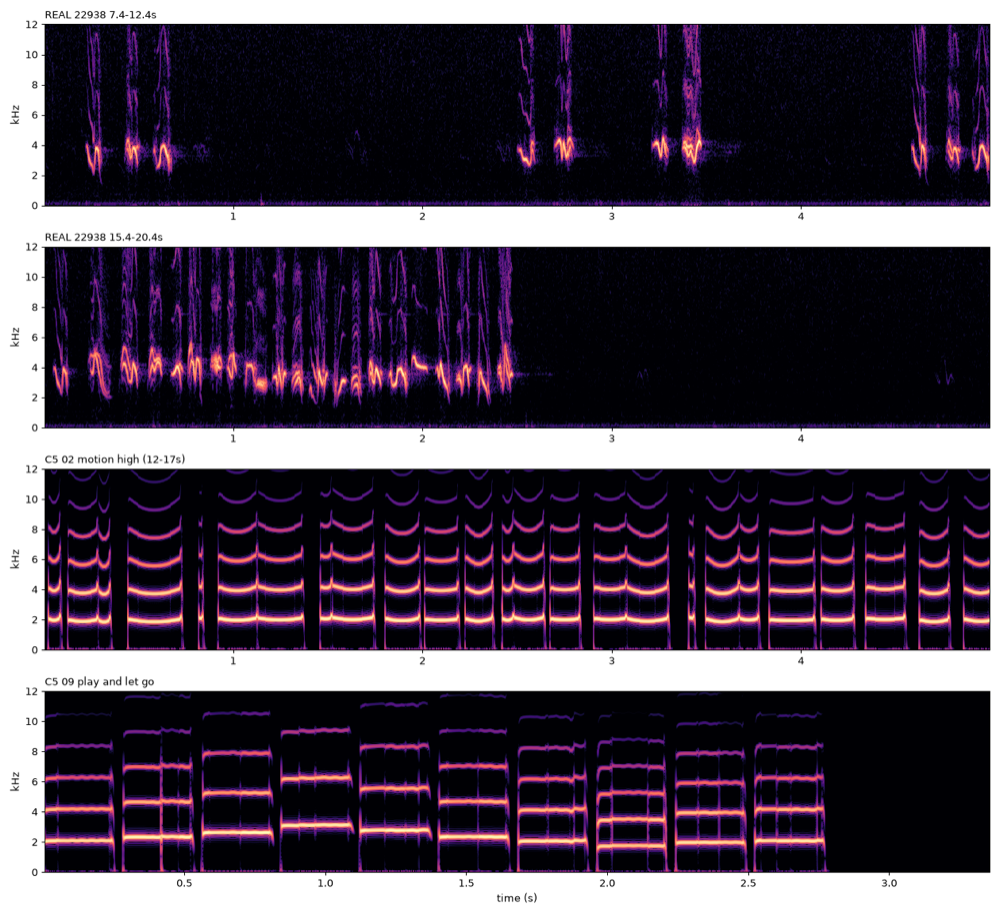
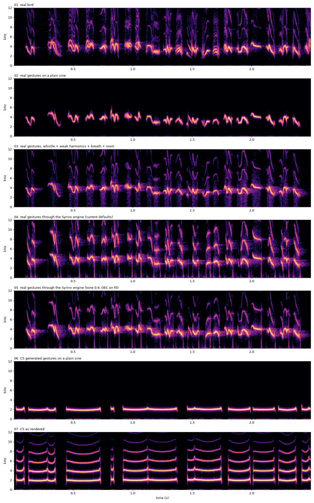
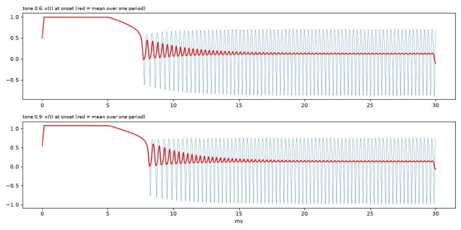

# Approach review — 2026-10-11

> Requested by the human after the C5 listening: “they all sound terrible, like morse code; the colour is synthetic; the variations feel fake. Review the whole approach as a research director.”
> Status: **proposal**. Nothing in `state.md`, the plan or the code was changed by this review.
> Evidence page: `listening/REVIEW/index.html` · scripts: `scripts/review/` · figures: `reviews/assets/`.

## 1. Verdict

The project did not fail on the physics; it failed on **method**. We built the bird's body for 14 work packages before ever measuring it against the bird. Nothing in the pipeline was ever required to sound like the recording, and every work package passed its own tests while the product drifted away from "bird".

The measurements show three concrete faults, in order of importance:

1. **The melodies (gestures) are wrong.** A real bird never holds a pitch. Each element is a swoop of about half an octave in about 75 ms. Our generator holds near-steady beeps around the played note, which is literally morse code. This is the largest error and the cheapest to fix, because the bird's real curves can be taken straight from the recording.
2. **The colour is too bright and too low.** Our second harmonic is 20–28 dB louder than the bird's, and we sing an octave lower than this bird (about 2.0 kHz instead of 3.6 kHz).
   - The cause is mostly a default that contradicts our own source, Riede et al. 2006. That paper says the OEC (the resonant cavity in the throat) is tuned *to the fundamental*. Our tracking formula instead puts the resonance at 2–3× f0, so it boosts the harmonics.
3. **The product doctrine produces beeps by design.** We map a keyboard note to a held, in-tune pitch, with Snap and a concert-pitch band. Birds do not do that. The Leash control generates around the held note, which only softens the problem.

The anatomical engine itself is **salvageable**. Given the real bird's gestures, it reproduces the pitch motion at full speed. A two-parameter change brings its harmonic balance within about 7 dB of the bird's.

## 2. Evidence

### 2.1 Real bird vs C5 output (measured, same analysis on both)

| | Real bird (22938, 15.4–17.9 s) | C5 output (02, high Motion) |
|---|---|---|
| median f0 | **3.6 kHz** (5–95 %: 2.5–4.5 kHz) | **2.0 kHz** (1.86–2.17 kHz) |
| pitch speed, median | **18 600 cents/s** | **1 170 cents/s** (16× slower) |
| steady frames (< 1 500 c/s) | **6 %** | **60 %** |
| pitch range inside one element | **≈ 610 cents** | **≈ 190 cents** |
| element length, median | **75 ms** | **188 ms** |
| 2nd harmonic vs fundamental | **−33 dB** (near-pure whistle) | **−5 dB** (buzzy) |

Across all 145 annotated sounds in `22938`, the dominant frequency is 2.7–4.6 kHz. The energy below 1.5 kHz sits about 50 dB under the rest. That means **there are no zebra-finch-style harmonic stacks (about 600 Hz) anywhere in this recording.** `01_research.md` §2.7 designed for those stacks.

### 2.2 Where is the bird lost? A 2 × 2 copy-synthesis experiment

We extracted the dominant pitch and loudness curves from the real recording, and the same curves from the C5 render. Each set was played through either a plain sine whistle or the Syrinx engine. For the engine path, the real curves become a gesture score (`render_score`, through the real VoiceController and BirdVoice) at Size 0.75, so the band covers this bird's 2.5–4.9 kHz.

| # | Gestures | Voice | pitch speed (c/s) | steady | H2−H1 |
|---|---|---|---|---|---|
| 01 | real recording | — | 18 600 | 6 % | −33 dB |
| 02 | **real** | plain sine | 14 500 | 9 % | (none) |
| 03 | **real** | sine + harmonics at −30 dB + breath + small room | 14 500 | 9 % | −30 dB |
| 04 | **real** | **Syrinx engine, current defaults** (tone 0.6, OEC tracking) | 18 100 | 8 % | **−11 dB** |
| 05 | **real** | **Syrinx engine, tone 0.9, OEC on f0** | 14 800 | 7 % | **−26 dB** |
| 06 | **C5 generated** | plain sine | 1 225 | 58 % | (none) |
| 07 | C5 generated | Syrinx engine (as you heard it) | 1 170 | 60 % | −5 dB |

What the numbers say. The listening page is there to confirm or overrule them.

- **06 vs 02:** the same bare sine gives morse code with our gestures and a swooping whistle with the bird's. The gestures carry most of the "bird".
- **04:** the engine follows real gestures at full speed: 18 100 c/s, steady frames 8 %. The pitch-led controller and inverse map work. The colour is too bright.
- **05:** placing the OEC resonance on the fundamental and using a purer source moves the second harmonic from −11 to −26 dB, close to the bird's −33 dB. Remaining defects:
  - a small low-frequency tick at every element onset, about −40 dB below the peak and lasting about 6 ms; it shows as vertical lines in the spectrogram;
  - no two-voice segments (the real swipes often show two parallel traces);
  - no real breath or noise texture.
- **03 vs 05** is the decision listening item (see §5).

## 3. Diagnosis — why we drifted

**Technical**
- **Gestures were invented, not observed.** The C4 archetypes and the C5 grammar were hand-designed by agents that cannot hear, then tuned by one line of feedback per round. The C5 retune ("too long, too gliding") made gestures **shorter and shallower** (`kAnchorSigmaCents` 150 → 55, chips weighted 2.6, long sweeps 0.06). Real birds are short **and deep**, so the retune converged on beeps.
- **Register follows the model, not the bird.** The playable band (D6–C8 at Size 1) came from where the normal form is comfortable, and demos sat on C7 (2.1 kHz). This bird lives at 2.5–4.9 kHz.
- **The OEC default contradicts the literature we cite.** The default is `f_H = 3000·(f0/1000)^0.7`, which puts the resonance at about 1.7–3× f0. Riede 2006 reports resonance tracking f0. With the +6 dB/oct radiation tilt on top, the result is strong harmonics and the "synthetic colour".
- **Demos removed the remaining naturalness.** C5 renders ran with noise off (`noise.aspiration` 0, `noise.beta_sigma` 0), Snap 0.25 and Range 0.55.

**Process**
- **No reference in the loop.** In 14 work packages, no acceptance criterion measured distance to a real bird. Real audio appeared only ad hoc (B3 07/08, B6 03b). D1 was parked, so the only reference left the plan, and fitting (E) and learned gestures (F) were scheduled after 20 work packages.
- **The warning signs were answered by retuning demos.** Since B3 the feedback has repeatedly been "metallic", "printer", "machine-like", "not bird-like", "synthetic" (B3, C1, C3, C4, C5). Each time an agent adjusted a render; no one questioned the method. Verification (does the tube resonate at c/4L?) replaced validation (does it sound like the bird?).
- **This is the second physics-first program with the same outcome.** The earlier BirdVoice program stopped at packet 139 still chasing a "metallic" timbre. The lesson is about ordering: physics-first, reference-last does not converge on "sounds like a bird".

## 4. What to keep, what to change

**Keep**
- **The Tier-1 engine (B1–B6).** It can follow real gestures; its colour is a calibration problem, not a dead end, with 05 as first evidence.
- **The atlas, inverse map and pitch-led controller (C2–C3).** This is exactly the tool to turn *measured pitch curves* into physiology. It makes most of the E-phase CMA-ES inversion unnecessary for gestures.
- **Plugin plumbing (C1, C5).** Allocator, polyphony, tempo sync, the Leash blend, zero-allocation rendering and the score format all stay.

**Change**
1. **Gestures come from the bird, now.** Build a syllable bank from the 145 annotated sounds: pitch and loudness curves (plus a second trace where two voices sing), keyed by label (swipe, peep, Hswipe, Lswipe, alarm…).
   - The generator *selects, sequences and varies real syllables*: a Markov chain over the annotated label sequence, plus variation by small time and pitch warps, or FPCA within a syllable type.
   - This is F1–F3 brought forward, without E1–E4.
2. **Calibrate the colour against the recording.** Fit a handful of constants on the copy-synthesis (tone mapping, OEC ratio, gape, trachea reflection/loss, radiation mix, noise levels) to the real harmonic balance and spectral envelope, then:
   - remove the onset tick;
   - add two-voice where the data shows it;
   - move the register (Size or γ) to this bird.
3. **Make "birdness" an acceptance gate.** Every listening page carries the real bird as reference and a metrics panel: register, pitch speed, steady fraction, range per element, element and gap length, harmonic balance. A work package that moves *away* from the bird cannot be approved.
   - Optional: an embedding or classifier proxy (BirdNET / Perch). That needs a model download, which you would need to OK.
4. **Rethink the musician mapping.**
   - A key selects register, phrase family and intensity; the bird keeps its own curves, and "in tune" applies only to the *anchors and targets* of sweeps.
   - Leash defaults high; the in-tune "bird-voiced theremin" becomes an expert mode.
5. **Re-plan.** Pause C6: no UI or presets on a voice that does not yet sound like a bird. Insert R1–R3 (below), and make E1–E4 optional, used only if calibration cannot reach the colour.

## 5. Proposed next steps

| Step | What | Gate (you listen) |
|---|---|---|
| **R0 (done, this review)** | Copy-synthesis experiment, `listening/REVIEW/` | Do 02/03 give you a glimpse of a bird? How do 04/05 compare to 03? |
| **R1 — real syllable bank + copy playback** | Ingest 22938 (D1-lite, existing tseg annotations), extract curves for all 145 sounds, gesture-score export, play real syllables from the plugin (one key = one syllable type) | Plugin plays recognisable bird syllables |
| **R2 — colour calibration** | Fit the few voice constants to the recording; fix the onset tick; two-voice; register | Engine ≈ whistle reference (03) or better, in blind A/B |
| **R3 — learned generator** | Markov grammar from the label sequence; variation from real syllables; Leash/Density/Variation re-mapped onto it | Generated phrases rated "bird" vs real in blind A/B |
| then C6 | UI and presets on a voice that passes R1–R3 | M4 |

**Decision rule after R0/R2.**
- If **05 ≈ 03**: keep the physical engine as the default voice and calibrate it.
- If **03 is clearly better than 05**: make the default voice an *anatomically parameterised spectral voice*. That means two FM sources (left/right), an OEC resonance and gape tilt, and breath noise, with the same physiological controls. It runs at about 1/50 of the CPU (the engine is 2.7 %/voice). The Mindlin engine stays as the "rough / physiology" voice for buzzes and non-linear sounds.

Either way, the gestures are the critical path.

## 6. Decisions needed from the human

1. Listen to `listening/REVIEW/` and answer: do 02/03 sound like a bird? Rank 03 / 04 / 05.
2. Confirm the species of `22938`. Its sounds (tonal swoops at 2.5–4.9 kHz, no stacks) are not the zebra finch song assumed in `01_research.md`. Can more recordings be added later (more birds of this species, or other songbirds)?
3. C5 options:
   - commit as `partial`, keeping the plumbing and replacing the content in R3; or
   - hold it unstaged until R3.
4. Approve the re-plan (pause C6, add R1–R3, E-phase optional). Approval would turn into a `decisions.md` entry and updated `state.md` / work-package files.

## 7. Caveats

- The reviewer cannot listen. Every claim here is from measurements, and your ears overrule them.
- The tracker follows the *dominant* trace only. Two-voice segments are reduced to one voice in 02–05, so they undersell the bird.
- The 04/05 engine settings are a quick guess, not a fit. 05 is a lower bound on what calibration can reach.
- The "pitch speed" and "steady" statistics use a 1 ms hop and a 7-point smoothing. They compare items fairly with each other but are not published SAP measures.
- Reproduce with: `python/.venv/bin/python scripts/review/experiment.py scripts/review "$PWD" listening/REVIEW`, then `(cd python && .venv/bin/python -m cuicui.listen page ../listening/REVIEW/manifest.json)`.

## 8. Human listening results (2026-10-11)

| Item | Verdict |
|---|---|
| 02 real gestures → plain sine | "really feels like a bird" |
| 03 real gestures → whistle + colour + room | "hard to differentiate from the original" |
| 04 real gestures → engine, current defaults | "suddenly more synthetic, different clicks" |
| 05 real gestures → engine, tone 0.9, OEC on f0 | "perfect if you take out the clicks during attacks" |
| 06 C5 gestures → plain sine | "flat, no melody, literally morse code" |
| 07 C5 original | "wrong, like 06" |

What these results mean:
- **The gestures carry the bird (first-order factor).** 02 vs 06 differ only in gestures, both on the same bare sine, and the difference is bird vs morse code.
- **The colour is a calibration issue (second-order factor).** 04 vs 05 differ only in two voice settings. The engine needs no redesign.
- **The anatomical engine is good enough for this bird's song.** 05 ≈ 03, so by the §5 decision rule we keep it as the default voice.
- **The acoustic scene matters.** 03's small room and breath noise are part of "indistinguishable".

## 9. Onset click diagnosis

Test setup: labial oscillator alone (`cuicui_core.source_only`), σ = 0.75, target f0 = 3.5 kHz, α ramped from rest with a 3 ms attack like the controller.

- **Before the onset:** the rest state sits on the upper fixed-point branch, x ≈ 1.0.
- **At the onset:** x drops to the oscillation centre (period mean ≈ 0.12) in about 1 ms. The oscillation itself is born at full amplitude (p2p ≈ 1.6; the inverse map puts this register at β ≈ 0.0–0.1, a SNIC onset).
- **Result:** a step of about 0.9, as large as the oscillation, enters the source signal. It passes the 20 Hz DC blocker and is emphasised by the radiation derivative. Offsets do the reverse.
- **Physical reading:** real labia are adducted *before* airflow starts, so the position change makes no sound. In the model, labial position *is* the sound.
- **Fix candidates for R2:**
  - pre-phonatory adduction (hold α just below threshold during mini-breaths inside a bout);
  - a source DC tracker or higher DC-blocker cut (well below the 2.5 kHz floor of this bird);
  - a short flow fade-in.
  Each needs a test that measures onset transients against the real recording (onset energy below 1.5 kHz is about 50 dB down in 22938).

## 10. Human decisions so far (2026-10-11, discussion — not yet in `decisions.md`)

| # | Decision | Consequence |
|---|---|---|
| 1 | **Real syllables first; variations later.** "Have something that works and work from there; isolate issues." | The first generator plays real syllables only. Variation is a separate later step. |
| 2 | Variation, when it comes, **stays within this bird's style** (no invented syllables for now). | Variation ≤ the natural spread measured in the corpus. |
| 3 | **No "in key".** The bird should **dance around the note**. What "the note" of a syllable is must be studied before it is designed. | Study **PITCH1** (`agent documents/studies/PITCH1_perceived_pitch.md`), then PITCH2 (tolerance). |
| 4 | `22938` is a **zebra finch**; many more recordings are available. | The corpus can grow. This bird's recorded repertoire (tonal sweeps, no low stacks) sets the design targets, not the textbook. |
| 5 | **Understanding before implementation.** C5 is committed as partial; the re-plan waits until the listening studies are understood. | No new work packages yet; the "understanding phase" runs as small, isolated listening studies. |
| 6 | C5 committed as **partial** (`0822405`). | Plumbing kept, gesture content to be replaced. |
| 7 | Playing modes: all five are wanted eventually. **A + B first, as one behaviour:** a key plays one real syllable; if the key is still held when it ends, the bird keeps singing around the note (B). Code must be **modular** so C (conductor/flock), D (drawn gestures) and E (whistle-in) plug in later. | Architecture requirement for the post-study design; no implementation yet. |
| 8 | PITCH1 done. Provisional: a syllable's note ≈ where it lands (end / recency-weighted); turning points don't define it; tolerance is wide in isolation. | Use for PITCH2 design; confirm with a reference note present. |
| 9 | Keyboard mapping **(a)**: the bird sings the note's name at its own height. | Used in PITCH2. |
| 10 | Encode **both** note rules (steady parts, landing) with a **user toggle**; default landing until data decides. | Playground implements it; product option later. |
| 11 | PITCH2 done: with the held note 2–3 octaves below, placement barely matters (P(yes) 0.79 on the note vs 0.65 a tritone away; no rule or tolerance measurable). | Mapping (a) to be discussed: the bird is tonally free in this setting. |
| 12 | **Syllable pitch rule (human, after PITCH2):** a syllable's note = its **longest steady part**; if that part is too short, its **ending**. Operational default: steady = the pitch stays within ±50 c; "too short" = under 20 ms. On 22938 this uses the steady part for 66 % of syllables and the ending for 34 %. | Default rule for all placement; steady/landing/average stay available as a toggle. |
| 13 | **No more pitch tests for now.** "Notes are not so recognisable" (confirmed by PITCH1/PITCH2). Priority: **have a feel and play with it.** | Remaining formal studies reviewed for skipping; next step is a playable prototype. |
| 14 | **Default colour = the bird's own harmonics** (2nd/3rd at −30/−33 dB, the level measured in 22938); no breath; room optional. (COLOUR1 + COLOUR2) | Voice recipe default; also the colour target for the anatomical engine. |
| 15 | Prototype feedback: pitch-to-note match "questionable" (acceptable for now); fast playing felt repetitive (one short steady syllable). → Prototype now starts each key on a **random syllable**, puts the **first syllable exactly on the note**, and offers **"follow the keyboard"** (bird 3 octaves above the key) next to own height. | Feel to be re-checked by the human. |
