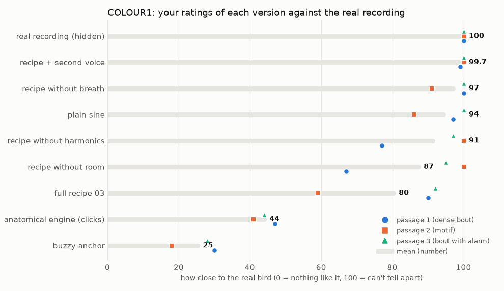

# COLOUR1 — What makes the resynthesised bird sound real?

> Study protocol, written **before** data collection. Status: **done 2026-10-11, results in §6** (sections 1–5 unchanged since before the test).
> Test: `listening/COLOUR1/index.html` (self-contained, 4.1 MB) · generator: `scripts/studies/colour1_make.py` (+ `colour1_page.html`, `voice2.py`) · hidden key: `listening/COLOUR1/design.json` (design hash `5898443cdc43`) · rendered versions for inspection: `listening/COLOUR1/wav/`.
> Origin: the approach review. Item 03 (real gestures, plus faint harmonics, breath and a small room) was "hard to differentiate from the original". Which ingredient does that work?

## 1. Questions

1. Which ingredient matters most for realism: **harmonics**, **breath** or **room**?
2. Does adding the **second voice** (the syrinx's other side) help?
3. How does the **anatomical engine** (tuned: tone 0.9, OEC on f0) compare with the best whistle recipe? Its attack clicks are **not yet fixed**.

## 2. Method

MUSHRA-style multiple-stimulus rating (simplified from ITU-R BS.1534).
- **Screens:** 3, one per passage of `22938`:

  | Passage | Span | Content |
  |---|---|---|
  | P1 | 15.40–17.85 s | dense bout |
  | P2 | 11.90–13.00 s | the motif |
  | P3 | 26.95–29.50 s | bout with low swipes and an alarm |

- **On each screen:**
  - The **Reference** (the real recording, high-passed at 1 kHz) is available at any time.
  - **9 versions** (A–I) appear in random order, with the letter assignment re-randomised per screen. Playback switches instantly at the same position.
  - The listener rates each version 0–100: how close to the real bird (100 = can't tell apart). Every slider must be moved.
- **Versions.** All use the real pitch and loudness curves of the dominant voice, are loudness-matched on voiced frames, and carry the recording's own background-noise bed (29.6–34.2 s):

  | ID | Content |
  |---|---|
  | ref | hidden reference: the real recording |
  | sine | plain sine ("02") |
  | full | sine + harmonics (−30 / −33 dB) + breath (noise on f0, −32 dB) + room (RT60 0.18 s, −22 dB) ("03") |
  | no_harm | full minus harmonics |
  | no_breath | full minus breath |
  | no_room | full minus room |
  | voice2 | full + the tracked second voice. The tracker finds only part of it: 164 / 39 / 120 ms of 1583 / 616 / 1770 voiced ms. |
  | engine | Syrinx engine with real gestures, tone 0.9, OEC on f0, Size 0.75, + room ("05"; onset clicks unfixed) |
  | anchor | sine with strong harmonics (−5 / −10 / −15 / −20 dB) + room: a buzzy, synthetic low anchor |

## 3. Analysis plan (fixed before data)

1. **Listener check.** The hidden reference should be rated ≥ 90 on at least 2 of 3 screens, and the anchor should be the lowest or near-lowest.
2. **Ingredient effects (leave-one-out).** For each ingredient, effect = full − (full without it), per passage and as the mean.
3. **Other contrasts:** voice2 − full, engine − full, full − sine, and each version vs the hidden reference.
4. **Report:** the mean rating per version (and per passage), as a table and a dot plot.

## 4. Decision rules

- **An ingredient matters** if removing it lowers the rating by **≥ 10 points on average and on at least 2 of 3 passages**. Ingredients that matter become standard parts of the voice chain (for example, a room module or breath noise).
- **Default voice for the plugin:**
  - Engine within 10 points of full: keep the **anatomical engine** as default (after the click fix) and add the ingredients that matter around it.
  - Engine rated much lower: decide after the click fix whether the clicks explain the gap (a quick re-test of only that version).
- **"As real as the recording":** a version within 10 points of the hidden reference, on average.

## 5. Limitations

- One listener, one session, three passages from one bird.
- The second-voice tracking is partial: the voice2 effect is a lower bound.
- The engine version still has its onset clicks, which can mask its colour.
- The room and breath settings are the 03 recipe, not tuned per passage.

## 6. Results (2026-10-11, one session, 3 screens, 5.5 min, Firefox)

Data: `listening/COLOUR1/results/colour1_results_2026-10-11-20-39.json` · analysis: `scripts/studies/colour1_analyze.py` → `listening/COLOUR1/analysis/colour1_report.json`.

| Version | P1 | P2 | P3 | Mean |
|---|---|---|---|---|
| real recording (hidden) | 100 | 100 | 100 | **100** |
| recipe + second voice | 99 | 100 | 100 | **99.7** |
| recipe without breath | 100 | 91 | 100 | **97** |
| plain sine | 97 | 86 | 100 | **94** |
| recipe without harmonics | 77 | 100 | 97 | **91** |
| recipe without room | 67 | 100 | 95 | **87** |
| full recipe (03) | 90 | 59 | 92 | **80** |
| anatomical engine (clicks unfixed) | 47 | 41 | 44 | **44** |
| buzzy anchor | 30 | 18 | 28 | **25** |

### Pre-registered outcomes
- **Listener check passed.** The hidden real recording got 100 on all 3 screens, and the anchor was lowest on all 3.
- **Four synthetic versions are within 10 points of the real recording:** + second voice, without breath, **plain sine**, without harmonics. Several individual versions got 100: indistinguishable for this listener.
- **Breath hurts.** Removing it raised the rating on every passage (+10, +32, +8; mean +16.7) → **remove it** from the voice chain.
- **Harmonics (−30 dB) and room: no consistent effect.** The signs are mixed across passages, so neither "matters" nor "hurts" → both are optional.
- **Second voice: +9 / +41 / +8, but not interpretable.** In P2 it differs from "full" for only 39 ms, yet the rating jumped from 59 to 100. That jump mostly measures **rating noise** (one judgment can move about 40 points between near-identical sounds; P2's "full" = 59 looks like an outlier).
- **Engine: 44, which is 36 below the full recipe and 50 below the plain sine.** By the decision rule: **fix the onset clicks, then re-test only the engine** against the sine.

### What this means
- **For this finch, the realism is in the gesture.** The real pitch and loudness curves on a plain sine score 94/100 against the recording.
- **Colour additions are second-order or harmful.** A clean, near-pure, click-free tone is the target. Strong harmonics are heard as clearly unreal (anchor 25).
- **The anatomical engine has to at least match a plain sine** before it can be the default voice.

### Caveat (not tested)
Every synthetic version sat in the recording's own background-noise bed. That shared "recorded" context may have helped them. In a dry plugin, an ambience layer could matter, which would be a separate test.
