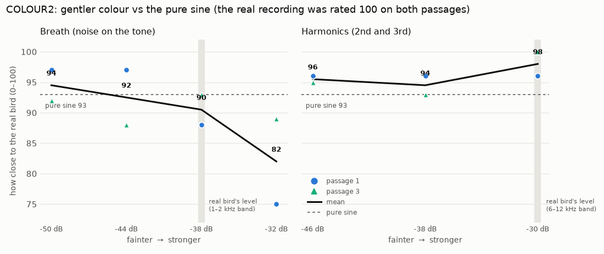

# COLOUR2 — Pure sine vs gentler breath and harmonics

> Study protocol, written **before** data collection. Status: **done 2026-10-11, results in §4** (sections 1–3 unchanged since before the test).
> Test: `listening/COLOUR2/index.html` (self-contained, 3.5 MB) · generator: `scripts/studies/colour2_make.py` (uses `colour1_make.py` and the shared page `colour1_page.html`) · hidden key: `listening/COLOUR2/design.json` (design hash `2e2e2973d5ee`) · renders: `listening/COLOUR2/wav/`.
> Origin: COLOUR1 found that breath at −32 dB hurt and faint harmonics at −30 dB had no consistent effect. The human asked: what about gentler amounts, at several levels?

## 1. Question

Is there a level of breath, or of harmonics, that makes the bird **more** real than a pure sine? Or is the pure sine already the best?

## 2. Method

Same MUSHRA-style page as COLOUR1.
- **Screens:** 2, P1 (15.40–17.85 s) and P3 (26.95–29.50 s).
- **Each screen:** the real recording as reference, plus **10 hidden versions** rated 0–100 for closeness.
- **Every version** has the real pitch and loudness curves, the recording's noise bed and loudness matching, and **no room**, so only the tested ingredient changes:

  | Version | Content |
  |---|---|
  | ref | hidden real recording |
  | sine | pure sine |
  | breath_50 / 44 / 38 / 32 | sine + breath (noise resonating on f0) at −50 / −44 / −38 / −32 dB (−32 = the COLOUR1 level) |
  | harm_46 / 38 / 30 | sine + 2nd harmonic at −46 / −38 / −30 dB, 3rd harmonic 3 dB lower (−30 = the COLOUR1 level) |
  | mix | sine + harmonics at −40 dB + breath at −46 dB |

- **Measured effect of each level** (P1, relative to the pure sine):

  | Version | 1–2 kHz band (under the tone) | 6–12 kHz band (harmonic region) |
  |---|---|---|
  | breath_50 / 44 / 38 / 32 | +1.6 / +4.1 / +8.7 / +14.2 dB | — |
  | harm_46 / 38 / 30 | — | +3.4 / +9.3 / +16.8 dB |

## 3. Predictions and analysis (fixed before data)

- **Predictions** (from COLOUR1):
  - the louder the breath, the lower the rating, with breath_32 lowest among the breath versions;
  - harmonics stay neutral at every level;
  - the pure sine is at or near the top.
- **Analysis:**
  - the mean rating per version over the 2 passages;
  - the trend over level for breath (50 → 32) and for harmonics (46 → 30), as the slope in points per 6 dB;
  - each version compared with the sine.
- **Decision rule** (given COLOUR1's single-rating noise of about ±40 points, only consistent effects count):
  - A level beats the sine if it is rated higher on **both** passages and by **≥ 10 points on average**. It then becomes the default of the voice recipe.
  - Otherwise the default voice is the **pure sine**, with breath and harmonics as optional user controls.

## 4. Results (2026-10-11, one session, 2 screens, 6 min, Firefox)

Data: `listening/COLOUR2/results/colour2_results_2026-10-11-21-04.json` · analysis: `scripts/studies/colour2_analyze.py` → `listening/COLOUR2/analysis/colour2_report.json`.

| Version | P1 | P3 | Mean |
|---|---|---|---|
| real recording (hidden) | 100 | 100 | **100** |
| harmonics −30 dB | 96 | 100 | **98** |
| harmonics −46 dB | 96 | 95 | 95.5 |
| harmonics −38 dB | 96 | 93 | 94.5 |
| breath −50 dB | 97 | 92 | 94.5 |
| mix (harm −40, breath −46) | 95 | 92 | 93.5 |
| **pure sine** | 96 | 90 | **93** |
| breath −44 dB | 97 | 88 | 92.5 |
| breath −38 dB | 88 | 93 | 90.5 |
| breath −32 dB | 75 | 89 | **82** |

### Pre-registered outcomes
- **Hidden reference found** on both screens (100). Every synthetic version was rated 82–98: all close to the real bird.
- **Breath: the louder, the worse.** The slope is −3.9 points per 6 dB louder. Breath −32 dB (the COLOUR1 level) is again the lowest (82), which **replicates COLOUR1**. At −50 dB it is harmless (94.5) but does not help.
- **Harmonics: never worse than the sine.** The slope is +0.9 per 6 dB (flat to slightly positive). The −30 dB version is the best synthetic version (98; 100 on P3).
- **Decision rule:** no version beats the sine by ≥ 10 points on both passages (harmonics −30 dB: +0 / +10). By the rule, the **pure sine stays the default**, with breath and harmonics as options.

### Revealed after the test: where the real recording sits
I measured the real passage P1 against the pure sine, using the same bands as §2:
- **Harmonic region (6–12 kHz):** the real recording is **+17.5 dB** above the sine; harmonics at −30 dB give +16.8 dB. **The version with the bird's own amount of harmonics was the listener's favourite.**
- **Under the tone (1–2 kHz):** the real recording is **+9.5 dB** above the sine, close to the −38 dB breath (+8.7 dB). That breath version still scored below the pure sine. **The real bird's extra energy there is not our kind of breath.** It more likely comes from room reflections, the second voice and recording noise. Our breath *texture* is wrong, not only its level.

### Recommendation (beyond the strict rule)
- **Harmonics:** at the bird's own measured level (−30 / −33 dB). They are physically faithful and were never rated worse than the sine; they become the default colour. The human can override this. This also gives the **anatomical engine a precise colour target**: 2nd harmonic ≈ 30 dB under the fundamental. Today it is −11 dB by default and −26 dB tuned.
- **Breath:** dropped from the default. A different breath model could be tested later.
- **Prototype:** voice "Whistle + bird harmonics" uses −30 / −33 dB harmonics and no breath. Rebuilt 2026-10-11.
