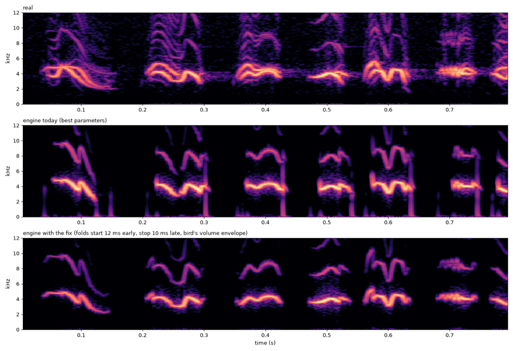

# ENGINE1 — Can the anatomical engine be cleaned up? Parameters first, then the click fix

> Status: **done 2026-10-11, results in §4**.
> Scripts: `scripts/studies/engine_sweep.py` (parameter sweep), `engine_gate_poc.py` (click-fix proof of concept), `engine1_make.py` (listening test) · test: `listening/ENGINE1/test/index.html` · key: `listening/ENGINE1/test/design.json` (design hash `28b2e661397a`).
> Origin: COLOUR1. The engine scored 44 against the plain sine's 94. The human asked whether parameters alone can fix it, even by turning features off.

## 1. Parameter sweep (no code change)

The real gestures of 22938 (15.40–17.85 s) were played through the engine (Size 0.75, real pitch through the controller).

Stage 1 swept tone, attack/release, radiation and aspiration. Stage 2 swept trachea loss and reflection and OEC damping. The best combination (tone 0.6, aspiration 0, radiation 1, attack 3 / release 8 ms, default tract) gives:

| Measure | Real bird | Engine, best parameters | Parameters alone? |
|---|---|---|---|
| breath / aspiration noise | — | off, no measurable change | **yes** |
| 2nd harmonic | −30 dB | −27 to −29 dB | **nearly** |
| 3rd harmonic | −33 dB | −50 dB | no (minor) |
| low thump at syllable start | −61 dB | −37 dB | **no** |
| low thump at syllable end | −62 dB | −26 dB | **no** |
| in-band click at syllable end | −16 dB | −6 dB | **no** |
| held-note pitch | — | accurate (±1–2 c); jitter 3–15 c | yes |
| fast sweeps | — | about 2 ms behind | acceptable |

What made things worse:
- **Lower radiation** cuts brightness but raises low thumps to about 0 dB.
- **Slower attacks** add thumps.
- **Other trachea reflections** make the sound brighter and add clicks.

An output high-pass at 1.5 kHz removes the low part of the thumps, but **not the end-of-syllable click**: that click reaches about 4 kHz, inside the bird's own band.

**Cause.** At every syllable boundary the oscillation is switched on or off by crossing the bifurcation, so the labia jump into vibration, or snap back to rest, at full level.

## 2. Proof of concept of the fix (offline, no engine change)

Each syllable is rendered with constant pressure. The labia start **12 ms early** and stop **10 ms late**, and the bird's own volume envelope is applied as a gain after the engine. The snaps then happen in silence.

| | start: low thump | start: in-band edge | end: low thump | end: in-band edge |
|---|---|---|---|---|
| real bird | −61.0 | −9.8 | −61.8 | −16.0 |
| engine today | −37.4 | −51.4 | −26.0 | −6.1 |
| **engine with the fix** | **−62.9** | **−9.5** | **−71.5** | **−17.2** |

All four measures reach the real bird's level, with no filter needed.

## 3. Listening check (pre-registered)

- **Format:** 2 passages (P1 15.40–17.85 s, P3 26.95–29.50 s) × 5 hidden versions, rated 0–100 against the real recording. Every version carries the noise bed, is loudness-matched and has no room.
- **Versions:**
  - the real recording (hidden);
  - **whistle + bird harmonics** (today's best voice);
  - **engine today** (best parameters);
  - **engine fixed** (proof of concept);
  - the buzzy anchor.
- **Decision rules:**
  - **Fix confirmed:** engine fixed − engine today ≥ 10 on both passages.
  - **Engine good enough as the default voice:** engine fixed within 10 points of the whistle on both passages.
  - **Outcomes:**
    - Fix confirmed: implement it in the engine (articulation by volume envelope, with a pre-roll and post-roll of the oscillation), as a work package with tests.
    - The engine also within 10 points of the whistle: it becomes the default voice.
    - Otherwise: the whistle stays the default, and engine colour work continues.

## 4. Results (2026-10-11, one session, 2 screens, 1.5 min)

Data: `listening/ENGINE1/results/engine1_results_2026-10-11-21-34.json`. Letters decoded with `design.json`.

| Version | P1 (swipes, peeps) | P3 (incl. long alarm) | Mean |
|---|---|---|---|
| real recording (hidden) | 100 | 100 | 100 |
| **whistle + bird harmonics** | **100** | **100** | **100** |
| engine fixed (proof of concept) | 100 | 52 | 76 |
| engine today (best parameters) | 31 | 29 | 30 |
| buzzy anchor | 24 | 25 | 24.5 |

### Decision-rule outcomes
- **Click fix confirmed:** +69 / +23 points over the engine today, on both passages.
- **Engine not good enough as the default voice:** it matches the whistle on P1 (100 = 100) but not on P3 (52 vs 100).
- → **The whistle (sine + the bird's own harmonics, driven by real gestures) is the default voice.** This is also the human's decision: "if the anatomical model does not work, let's simply switch to what works, even if non-anatomical".
- The anatomical engine becomes an **optional voice**. If it is ever revisited, the work is:
  1. implement the articulation fix (pre-roll / post-roll of the oscillation plus the gesture volume envelope);
  2. find what makes P3 fail (likely the long rough alarm and low swipes: extra harmonic brightness and wobble at about 2.7–3 kHz);
  3. re-test against the whistle.
