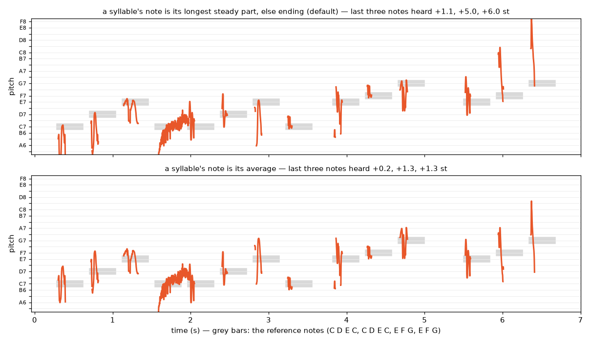
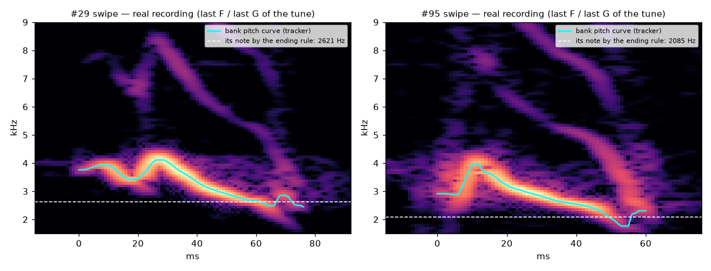

# MELODY1 — Why is a tune clear in R1's render and not when played?

> Origin: the human, after WP-R4. R1's listening item 02 (Frère Jacques tapped, "follow the keyboard") was clearly recognisable; live playing was not.
> Exploratory, not pre-registered: renders compared by ear, with measurements. The decisions it leads to are taken in WP-R5, with a pre-registered test.
> Page: `listening/MELODY/index.html`. Scripts: `scripts/studies/melody1_cases.py`, then `scripts/studies/melody1_reference.py`.

## 1. What was rendered

All renders are made by the plugin (`plugin_render`), seed 7. The melody: Frère Jacques, first two lines, keys C4–G4: C D E C, C D E C, E F G, E F G. The timing is R1's.

| Item | How it is played |
|---|---|
| 00 | R1's original file: 60 ms taps, follow the keyboard |
| 01b | Today's build with the release alarm off (D-030): the same syllables as R1 |
| 01 | Today's build (alarm rule on): the same taps, but other random syllables (the first-syllable draw now skips the 5 alarms) |
| 02 | Taps, own height (the default mapping) |
| 03 | Keys held 0.35 s, follow |
| 04 | Keys held to the next note (legato), follow; the 0.6 s and 0.84 s notes end with the release call |
| 05 | Legato, follow, Snap to note 100 % |
| 06 | Legato, follow, Snap 100 %, Birds 1 |
| 20 | The reference melody on a soft sine at the bird's target pitches (C7–G7) |
| 21–24 | R1's syllables plus the reference melody, one item per note rule: default, steady parts, landing, average |

## 2. The human's verdicts (2026-10-12)

- **00:** correct.
- **01b:** correct (same as 00).
- **01:** "incorrect. different melody, not too far either but i would not recognise it if it wasn't said."
- **02:** "completely different melody".
- **03 and 04:** cannot recognise the tune.
- **05 and 06:** "I recognise the melody".
- **20:** "now I realise that the end of 00 and 01 is wrong. the ending goes up in the notes when normally it is supposed to repeat the last 3 notes."
- **21:** "mostly 2-3 last notes are wrong."
- **The human's hypothesis:** "some issue with the pitch detection. 2 last notes are detected on sound end, and the pitch calculated drops suddenly at the end, which is wrong."

## 3. Measurements

- **Syllables per key and placement** (from the plugin's syllable log):

  | Item | Syllables per key | On the key's note (±50 c) | Release calls |
  |---|---|---|---|
  | 00/01 (taps) | 1.0 | 100 % | 0 |
  | 03 (held 0.35 s) | 3.1 | 39 % | 0 |
  | 04 (legato) | 3.9 | 33 % | 2 |
  | 05/06 (Snap 100 %) | 3.9 | 100 % | 2 |

  "On the note" means the syllable's note, by the note rule, sits on the key.
- **Heard offset (proxy):** for each tap, the bird's loudness-weighted pitch minus the note, in semitones. R1's syllables:

  | Note rule | Mean \|offset\| over 14 notes | Last three notes (E F G) |
  |---|---|---|
  | longest steady part, else ending (default, D-019) | 1.6 | +1.1, +5.0, +6.0 |
  | steady parts | 0.6 | +0.8, +0.1, +1.7 |
  | landing | 1.8 | +1.1, +5.0, +6.0 |
  | average | 0.6 | +0.2, +1.3, +1.3 |

  This proxy favours "average" by construction; it agrees with the human's ear on the default rule.
- **The last F and G against the recording** (syllables #29 and #95; spectrogram peak frequency, `fig_last_notes_tracker.png`):
  - The tracked curve matches the recording within about 1–3 % down to about −12 dB from the syllable's peak.
  - Both syllables really glide down at the end: #29 from 4.0 to 2.6 kHz, #95 from 4.0 to 2.3 kHz.
  - Only the quietest last milliseconds are misread. Below about −20 dB, #95 reads 1.76 kHz where the recording shows no such frequency.
- **Across the bank** (118 playable syllables, loudness-weighted pitch as the proxy):
  - 44 syllables (37 %) take their note from the "ending" (last quarter of the voiced curve, plain mean).
  - Default rule: 25 % of the syllables have a note more than 2 semitones from their loud part, and 9 % more than 4.
  - "Steady parts": 8 % and 1 %. "Average": 13 % and 0 %.
  - Of the "ending" errors, 89 % put the note too low. The bird then shifts the syllable up, so it sounds too high.

## 4. Interpretation

1. **Held keys hide the tune.**
   - A tap gives one syllable, placed on the note. A held key gives about 3–4: after the first, the bird continues its phrase at its own pitches (Snap to note 0 %).
   - This explains 03 and 04.
   - With Snap to note 100 % (05, 06), every syllable is placed on the note. The per-syllable errors then average out over 3–4 syllables, and the tune is recognisable again.
2. **The note of a falling glide is set at its quiet bottom.**
   - The default rule takes "the longest steady part, else the ending". A fast glide has no steady part, so its note is the plain mean of the last quarter of its curve. That is where the glide is lowest and quietest.
   - The ear hears the loud part, 3–6 semitones higher. Placing the quiet bottom on the note pushes the whole syllable up.
   - This is the "ending goes up" in 00 and 01 (the last F and G are such glides). It is also why 01 sounds wrong: other random syllables, more of them glides.
   - The human's diagnosis points at the right spot (the end of the curve). The pitch tracker is only a small part of it: the glide down is real. The rule ignores loudness, and the tracker is unreliable only in the quietest last milliseconds.
3. **The mapping.** "Own height" folds the tune (02). Melodies need "follow the keyboard".
4. **D-019 was chosen by PITCH1/PITCH2,** with each syllable heard against a held note 2–3 octaves below, where placement "barely mattered". A melody depends on the steps between notes, so the rule matters there.

## 5. Consequences

- **WP-R5** (before R3):
  - choose, by a pre-registered listening test, a note rule that gives glides a note the ear agrees with (loudness-aware ending, loudness-weighted mean, or "steady parts");
  - ignore the quietest frames when computing notes;
  - rebuild the bank;
  - decide how held keys and the release call behave in melodies.
- **D-031:** this re-opens D-019 for syllables without a steady part.
