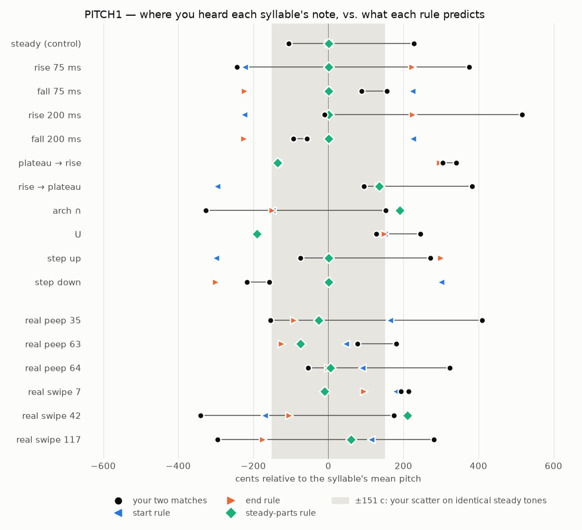

# PITCH1 — What note does a listener hear in a bird syllable?

> Study protocol, written **before** data collection (pre-registration). Status: **done 2026-10-11, results in §9** (sections 1–8 unchanged since before the test).
> Test page: `listening/PITCH1/index.html` (self-contained) · generator: `scripts/studies/pitch1_make.py` · hidden key: `listening/PITCH1/design.json` (design hash `1a43cbc6743a`).
> Origin: approach review 2026-10-11. The human's goal is that a bird does not play "in key" but **dances around the note**. Before building that, we need to know what "the note" of a syllable is.

## 1. Question

A finch syllable sweeps about half an octave in about 75 ms and never holds still. When a musician hears one, **which single pitch do they assign to it**?

The candidates are its average, its start (attack), its end, its highest or lowest point, or the moments where the pitch briefly holds still (plateaus and turning points). The answer becomes the definition of "the syllable's note" in everything that follows: tuning, "dance around the note", Snap and keyboard mapping.

## 2. What is already known

Citations are from memory and must be verified before we rely on them.

- **Moments where the pitch moves slowly get more weight.** The overall pitch of frequency-modulated tones behaves like a weighted average of the instantaneous frequency, with more weight where frequency changes slowly (Gockel, Moore & Carlyon 2001, JASA). Our existing Snap formula already uses this idea: weight `exp(−|dP/dt| / 2000 c/s)`.
- **The end gets more weight than the start.** For short vibrato tones and short glides, the final part weighs more (d'Alessandro & Castellengo 1994, JASA; d'Alessandro, Rosset & Rossi 1998, JASA).
- **Musical pitch weakens at the top of this bird's range.** "Which note" judgments (pitch chroma, transposition) degrade above roughly 4–5 kHz (Attneave & Olson 1971, and older work). This bird sings at 2.5–4.9 kHz, at the upper edge of where the sense of a musical note is reliable.
- None of this was measured on birdsong syllables or for a musician's sense of "which note". That gap is what this study fills.

## 3. Hypotheses: candidate rules for "the note"

| ID | Rule | Weighting over the syllable |
|---|---|---|
| H1 | **mean** | every millisecond counts the same |
| H2 | **energy-weighted mean** | louder moments count more |
| H3 | **start** | first 25 % of the syllable |
| H4 | **end** | last 25 % of the syllable |
| H5 | **stable parts** | weight `exp(−|dP/dt|/v0)`, v0 = 1000 / 2000 / 4000 c/s |
| H6 | **extremes** | highest or lowest point |
| H7 | **stable × recency** | H5 multiplied by a ramp from 0.5 (start) to 1.5 (end) |
| H0 | **no single note** | matches are inconsistent between repeats, or the listener reports "no clear note" |

## 4. Method

- **Listener:** the human (musician, n = 1). The result describes the target user's ear, not people in general; we replicate with other listeners later if a decision depends on generality.
- **Task:** method of adjustment.
  - Each trial plays the **syllable**, a 400 ms gap, then a **steady comparison tone** with the same duration and loudness.
  - The listener moves a slider (continuous, ±5 / ±25 cent nudges, loop mode) until the tone has "the same pitch as the syllable: the single note that best represents it".
  - The listener also reports the pitch's clarity: *clear / vague / no clear note*.
- **Stimuli:** all are pure-sine whistles synthesised in the page from 1 ms contours. The timbre is identical across stimuli, so only the pitch movement differs (isolating one factor).
  - **11 synthetic contours**, centred at 3.4 kHz:
    - steady (control);
    - linear rise and fall, 600 c in 75 ms;
    - the same rise and fall in 200 ms;
    - plateau-then-rise and rise-then-plateau;
    - parabolic arch and U;
    - two-plateau step up and step down.
  - **6 real syllables** from `22938` (segments 7, 42, 117 swipes; 35, 63, 64 peeps), resynthesised from the tracked contour and envelope. This is the "02" voice, which the listener judged "really feels like a bird".
- **Controls against bias:**
  - every trial is transposed at random ("roving"): ±300 c for synthetic, ±200 c for real;
  - the comparison starts 200–700 c above or below at random;
  - the slider's range and centre are randomised;
  - stimulus identities are hidden (opaque IDs);
  - the order is shuffled, never the same stimulus twice in a row.
- **Trials:** 2 practice (steady), then 17 stimuli × 2 repeats = **36 trials**, about 20 minutes. Pauses are allowed (progress saved in the browser).
- **Level:** fixed RMS for every sound (about −22 dBFS); the listener sets the volume once with the reference tone.
- **Recorded per trial:** matched pitch (cents), clarity, number of plays, loops, slider moves, time spent.

## 5. Analysis plan (fixed before data)

1. **Listener precision.** On the steady tones (2 practice + 2 test) compute the bias and the spread of match error. This spread is the noise floor.
2. **Test-retest.** For each stimulus, compute |match₁ − match₂|; the median is the reliability. Any stimulus whose two matches differ by more than 150 c, or that gets "no clear note" twice, counts toward **H0**.
3. **Model comparison.** For every rule H1–H7, compute the RMS error between predicted and matched pitch (after removing the rove) across the 15 non-control stimuli. Report each rule's error and its rank.
4. **Key contrasts** (each predicts a sign and size):

   | Contrast (first − second, cents) | mean | end | start | stable | stable × recency | max / min |
   |---|---|---|---|---|---|---|
   | rise − fall (75 ms) | 0 | +446 | −446 | 0 | +100 | 0 |
   | rise − fall (200 ms) | 0 | +449 | −449 | 0 | +100 | 0 |
   | rise-then-plateau − plateau-then-rise | +329 | +168 | +168 | +600 | +600 | +18 |
   | arch − U | +211 | −86 | −86 | +591 | +591 | +32 |
   | step up − step down | 0 | +600 | −600 | 0 | +162 | 0 |

   Values are computed from `design.json` and measured on the listener's matches after removing the rove.
5. **Duration effect.** Is the end weighted more in the 200 ms glides than in the 75 ms ones (d'Alessandro)?
6. **Real syllables.** Which rule predicts the 6 real syllables best? Plot the residuals against syllable shape.
7. **Clarity.** Report the share of "no clear note" against sweep speed and syllable type.

**Decision rule.**
- If one rule (or the fitted H7 weighting) has the lowest RMS error, and its advantage over the next rule is larger than the test-retest median, it becomes the provisional definition of "the syllable's note" for PITCH2.
- If not, we run a larger follow-up (more items, 3–4 repeats) before deciding.
- If H0 dominates (most syllables have no stable note), "dancing around the note" must be defined on pitch *region* (register), not note.

## 6. Predictions per stimulus (read **after** doing the test)

Each value is predicted pitch minus the stimulus mean, in cents. Synthetic stimuli have flat loudness, so "energy" ≈ mean for them.

| Stimulus | Shape | ms | start | end | stable (v0 2000) | energy | max | min |
|---|---|---|---|---|---|---|---|---|
| S06 | steady | 75 | 0 | 0 | 0 | 0 | 0 | 0 |
| S09 | rise | 75 | −223 | +223 | 0 | 0 | +292 | −292 |
| S08 | fall | 75 | +223 | −223 | 0 | 0 | +292 | −292 |
| S14 | plateau → rise | 75 | −136 | +297 | −136 | −9 | +447 | −136 |
| S11 | rise → plateau | 75 | −297 | +136 | +136 | +9 | +136 | −447 |
| S04 | arch | 75 | −149 | −149 | +190 | +20 | +195 | −374 |
| S10 | U | 75 | +149 | +149 | −190 | −20 | +374 | −194 |
| S15 | slow rise | 200 | −225 | +225 | 0 | 0 | +297 | −297 |
| S05 | slow fall | 200 | +225 | −225 | 0 | 0 | +297 | −297 |
| S17 | step up | 75 | −300 | +300 | 0 | 0 | +300 | −300 |
| S13 | step down | 75 | +300 | −300 | 0 | 0 | +300 | −300 |
| S02 | real peep (seg 35) | 88 | +163 | −91 | −26 | −7 | +198 | −147 |
| S03 | real peep (seg 63) | 59 | +46 | −125 | −74 | +11 | +139 | −183 |
| S16 | real peep (seg 64) | 93 | +90 | −1 | +6 | −28 | +148 | −168 |
| S07 | real swipe (seg 117) | 132 | +113 | −174 | +60 | +124 | +319 | −421 |
| S01 | real swipe (seg 42) | 100 | −170 | −105 | +210 | +91 | +283 | −419 |
| S12 | real swipe (seg 7) | 95 | +179 | +94 | −11 | −58 | +247 | −278 |

## 7. Limitations

- **One listener, who also knows the hypotheses.** The roving, hidden IDs and random starts limit, but do not remove, the expectation bias.
- **Pure-sine voice only.** The engine colour or two-voice syllables might shift the answer. That is a later check, one factor at a time.
- **Comparison tone.** The comparison is a steady pure tone. A musician might hear "the note" differently against a piano or a chord; PITCH2 adds musical context.
- **Coverage.** Only 6 real syllables, all from one recording and two types (no Hswipe, Lswipe or alarm).

## 8. What comes next (not built yet)

- **PITCH2 — how far can a syllable sit from the note and still "dance around it"?**
  - Setup: a held reference note (or chord), then syllables whose note (the PITCH1 rule) is offset by 0, ±50, ±100, ±200 or ±400 c.
  - Response: "belongs to the note?" ratings.
  - Output: a psychometric curve giving the tolerance window, separately for swipes and peeps.
  - It also tests which part of the syllable must land near the note.
- Later understanding steps, each a small listening test that isolates one factor:
  - **colour:** which of harmonics, breath, room or two-voice makes item 03 indistinguishable;
  - **register:** how far the bird can be transposed or size-scaled before it stops being a bird;
  - **sequence:** real order vs shuffled vs learned order, and timing;
  - **playing:** prototypes of the playing modes.

## 9. Results (2026-10-11, one session, 36 trials, 17 minutes, Firefox)

Data: `listening/PITCH1/results/pitch1_results_2026-10-11-19-08.json` · analysis: `scripts/studies/pitch1_analyze.py` → `listening/PITCH1/analysis/pitch1_report.json`.

### Pre-registered analyses

1. **Precision on identical steady tones.** Errors were −13, +145, −106 and +228 cents: bias +64 c, SD **151 c**. At 3.4 kHz and 75 ms, the listener's "same pitch" is only defined to about ±1.5 semitones.
2. **Test-retest.** The median |repeat difference| was **334 c**.
   - Implied per-match spread: steady ≈ 150 c, synthetic glides ≈ 210 c, real syllables ≈ 460 c.
   - Ten of 17 stimuli meet the H0 flag. The steady control is among them, so the flag mostly reflects measurement noise.
3. **Model comparison** (RMS error over all non-control trials):
   - top tier: end 244, mean 248, energy 259, median 265;
   - middle: stable-parts 279–298, max 299;
   - clearly worse: start 344, min 437.
   - On stimulus means: end 160, mean 165, stable 210–234, start 290. The steady-tone floor is 145.
4. **Key contrasts:**

   | Contrast | Observed | mean | end | start | stable |
   |---|---|---|---|---|---|
   | rise − fall (75 ms) | −56 | 0 | +446 | −446 | 0 |
   | rise − fall (200 ms) | +329 | 0 | +449 | −449 | 0 |
   | rise→plateau − plateau→rise | +244 | +329 | +168 | +168 | +600 |
   | arch − U | −62 | +211 | −86 | −86 | +591 |
   | step up − step down | +286 | 0 | +600 | −600 | 0 |

5. **Clarity:**
   - real syllables: 2 clear, 8 vague, 2 "no clear note" (the multi-turn swipe, seg 117, both times);
   - synthetic glides: 8 clear, 11 vague, 1 none;
   - steady: 2/2 clear.
6. **Anchoring.** The error follows the comparison's starting point (slope 0.35), and 3 trials were accepted without moving the slider. The method of adjustment reached its limit in this register.

**Decision rule outcome:** no rule beats the next by more than the test-retest noise, so the pre-registered rule says **inconclusive on the exact rule**.

### What is robust despite the noise
- **The steady-parts rule is rejected in its two cleanest tests**, where both repeats agree:
  - **plateau → rise** was heard at +305 / +341. That is the *end* (+297), not the plateau (−136).
  - **U** was heard at +128 / +245. That is the height of its ends (+149), not its bottom turning point (−190).
- **The end counts more** wherever the repeats agree:
  - plateau → rise (end);
  - step down, −158 / −217 (end −300);
  - slow fall, −94 / −58 (toward the end, −225).
  - Exception: the fast 75 ms fall was heard toward its start (+155 / +88).
- **The note of a syllable is a region, not a point.** It spans ±1.5 semitones on steady tones and several semitones on real syllables, and real syllables were "vague" or "no clear note" 10 times out of 12.

### Exploratory (not pre-registered; treat as hypotheses for PITCH2)
- Best-fitting weighting: **no stability weight, strong recency.** The weight rises from about 0.05 at the onset to about 1.95 at the end; RMS 235 vs 248 for the mean.
  - The recency is strong for 200 ms glides (RMS 218 vs 264) and for steps (132 vs 195).
  - It is absent for 75 ms glides.
- An "endpoints" rule (average of the first and last quarter) gives RMS 237. Midrange gives 247.

### Provisional conclusion (for design, until PITCH2)
- **A syllable's note ≈ where it lands.** Use its end, or a recency-weighted mean, not its turning points or its attack.
- **The tolerance is wide.** In isolation, offsets of ±150 c are below this listener's matching precision at 3–4 kHz. "Dance around the note" matches how the ear actually hears these sounds.
- **Musical context may sharpen this.** A sounding reference note gives beats and consonance to judge by, so PITCH2 must measure the tolerance **with a reference note present**. It should use a rating or forced-choice task rather than adjustment, which anchors.
