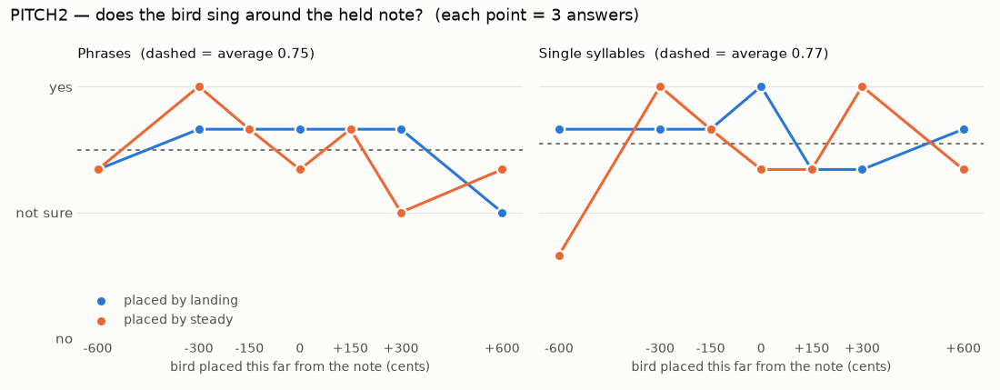

# PITCH2 — Does the bird "dance around the note"?

> Study protocol, written **before** data collection. Status: **done 2026-10-11, results in §8** (sections 1–7 unchanged since before the test).
> Test: `listening/PITCH2/index.html` · playground: `listening/PITCH2/playground.html` · generator: `scripts/studies/pitch2_make.py` (+ `pitch2_common.js`, `pitch2_test.html`, `pitch2_playground.html`) · hidden key: `listening/PITCH2/design.json` (design hash `2d7cdd9efb91`).
> Follows PITCH1, where a syllable's note was ≈ where it lands, ±1.5 semitones even on steady tones, with no reference note.

## 1. Questions

1. **Tolerance.** With a held note sounding, how far can the bird sit from it and still be heard as singing *around* that note?
2. **Rule.** Which definition of a syllable's note anchors the bird better: **steady parts** (where the pitch holds or turns) or **landing** (where it ends)? The human asked to keep both, as an option toggle.
3. **Context.** Do **phrases** change the judgment compared with **single syllables**? The human suspects PITCH1 was biased by presenting syllables alone.
4. **Register mapping (a).** The bird sings the note's *name* at its own height, 2–3 octaves above the held note. Does a held note that far below still "hold" the bird?

## 2. Design

- **Context:**
  - A soft held note (harmonics 1–12 at 1/n², 6 dB under the bird) in **octave 4**, one of the 12 note names.
  - The bird enters 0.35 s later at its own height: the same note name in the octave nearest its natural pitch. Targets are tempered notes within ±3 semitones of the material's natural height.
- **Material** (pure-sine resynthesis of real contours from `22938`, the voice judged "really feels like a bird"):

  | Item | Content | landing − steady per syllable (cents) |
  |---|---|---|
  | phrase A | 15.44–16.47 s, 8 syllables | +33, **−1011**, −34, −79, +51, −105, −31, +62 |
  | phrase B | 16.46–17.35 s, 8 syllables | **−227**, +95, **−252**, +16, +69, **−230**, −66, −119 |
  | motif C | 11.95–12.90 s, 5 syllables (this bird's repeated motif) | +56, 0, −92, −113, −28 |
  | single A | segment 20 (long descending swipe) | **−1011** |
  | single B | segment 27 (two plateaus, high then low) | **−227** |
  | single C | segment 15 (U-shaped swipe) | −92 |

- **Placement.** Every syllable is transposed so that its anchor, by the trial's rule, lands at *target + Δ* (snap = 1; real timing kept).
- **Factors:** rule {steady, landing} × Δ {−600, −300, −150, 0, +150, +300, +600 c} × material (6: 3 phrases, 3 singles) = **84 trials**. They follow 4 practice trials, in random order with the same item never twice in a row. Each item appears once per cell.
- **Response:** "Does the bird sing around this note?" → *Yes, it belongs* / *Not sure* / *No, it's off*. Each trial plays automatically and can be replayed. About 15 minutes.
- **Blinding:** the rule, Δ and target are hidden. The note name changes on every trial (roving).

## 3. Hypotheses and predictions

The hearing hypotheses are **H-steady**, **H-landing** and **H-average** (the control).
- Each one assigns every syllable a heard note.
- A trial's heard offset is that note's distance from the target, as pitch class (wrapped to ±600 c). These offsets are precomputed per trial in `design.json`.
- For a phrase, the heard offset is the mean over its syllables.

Predictions:
- **Rule.** If H-landing is true, landing-placed trials peak at Δ = 0. Steady-placed trials peak where the steady placement's landing error is cancelled. H-steady predicts the mirror image. The predicted peak of the steady-placed curve under H-landing:

  | Item | single A | single B | single C | phrase A | phrase B | motif C |
  |---|---|---|---|---|---|---|
  | Peak at Δ | −189 (octave-wrapped) | +227 | +92 | −11 | +89 | +35 |

  **Singles discriminate the rules; phrases barely do.** Across a phrase, the per-syllable differences partly cancel: the wrong rule scatters the syllables around the note instead of shifting the phrase. A pre-stated corollary: if the phrase curves of the two rules overlap, **the rule choice matters less in phrases than for single syllables**.
- **Tolerance.** P(yes) falls with |heard offset|. Without a reference (PITCH1) the precision floor was ±150 c. **With a reference, we expect a narrower window.**
- **Mapping (a).** P(yes | Δ = 0) clearly exceeds P(yes | Δ = ±600) if a held note three octaves down still anchors the bird.

## 4. Analysis plan (fixed before data)

1. **Score.** Yes = 1, Not sure = 0.5, No = 0. Practice trials are excluded.
2. **Mapping check.** Compare P(yes | Δ = 0) with P(yes | Δ = ±600), pooled over rules and materials.
3. **Model comparison.** For each hearing hypothesis H, fit P(yes) = f + (p − f)·exp(−o²/2σ²). Here o is the heard offset under H; σ, p and f are fitted by maximum likelihood on the Bernoulli-scored answers. Compare log-likelihoods across H (ΔLL > 2 counts as a meaningful preference). Do this pooled, then separately for phrases and singles.
4. **Tolerance.** Report σ and the half-height width (≈ 1.18 σ) of the preferred H, for phrases and singles.
5. **Descriptives.** P(yes) per rule × Δ × context (table and plot). Also report the share of "Not sure" and the time per answer.

## 5. Decision rules

- **Mapping check fails** (P(yes|0) − P(yes|±600) < 0.3): a held note 2–3 octaves below does not anchor the bird. Mapping (a) must be revisited with the human, for example a reference in the bird's octave, or tying the bird's height to the key.
- **Default rule:** the H with ΔLL > 2 in the **phrase** context, since B mode sings phrases. The single-syllable result decides A mode. Both rules stay available as a toggle (human decision). With no clear winner, the default stays **landing** (PITCH1 provisional).
- **Dance width:** the preferred H's σ in phrases becomes the default spread around the note for B mode (Range = 1).

## 6. Limitations

- **One listener**, who knows the hypotheses. Blinding and roving limit, but do not remove, the expectation bias.
- **Snap = 1:** every syllable sits on the note. Real B-mode phrases may keep part of their natural melody; the playground lets you hear that (snap slider).
- **Simple held note:** pure harmonic, octave 4 only. A piano or chord context may sharpen or loosen the judgment.
- **Pure-sine voice**, not the anatomical engine (one factor at a time).

## 7. Playground (not part of the measurement)

`playground.html` uses the same placement code with these controls:
- note name;
- material;
- **rule toggle** (steady parts / landing / average);
- snap from natural melody to every syllable on the note;
- offset;
- held note and bird on/off;
- an A/B button: steady then landing.

Use it **after** the test, so the rating stays blind.

## 8. Results (2026-10-11, one session: 84 trials + 4 practice, 9.5 min, Firefox)

Data: `listening/PITCH2/results/pitch2_results_2026-10-11-19-56.json` · analysis: `scripts/studies/pitch2_analyze.py` → `listening/PITCH2/analysis/pitch2_report.json`.

**Answers:** 46 yes, 36 not sure, 2 no. The median answer time was 4.0 s.

### Pre-registered analyses
- **Mapping check — FAILS.**
  - P(yes) at Δ = 0 is **0.79**; at Δ = ±600 c (a tritone away) it is **0.65**.
  - The difference is 0.15, under the 0.3 threshold.
  - A held note 2–3 octaves below the bird barely anchors it: placed a tritone off, the bird still "belonged" most of the time.
- **Model comparison — no tuning detectable.** Log-likelihood vs "no tuning at all":

  | | no tuning | best model | ΔLL |
  |---|---|---|---|
  | all trials | −46.11 | −45.14 (Δ only) | 0.97 |
  | phrases | −23.62 | −23.00 | 0.62 |
  | singles | −22.45 | −22.00 | 0.45 |

  The rule models score the same as each other (all trials: H-steady −45.74, H-landing −45.84, H-average −46.14). No model beats chance-level "no tuning" by ΔLL > 2.
- **Tolerance:** not estimable, because the curves are flat. The mean score by Δ is:

  | Δ (cents) | −600 | −300 | −150 | 0 | +150 | +300 | +600 |
  |---|---|---|---|---|---|---|---|
  | mean score | 0.62 | 0.92 | 0.83 | 0.79 | 0.75 | 0.75 | 0.67 |

  There is at most a faint dip at ±600.
- **Material mattered more than placement:**

  | Material | yes | not sure | no |
  |---|---|---|---|
  | phrase A | 2 | 12 | 0 |
  | phrase B | 8 | 6 | 0 |
  | motif C | 11 | 3 | 0 |
  | single A | 6 | 7 | 1 |
  | single B | 9 | 5 | 0 |
  | single C | 10 | 3 | 1 |

  The dense phrase with wide swoops (A) left the listener unsure whatever its placement. The motif and simple syllables "belonged".

### Decision-rule outcomes
1. **Mapping (a) must be revisited with the human.** In this setting (a soft held note in octave 4, the bird 2–3 octaves up) the note does not audibly anchor the bird. The bird sounds acceptable over any note name.
2. **Default rule:** the data cannot choose. By the rule, the default stays **landing** (PITCH1), with the steady/landing toggle kept as the human asked.
3. **Phrases vs singles:** no difference in tuning, because both are flat. The human's hypothesis cannot be tested while nothing anchors the bird.

### Possible reasons, to be tested and not assumed
- **Octave distance.** Pitch-class (chroma) relations weaken across three octaves and above about 4 kHz.
- **The held note's harmonics were weak** (1/n²), so nothing sounded in the bird's own register to compare against. Real instruments are richer.
- **The bird's own note is fuzzy** (PITCH1: ±1.5–4.5 semitones).
- **The task was hard to judge:** "Not sure" was used for 43 % of answers.
