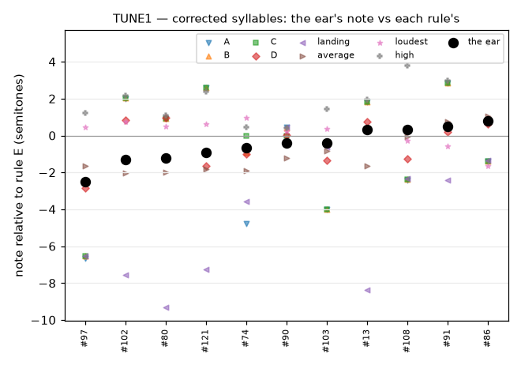

# TUNE1 — Every syllable on one note: which ones are out of tune?

> Study protocol, written **before** data collection (pre-registration, WP-R5). Status: **done 2026-10-13, results in §6** (sections 1–5 unchanged since before the test, apart from the information line added to §4 before the listener started).
> Page: `listening/R5/tune1/index.html` (self-contained; the voice is synthesised in the page) · generator: `scripts/studies/tune1_make.py` (template `scripts/studies/tune1_page.html`) · design: `listening/R5/tune1/design.json` (design hash `6657cac8a7ac`) · analysis: `scripts/studies/tune1_analyze.py <results.json>`.
> Origin: MELODY2. No note rule beat today's by 10 points; the human chose **E (loudness-weighted average)** as the new default, and heard that some Frère Jacques notes are still too high ("they play too high, got analysed too low"). The human designed this test: "a test that goes through every note tuned at the same pitch, and I can correct the pitch of the wrong ones. The corrected pitch should dominate any type of pitch decision." And: "on each sample we should be able to hear the sound using the different pitch decision algorithms, just to make sure issues cannot be fixed only by changing that."

## 1. Question

Placed by rule E on one fixed note, which of the bird's 123 syllables sound off that note, and by how much? Can any note rule (A–E or another simple one) reproduce what the ear hears, or do some syllables need a note set by ear?

## 2. Method

- **Listener:** the human (musician), Firefox, headphones. Not blind: it is a tuning task, and the listener sees which rule each button uses.
- **The note:** every syllable is placed so that its note lands on **A7 (3520 Hz)**, the tempered note nearest the bird's centre under rule E (10546 cents). That moves each syllable by at most about ±7 semitones from where the bird sang it.
- **The voice:** the PROTO1 / plugin whistle synthesised in the page from the bank's 1 ms curves (sine plus the bird's 2nd/3rd harmonics at −30/−33 dB, light room).
- **Reference:** a soft tone on the note, either before each syllable (default) or held under it (drone), or none (listener's choice).
- **Groups:** the syllables in the bank's order, grouped by phrase. The four short first phrases form one group, and phrases 6 and 7 another, giving **8 groups** of 7–22 syllables.
- **Per group:** "Play the row" plays every syllable of the group one after another on the note, so the odd ones stand out.
- **Per syllable:**
  - ▶ plays it on the note (rule E plus the listener's correction);
  - a slider moves it (−700 … +700 cents, nudges of ±10 c and ±1 semitone) until it sits on the note;
  - **"no clear note"**: the syllable cannot be heard as one note, so it should not be used where a note matters;
  - **the rules**: buttons play the syllable placed by each note rule (below). Ticks on the slider show where each rule would place it, and "use this rule" sets the slider there.

  | Button | Rule (all but A ignore frames more than 20 dB below the syllable's peak) |
  |---|---|
  | A | longest steady part, else the ending (D-019, the old default) |
  | B | longest steady part, else the ending of the loud part |
  | C | longest steady part, else the loudness-weighted average |
  | D | steady parts (stability-weighted average) |
  | E | loudness-weighted average (**the new default; the slider's zero**) |
  | landing | the last quarter (plain average) |
  | average | plain average |
  | loudest | the pitch at the loudest moment (frames within 3 dB of the peak) |
  | high | the high part: the 80th percentile of the pitch over the frames within 12 dB of the peak |

  "loudest" and "high" are new, exploratory. "high" tests the idea that the ear follows a syllable's high excursions (MELODY2, exploratory part).
- **Check round:** after the last group, 10 syllables come back with the rule buttons, the ticks and the labels hidden, and the slider at zero:
  - up to 6 that the listener corrected (chosen at random);
  - the rest from those left uncorrected.

  The listener sets them again. This measures how repeatable the settings are.
- **Saved:** every slider value, "no clear note" flags, plays per button, time per group. Progress is kept in the browser.

## 3. How the results are used (fixed before data)

1. **A correction** is a syllable whose first-pass slider value is at least **25 cents** away from zero. Smaller values count as "on the note" (slider jitter).
2. **The heard note** of a corrected syllable = its rule-E note − the slider value. For example, a syllable moved down 300 cents sounded too high, so its note was really 300 cents higher than rule E said.
3. **Reliability gate** (check round):
   - the median |first − second| setting over the 10 items must be **≤ 150 cents**;
   - if it is, the corrections are used as set in the first pass;
   - if not, the corrections are reported as unreliable and the human is asked before they are used.
4. **Corrections dominate every rule:** in the rebuilt bank, a corrected syllable's note is the heard note under **every** note-rule choice (rule, steady parts, landing, average).
   - The corrections are stored in a file next to the bank (`assets/voicebanks/zf_22938/`) and applied by `python -m cuicui.bank`.
5. **"No clear note"** syllables are never used where a single note matters: they are never the first syllable of a key press (taps and the first syllable on the note). They still sing inside the bird's phrases, so its song is unchanged.
6. **Can a rule do it instead?** (the human's check) For each rule, compute the share of syllables whose note is within ±100 cents of the heard note:
   - over all syllables (uncorrected ones count as heard on rule E's note);
   - over the corrected ones only.

   Two outcomes:
   - **A rule matches the ear** if it is within ±100 c on **≥ 90 % of all syllables and ≥ 70 % of the corrected ones**. It is then shown to the human as an alternative to the corrections, and the human decides.
   - **Otherwise** the corrections are needed, and that is the answer to "can it be fixed only by changing the rule?".
7. **Acceptance check afterwards** (WP-R5 criterion 3): with the corrected bank, Frère Jacques tapped (follow the keyboard, 60 ms taps) with 5 seeds. The human must recognise the tune in all 5 and hear no note going up at the end.

## 4. Reported, no decision attached

- The number of corrections and "no clear note" flags, and the size of the corrections (median, largest; up vs down).
- The labels of the corrected syllables (peep, swipe, …) and whether they are the ones flagged by MELODY2's exploratory analysis (loud part reaching > 3 semitones above the note).
- Plays per rule button, and the time taken.
- The check round's median |first − second| over the corrected items only. Untouched syllables left at zero twice make the overall median look better than the corrections' own precision.

## 5. Limitations

- **One listener, not blind.** The listener sees the rules and can hear each, by design.
- **One fixed note (A7).** A syllable might sound different at another height; placements move syllables by up to ±7 semitones.
- **Corrections are tied to this recording's annotation.** They are keyed by segment number and label, and are checked when the bank is built.
- **The precision of pitch at 3–4 kHz is limited** (PITCH1: ±1.5 semitones without a reference). The reference tone and the check round address this.

## 6. Results (2026-10-13, one session, 8.5 min of group time, Firefox, reference "tone before" at −9 dB)

Data: `studies/data/TUNE1/` (results + design) · analysis: `scripts/studies/tune1_analyze.py` → `listening/R5/tune1/analysis/` (`tune1_report.json`, `note_corrections.json`).

**Coverage:** every syllable was heard, in a row or on its own (113 single plays, 7 row plays). For two groups (phrases 6–8, 34 syllables) the listener only played the row and moved on. The rule buttons were used on 2 syllables (#20, #74).

### Pre-registered analysis
1. **Corrections (≥ 25 c):** **11 of 123** syllables, all swipes (9 swipe, 1 Hswipe, 1 swipe+swipe). 112 were left on the note; 2 more were moved by less than 25 c (#3 −20, #20 0). None was marked "no clear note".
   - Sizes: median **65 c**, largest 250 c. **7 moved up** (they sounded too low under E), 4 down.
   - Only 3 beyond a semitone: #97 +250, #102 +130, #80 +120.
2. **Reliability gate: PASS.** Median \|first − second\| over the 10 check items = **32 c** (gate 150 c). The corrections are used as set in the first pass.
3. **Corrections dominate every rule:** the draft file `note_corrections.json` holds the 11 heard notes.
4. **Can a rule do it instead?** Share of syllables whose note is within ±100 c of the heard note:

   | Rule | all syllables | corrected ones | matches the ear (≥ 90 % and ≥ 70 %) |
   |---|---|---|---|
   | **E** (loudness-weighted average, the new default) | **97.6 %** | 72.7 % | **yes** |
   | loudest | 87.8 % | 36.4 % | no |
   | D (steady parts) | 84.6 % | 72.7 % | no |
   | average (plain) | 81.3 % | 81.8 % | no |
   | C | 73.2 % | 18.2 % | no |
   | B | 54.5 % | 18.2 % | no |
   | landing | 48.8 % | 18.2 % | no |
   | A (D-019, the old default) | 47.2 % | 9.1 % | no |
   | high (80th percentile) | 40.7 % | 9.1 % | no |

   **Verdict (pre-registered):** the corrections are usable, and **rule E itself matches the ear**, so the human is shown both and decides.

### Information (§4)
- **The check round, corrected items only:** median \|difference\| 45 c. Of the 6 corrected syllables shown again, 4 were left at zero the second time (#102 130 → 0, #91 −50 → 0, #108 −30 → 0, #90 40 → 0). The 2 moved again went the same way, but less far (#80 120 → 85, #97 250 → 65). The 4 uncorrected ones stayed at zero. Check-round plays were not recorded (a page limitation).
- **MELODY2's suspects:** 3 of the 19 syllables whose loud part reaches > 3 semitones above the note were corrected. #71 (Frère Jacques 3's last G), #95 and #81 sounded on the note under E.

### Reading
- Placed on one note after a reference tone, **rule E is what this listener hears** for nearly every syllable. The old rule A was more than a semitone off the ear for more than half of them.
- The "ear follows the high part" idea (MELODY2, exploratory) is **not supported**: the "high" rule is the furthest from the ear.
- The corrections are small and only partly repeatable: they sit near the listener's precision (≈ ±50 c here, far better than PITCH1's ±150 c without a reference).
- **So the remaining Frère Jacques problem is not the note values.** Exploratory, from the MELODY2 ratings: the screens rated lower under E have more **very wide sweeps** (> 8 semitones in their loud part). Over the 9 screens, r = −0.79 with that share and −0.76 with the mean sweep width. The worst screen, FJ-2 (71), has 4 such syllables of 14. A wide sweep can sound on the note alone and still blur a tune. This is a hint, not a result.
